# Interchange formats → the existing internal IdList tree

Draft exploration. **Interchange format** means the saved objects, tuples, or columnar store. **Internal format** means the live structure used for lookup and editing. Every row in this interchange-format matrix ends in the existing IdList tree. JSON versus binary is only an encoding choice, covered separately.

**New: [same F08 JSON, current IdList tree versus native columnar internals](native.md).** That matched experiment implements native lookup/editing and measures loading, conversion, memory, GC and mutation costs. It keeps the wire format fixed so we can isolate the internal design. This report below keeps the internal tree fixed so we can compare interchange formats.

Measured 2026-10-20 (America/New_York) in Chromium 151.0.7922.34 on Apple M5 Pro, CPU rate 1×. Each document has 104,852 characters, 1,173 paragraphs, and the same 12,091 ID runs. This is a controlled ProseMirror editor, not the production application. Four documents means four copies of this trace, not four production documents.

## Read the names

These names describe the **interchange** representation. A columnar store is one object containing arrays, not a different Mongo storage engine. All non-baseline options encode deletion as a negative count: -2 means two deleted IDs. That is what the old word ‘signed’ meant.

Format IDs F01–F09 are stable identifiers, not ranks. The same ID is used across charts, recommendations, JSON/binary encodings, and loader paths. Expand a format below the recommendations to see its complete JSON.

- [F01 — Object records: deletion flag](#f01).
- [F02 — Object records: negative count means deleted](#f02).
- [F03 — Tuple records: negative count means deleted](#f03).
- [F04 — Columnar store: all counters](#f04).
- [F05 — Columnar store: reconstruct counters](#f05).
- [F06 — Columnar store: split IDs + reconstruct counters](#f06).
- [F07 — Columnar store: deduplicate IDs + reconstruct counters](#f07).
- [F08 — Columnar store: deduplicate clients + reconstruct counters](#f08).
- [F09 — Columnar store: deduplicate IDs + all counters](#f09).

**Conversion paths:** ‘Via IdList.load()’ means wire format → the run objects that IdList.load expects → the internal tree. For F01 those run objects are already the decoded shape. ‘Direct tree construction’ feeds decoded fields straight into the same tree, skipping that intermediate array. Neither changes the internal format.

## Three recommendations

1. **Mongo storage first: F05 — Columnar store: reconstruct counters.** This is the smallest ordinary-field option with Snappy: 155.8 versus 180.5 KB/document for the baseline. Its start counters are reconstructed from previous runs; exceptions are stored, so this is lossless. It is my default candidate for the current Snappy setup, subject to validation on actual documents.

2. **Retained browser memory first: do not choose an interchange format as a substitute for an internal redesign.** F05 — Columnar store: reconstruct counters retains 6.5 MB versus 7.3 MB for the baseline in this four-document run, but every option here still constructs the same editing-tree design. The [native F08 experiment](native.md) now measures indexed, chunked native editing, including the index build time, memory cost and snapshot export. It supersedes the initial slow full-rewrite prototype. Direct loaders only remove temporary conversion allocations.

3. **Browser speed first: investigate F09 — Columnar store: deduplicate IDs + all counters, through the existing loader.** It has the lowest observed 4-document complete-ready P95 among JSON interchange options: 53.6 versus 58.3 ms for the baseline. Conversion-to-tree P95 is 19.0 versus 18.2 ms. Its Snappy storage is 245.9 versus 180.5 KB/document. Treat it as a candidate for a representative-corpus test, not a stable production winner. A lower interchange parse time alone is not enough; see the [separate internal-format experiment](native.md) for native columnar editing.

None of these results justifies changing independent opaque 8-character nanoids into structured IDs. The split-ID/client-sharing options require Matthew’s client/sequence structure; those measurements are not evidence for opaque nanoids. Binary stays an optional later optimization.

### F05 versus F09: two different things to save

Both are columnar stores. **F05 saves predictable start counters, but repeats the ID for every run. F09 saves repeated ID strings, but stores every start counter.** Neither changes the internal IdList tree. These are independent choices: F07 combines deduplicated IDs with reconstructed counters.

For two runs of writer_0—three live entries starting at 0, then two deleted entries starting at 3—the same data looks like this. These tiny examples illustrate the layouts; they are not the measured workload.

**F05 — Columnar store: reconstruct counters**

```json
{
  "bunchIds": ["writer_0", "writer_0"],
  "startCounterIndexes": [],
  "startCounters": [],
  "counts": [3, -2]
}
```

**F09 — Columnar store: deduplicate IDs + all counters**

```json
{
  "bunchIds": ["writer_0"],
  "bunchIndices": [0, 0],
  "startCounters": [0, 3],
  "counts": [3, -2]
}
```

### Expand each format: the same data in nine layouts

All nine examples below contain the same four runs: alice_0 has three live entries, bob_0 has one live entry, alice_1 has two live entries, then alice_0 has two deleted entries starting at counter 3. Structured IDs here make F06/F08 meaningful; they do not imply changing opaque nanoids. These JSON objects/arrays are also the ordinary Mongo field values, not JSON strings.

<a id="f01"></a>
<details><summary>F01 — Object records: deletion flag — expand JSON</summary>

One object per run, with separate count and isDeleted fields.

Interchange format shown below; internal format after load: **existing IdList tree**.

```json
[
  {
    "bunchId": "alice_0",
    "startCounter": 0,
    "count": 3,
    "isDeleted": false
  },
  {
    "bunchId": "bob_0",
    "startCounter": 0,
    "count": 1,
    "isDeleted": false
  },
  {
    "bunchId": "alice_1",
    "startCounter": 0,
    "count": 2,
    "isDeleted": false
  },
  {
    "bunchId": "alice_0",
    "startCounter": 3,
    "count": 2,
    "isDeleted": true
  }
]
```

</details>

<a id="f02"></a>
<details><summary>F02 — Object records: negative count means deleted — expand JSON</summary>

One object per run. Replace the separate deletion flag with a negative count for deleted IDs: count: -2 means two deleted IDs.

Interchange format shown below; internal format after load: **existing IdList tree**.

```json
[
  {
    "bunchId": "alice_0",
    "startCounter": 0,
    "count": 3
  },
  {
    "bunchId": "bob_0",
    "startCounter": 0,
    "count": 1
  },
  {
    "bunchId": "alice_1",
    "startCounter": 0,
    "count": 2
  },
  {
    "bunchId": "alice_0",
    "startCounter": 3,
    "count": -2
  }
]
```

</details>

<a id="f03"></a>
<details><summary>F03 — Tuple records: negative count means deleted — expand JSON</summary>

One three-element array per run: [bunchId, startCounter, count]. Negative count means deleted. This measured variant is a triple, not a four-tuple.

Interchange format shown below; internal format after load: **existing IdList tree**.

```json
[
  ["alice_0", 0, 3],
  ["bob_0", 0, 1],
  ["alice_1", 0, 2],
  ["alice_0", 3, -2]
]
```

</details>

<a id="f04"></a>
<details><summary>F04 — Columnar store: all counters — expand JSON</summary>

Separate arrays for bunchIds, startCounters, and counts. Each position describes one run. Negative counts mean deleted; IDs repeat in the bunchIds column.

Interchange format shown below; internal format after load: **existing IdList tree**.

```json
{
  "bunchIds": ["alice_0", "bob_0", "alice_1", "alice_0"],
  "startCounters": [0, 0, 0, 3],
  "counts": [3, 1, 2, -2]
}
```

</details>

<a id="f05"></a>
<details><summary>F05 — Columnar store: reconstruct counters — expand JSON</summary>

The same columns, but infer each start counter from the previous run for that ID (or zero for its first run). Store only exceptions and their delta-encoded run indexes. No data is discarded.

Interchange format shown below; internal format after load: **existing IdList tree**.

```json
{
  "bunchIds": ["alice_0", "bob_0", "alice_1", "alice_0"],
  "startCounterIndexes": [],
  "startCounters": [],
  "counts": [3, 1, 2, -2]
}
```

Here startCounters and startCounterIndexes are empty because every start is predictable. If alice_0 resumed at counter 8 instead of 3, this example would store startCounterIndexes: [3] and startCounters: [8]; the 3 locates the fourth run (zero-based). The other starts are still reconstructed.

</details>

<a id="f06"></a>
<details><summary>F06 — Columnar store: split IDs + reconstruct counters — expand JSON</summary>

Reconstruct counters as above; additionally split each structured clientId_sequence ID into clientIds and seqNums columns. Client strings still repeat. This is not valid for arbitrary opaque nanoids.

Interchange format shown below; internal format after load: **existing IdList tree**.

```json
{
  "clientIds": ["alice", "bob", "alice", "alice"],
  "seqNums": [0, 0, 1, 0],
  "startCounterIndexes": [],
  "startCounters": [],
  "counts": [3, 1, 2, -2]
}
```

</details>

<a id="f07"></a>
<details><summary>F07 — Columnar store: deduplicate IDs + reconstruct counters — expand JSON</summary>

Reconstruct counters and store each distinct whole ID once in bunchIds. A bunchIndices column refers to that list; this does not split or change the IDs.

Interchange format shown below; internal format after load: **existing IdList tree**.

```json
{
  "bunchIds": ["alice_0", "bob_0", "alice_1"],
  "bunchIndices": [0, 1, 2, 0],
  "startCounterIndexes": [],
  "startCounters": [],
  "counts": [3, 1, 2, -2]
}
```

</details>

<a id="f08"></a>
<details><summary>F08 — Columnar store: deduplicate clients + reconstruct counters — expand JSON</summary>

Split structured clientId_sequence IDs, store each distinct client string once, and use clientIndices plus seqNums for each run. Reconstruct counters. Requires structured IDs, not arbitrary opaque nanoids.

Interchange format shown below; internal format after load: **existing IdList tree**.

```json
{
  "clientIds": ["alice", "bob"],
  "clientIndices": [0, 1, 0, 0],
  "seqNums": [0, 0, 1, 0],
  "startCounterIndexes": [],
  "startCounters": [],
  "counts": [3, 1, 2, -2]
}
```

</details>

<a id="f09"></a>
<details><summary>F09 — Columnar store: deduplicate IDs + all counters — expand JSON</summary>

Store each distinct whole ID once in bunchIds, use bunchIndices per run, and store every start counter. IDs remain intact. Counts are negative for deleted runs.

Interchange format shown below; internal format after load: **existing IdList tree**.

```json
{
  "bunchIds": ["alice_0", "bob_0", "alice_1"],
  "bunchIndices": [0, 1, 2, 0],
  "startCounters": [0, 0, 0, 3],
  "counts": [3, 1, 2, -2]
}
```

</details>

## Time spent converting to the internal format

**Decode:** response bytes → decoded interchange objects/arrays. **To internal tree:** decoded interchange state → a usable IdList, including counter reconstruction, ID reconstruction, intermediate run objects when used, validation, tree nodes and indexes. This second interval is timed directly around the loader—not calculated by subtracting other measurements. It excludes decode, ProseMirror creation, layout, and frame waiting. The raw field is named `hydrate` for compatibility with the original data.

The speed chart shows conversion-to-tree P95 alongside complete-ready P95. Expanded tables include decode P95 and conversion mean, P50 and P95. Each percentile comes from that interval’s actual samples; percentiles are not additive. This does not split tree construction from preprocessing, and it does not measure a native columnar internal library.

**Layout:** same document and DOM work in every row, with variable elapsed time. It stays inside complete-ready timing but is not a separate format-cost bar.

## Rerun of the suspect object-record result

All 24 options were rerun, not just the suspicious row: 5 fresh-context rounds × 20 loads = 100 samples per option/workload (previously 18). The loading implementation and timer boundaries are unchanged; only labels, metadata and sample count changed. Previous samples and all traces are [preserved](results/browser/previous/browser.json). No samples were filtered from either run. Mongo was not rerun: its unchanged measurements are separate from browser timing.

**F02 — Object records: negative count means deleted, 4 documents:** previous complete-ready P50 / P95 / maximum: **49.8 / 282.5 / 282.5 ms**. Rerun: **50.0 / 58.5 / 66.8 ms**. Conversion-to-tree P95: **235.5 → 19.2 ms**. Loads over 200 ms: **1/18 → 0/100**.

The original P95 was the maximum of 18 samples; the new P95 is observation 95 of 100. These are different tail estimators in practice; a lower new P95 does not prove the original stall was invalid. Its cause remains unknown. The old result is superseded for comparison, not erased. The rerun retains 0 loads exceeding three times their row median. Fresh-context round results and all raw samples remain available; none of this establishes a stable production ranking.

## 1. JSON interchange formats

Hold the loader path fixed: ordinary JSON inputs, object adapter, same final editor. Each speed chart is sorted by complete-ready P95 ascending. Conversion-to-tree P95 excludes decoding and is already inside that total, not added to it. GC comes from a separate trace pass. Storage and memory have their own charts, sorted smallest first; metric scales are independent.

Each row has 100 warm timing samples across 5 fresh browser contexts, 8 traced document replacements without forced GC between them, and 3 separately profiled memory runs. P95 is an empirical sample percentile, not a reliable population-tail estimate from this small run. Raw cold-start samples and per-round results are retained.

### Mongo storage: interchange formats

Ordinary BSON objects and arrays, not JSON strings. Same compact/checkpoint protocol for Snappy and Zstd. The physical-storage table and exact stored examples are below.

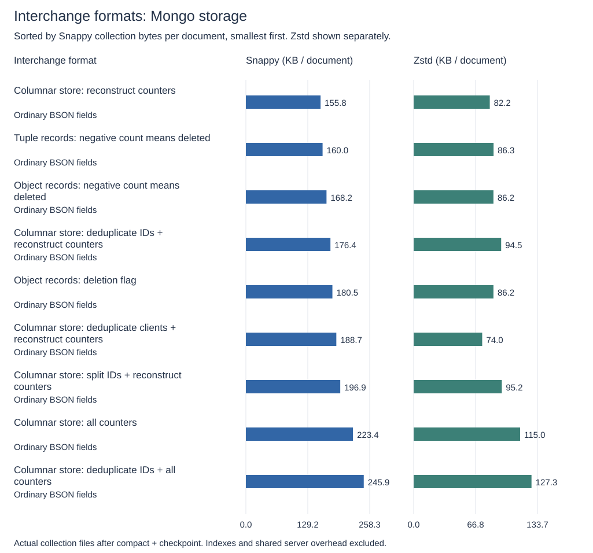

### 4 document(s): JSON interchange formats

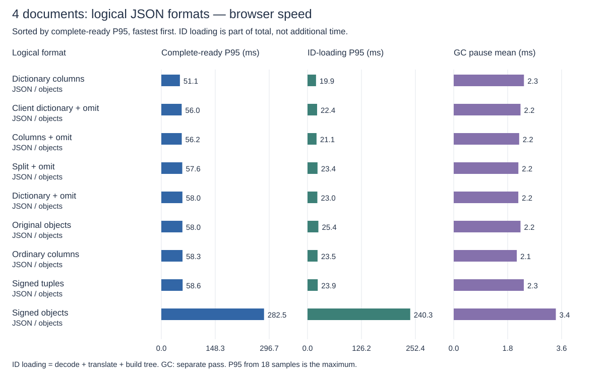

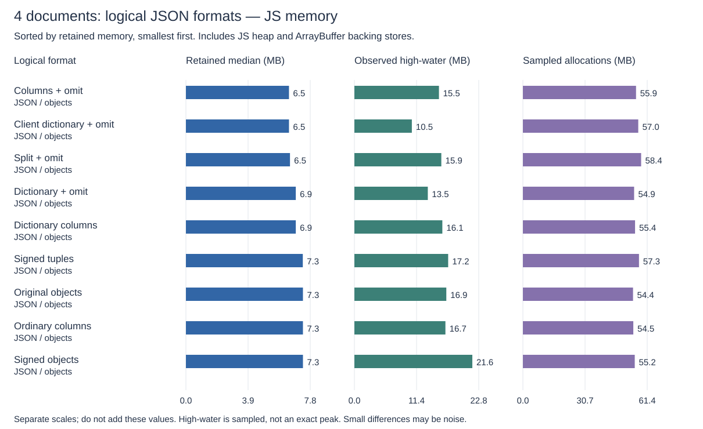

<details><summary>Show numeric results (9 rows)</summary>

| Interchange format                                               | Internal format      | Encoding | Conversion path   | Ready mean ms | Ready P50 ms | Ready P95 ms | Ready maximum ms | Decode P95 ms | To tree mean ms | To tree P50 ms | To tree P95 ms | Cold mean ms | GC mean / max pause ms | Observed high MB | Kept MB | Sampled allocations MB | First-edit P95 ms |
| ---------------------------------------------------------------- | -------------------- | -------- | ----------------- | ------------: | -----------: | -----------: | ---------------: | ------------: | --------------: | -------------: | -------------: | -----------: | ---------------------: | ---------------: | ------: | ---------------------: | ----------------: |
| F09 — Columnar store: deduplicate IDs + all counters             | Existing IdList tree | JSON     | Via IdList.load() |          46.7 |         49.4 |         53.6 |             58.9 |           1.3 |            16.0 |           15.7 |           19.0 |         60.2 |              2.5 / 1.7 |             16.2 |     6.9 |                   54.8 |              17.4 |
| F04 — Columnar store: all counters                               | Existing IdList tree | JSON     | Via IdList.load() |          46.8 |         49.1 |         58.2 |             59.4 |           1.8 |            16.2 |           15.8 |           22.7 |         58.3 |              2.3 / 1.6 |             16.7 |     7.3 |                   53.8 |              17.7 |
| F07 — Columnar store: deduplicate IDs + reconstruct counters     | Existing IdList tree | JSON     | Via IdList.load() |          46.8 |         42.6 |         58.3 |             70.2 |           1.0 |            16.5 |           15.5 |           21.9 |         58.5 |              2.2 / 1.6 |             13.5 |     6.9 |                   53.6 |              17.4 |
| F01 — Object records: deletion flag                              | Existing IdList tree | JSON     | Via IdList.load() |          50.0 |         49.9 |         58.3 |             69.7 |           4.7 |            15.9 |           15.5 |           18.2 |         60.0 |              2.1 / 1.5 |             15.2 |     7.3 |                   54.1 |              17.6 |
| F05 — Columnar store: reconstruct counters                       | Existing IdList tree | JSON     | Via IdList.load() |          50.6 |         50.0 |         58.3 |             70.1 |           1.1 |            19.3 |           18.7 |           21.4 |         61.6 |              2.2 / 1.4 |             15.6 |     6.5 |                   55.6 |              17.2 |
| F06 — Columnar store: split IDs + reconstruct counters           | Existing IdList tree | JSON     | Via IdList.load() |          51.0 |         50.0 |         58.3 |             59.3 |           1.3 |            19.5 |           19.1 |           22.2 |         60.0 |              2.2 / 1.5 |             15.3 |     6.5 |                   57.4 |              17.5 |
| F08 — Columnar store: deduplicate clients + reconstruct counters | Existing IdList tree | JSON     | Via IdList.load() |          51.1 |         49.9 |         58.5 |             61.1 |           0.9 |            19.9 |           19.5 |           23.2 |         65.0 |              2.4 / 1.6 |             10.5 |     6.5 |                   56.7 |              17.9 |
| F02 — Object records: negative count means deleted               | Existing IdList tree | JSON     | Via IdList.load() |          50.8 |         50.0 |         58.5 |             66.8 |           3.8 |            16.5 |           16.0 |           19.2 |         61.7 |              2.6 / 1.4 |             21.7 |     7.3 |                   57.7 |              17.7 |
| F03 — Tuple records: negative count means deleted                | Existing IdList tree | JSON     | Via IdList.load() |          49.5 |         49.9 |         59.2 |             79.6 |           2.1 |            17.1 |           16.1 |           22.8 |         61.8 |              2.2 / 1.4 |             12.9 |     7.3 |                   58.5 |              17.7 |

</details>

### 1 document(s): JSON interchange formats

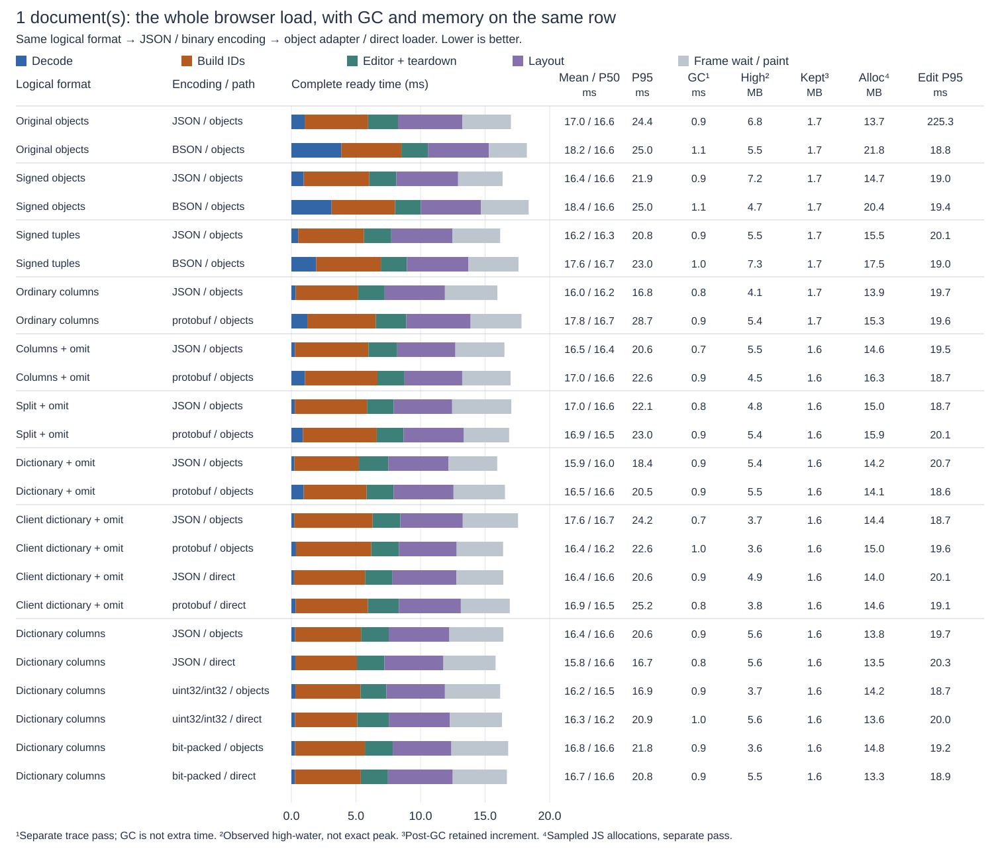

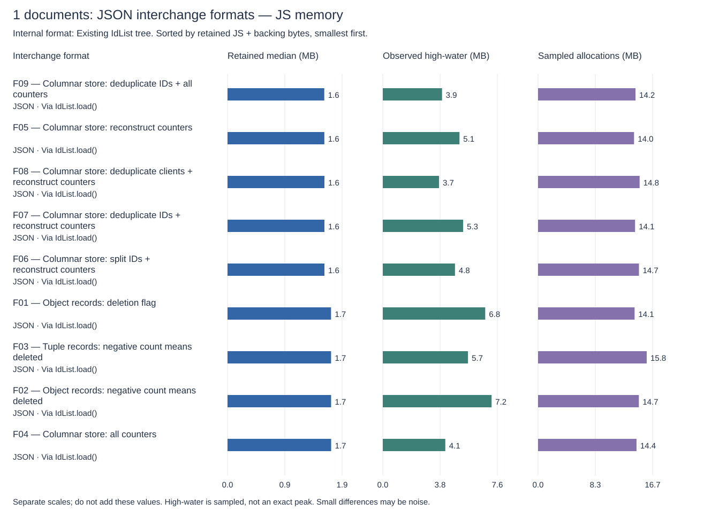

<details><summary>Show numeric results (9 rows)</summary>

| Interchange format                                               | Internal format      | Encoding | Conversion path   | Ready mean ms | Ready P50 ms | Ready P95 ms | Ready maximum ms | Decode P95 ms | To tree mean ms | To tree P50 ms | To tree P95 ms | Cold mean ms | GC mean / max pause ms | Observed high MB | Kept MB | Sampled allocations MB | First-edit P95 ms |
| ---------------------------------------------------------------- | -------------------- | -------- | ----------------- | ------------: | -----------: | -----------: | ---------------: | ------------: | --------------: | -------------: | -------------: | -----------: | ---------------------: | ---------------: | ------: | ---------------------: | ----------------: |
| F08 — Columnar store: deduplicate clients + reconstruct counters | Existing IdList tree | JSON     | Via IdList.load() |          16.8 |         16.6 |         16.8 |             24.8 |           0.3 |             5.7 |            5.6 |            6.6 |         25.4 |              0.8 / 0.7 |              3.7 |     1.6 |                   14.8 |              17.4 |
| F09 — Columnar store: deduplicate IDs + all counters             | Existing IdList tree | JSON     | Via IdList.load() |          16.6 |         16.6 |         16.9 |             25.4 |           0.4 |             4.9 |            4.7 |            6.1 |         25.0 |              0.9 / 1.2 |              3.9 |     1.6 |                   14.2 |              17.9 |
| F06 — Columnar store: split IDs + reconstruct counters           | Existing IdList tree | JSON     | Via IdList.load() |          16.8 |         16.6 |         17.0 |             22.6 |           0.4 |             5.6 |            5.6 |            6.5 |         26.7 |              0.9 / 1.2 |              4.8 |     1.6 |                   14.7 |              17.8 |
| F04 — Columnar store: all counters                               | Existing IdList tree | JSON     | Via IdList.load() |          16.7 |         16.6 |         17.1 |             25.0 |           0.5 |             4.8 |            4.6 |            5.8 |         25.0 |              0.9 / 1.1 |              4.1 |     1.7 |                   14.4 |              17.6 |
| F03 — Tuple records: negative count means deleted                | Existing IdList tree | JSON     | Via IdList.load() |          16.8 |         16.6 |         17.5 |             22.2 |           0.6 |             4.7 |            4.6 |            6.0 |         24.4 |              1.1 / 1.1 |              5.7 |     1.7 |                   15.8 |              17.2 |
| F05 — Columnar store: reconstruct counters                       | Existing IdList tree | JSON     | Via IdList.load() |          16.7 |         16.6 |         17.6 |             22.5 |           0.4 |             5.5 |            5.5 |            6.3 |         25.0 |              0.9 / 1.1 |              5.1 |     1.6 |                   14.0 |              17.7 |
| F02 — Object records: negative count means deleted               | Existing IdList tree | JSON     | Via IdList.load() |          16.8 |         16.6 |         17.6 |             22.3 |           1.1 |             4.8 |            4.7 |            5.8 |         25.0 |              1.0 / 1.3 |              7.2 |     1.7 |                   14.7 |              17.6 |
| F01 — Object records: deletion flag                              | Existing IdList tree | JSON     | Via IdList.load() |          16.8 |         16.6 |         17.9 |             21.6 |           1.2 |             4.6 |            4.6 |            5.6 |         24.7 |              0.8 / 1.1 |              6.8 |     1.7 |                   14.1 |              17.7 |
| F07 — Columnar store: deduplicate IDs + reconstruct counters     | Existing IdList tree | JSON     | Via IdList.load() |          16.8 |         16.6 |         20.6 |             24.9 |           0.3 |             4.8 |            4.7 |            5.9 |         24.6 |              0.9 / 1.3 |              5.3 |     1.6 |                   14.1 |              17.6 |

</details>

## 2. Secondary optimization: direct JSON loading

Same JSON structures, with and without an intermediate object-run array. This isolates the loader change from encoding. Mongo storage is unchanged. Direct loading still builds the same final editing tree.

### 4 document(s): direct JSON loading

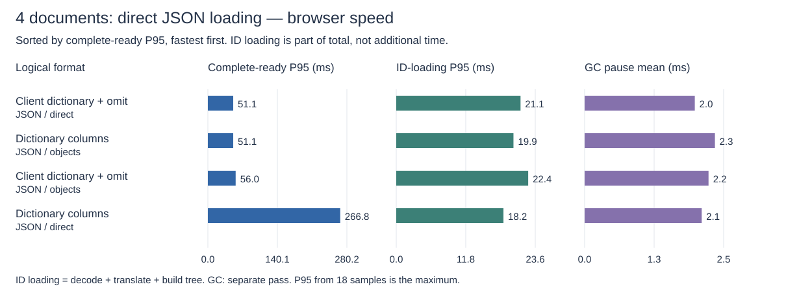

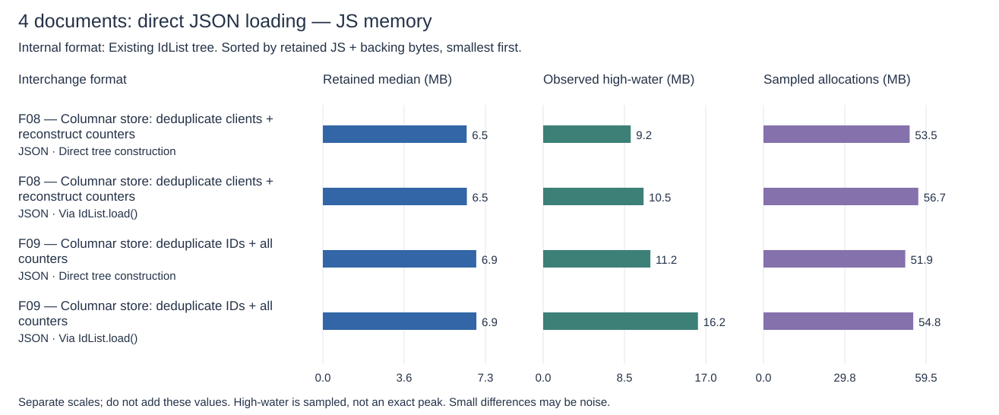

<details><summary>Show numeric results (4 rows)</summary>

| Interchange format                                               | Internal format      | Encoding | Conversion path          | Ready mean ms | Ready P50 ms | Ready P95 ms | Ready maximum ms | Decode P95 ms | To tree mean ms | To tree P50 ms | To tree P95 ms | Cold mean ms | GC mean / max pause ms | Observed high MB | Kept MB | Sampled allocations MB | First-edit P95 ms |
| ---------------------------------------------------------------- | -------------------- | -------- | ------------------------ | ------------: | -----------: | -----------: | ---------------: | ------------: | --------------: | -------------: | -------------: | -----------: | ---------------------: | ---------------: | ------: | ---------------------: | ----------------: |
| F09 — Columnar store: deduplicate IDs + all counters             | Existing IdList tree | JSON     | Direct tree construction |          43.7 |         41.7 |         50.0 |             51.4 |           1.2 |            14.2 |           14.0 |           16.0 |         58.5 |              2.3 / 1.5 |             11.2 |     6.9 |                   51.9 |              17.7 |
| F08 — Columnar store: deduplicate clients + reconstruct counters | Existing IdList tree | JSON     | Direct tree construction |          48.3 |         49.9 |         51.9 |             58.4 |           0.9 |            18.3 |           18.0 |           20.8 |         59.9 |              2.1 / 1.3 |              9.2 |     6.5 |                   53.5 |              17.7 |
| F09 — Columnar store: deduplicate IDs + all counters             | Existing IdList tree | JSON     | Via IdList.load()        |          46.7 |         49.4 |         53.6 |             58.9 |           1.3 |            16.0 |           15.7 |           19.0 |         60.2 |              2.5 / 1.7 |             16.2 |     6.9 |                   54.8 |              17.4 |
| F08 — Columnar store: deduplicate clients + reconstruct counters | Existing IdList tree | JSON     | Via IdList.load()        |          51.1 |         49.9 |         58.5 |             61.1 |           0.9 |            19.9 |           19.5 |           23.2 |         65.0 |              2.4 / 1.6 |             10.5 |     6.5 |                   56.7 |              17.9 |

</details>

### 1 document(s): direct JSON loading

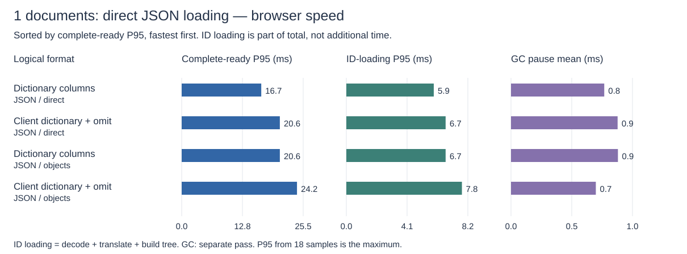

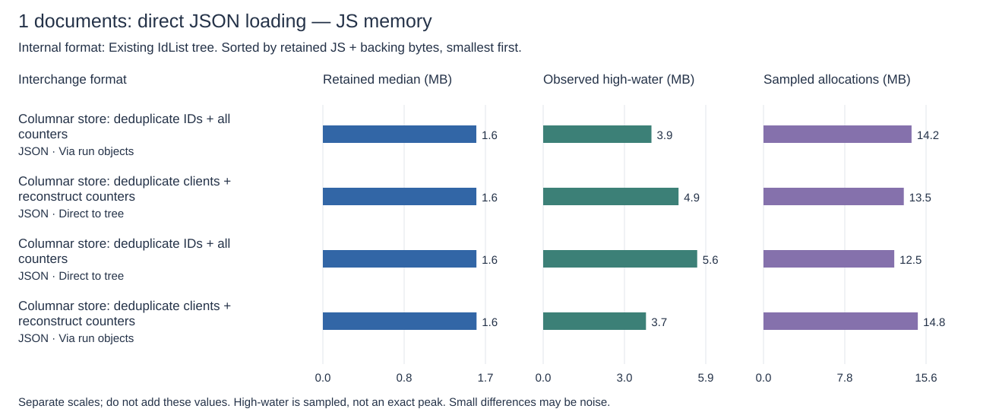

<details><summary>Show numeric results (4 rows)</summary>

| Interchange format                                               | Internal format      | Encoding | Conversion path          | Ready mean ms | Ready P50 ms | Ready P95 ms | Ready maximum ms | Decode P95 ms | To tree mean ms | To tree P50 ms | To tree P95 ms | Cold mean ms | GC mean / max pause ms | Observed high MB | Kept MB | Sampled allocations MB | First-edit P95 ms |
| ---------------------------------------------------------------- | -------------------- | -------- | ------------------------ | ------------: | -----------: | -----------: | ---------------: | ------------: | --------------: | -------------: | -------------: | -----------: | ---------------------: | ---------------: | ------: | ---------------------: | ----------------: |
| F09 — Columnar store: deduplicate IDs + all counters             | Existing IdList tree | JSON     | Direct tree construction |          16.5 |         16.6 |         16.7 |             24.6 |           0.4 |             4.6 |            4.4 |            5.6 |         24.6 |              0.8 / 0.7 |              5.6 |     1.6 |                   12.5 |              17.6 |
| F08 — Columnar store: deduplicate clients + reconstruct counters | Existing IdList tree | JSON     | Via IdList.load()        |          16.8 |         16.6 |         16.8 |             24.8 |           0.3 |             5.7 |            5.6 |            6.6 |         25.4 |              0.8 / 0.7 |              3.7 |     1.6 |                   14.8 |              17.4 |
| F09 — Columnar store: deduplicate IDs + all counters             | Existing IdList tree | JSON     | Via IdList.load()        |          16.6 |         16.6 |         16.9 |             25.4 |           0.4 |             4.9 |            4.7 |            6.1 |         25.0 |              0.9 / 1.2 |              3.9 |     1.6 |                   14.2 |              17.9 |
| F08 — Columnar store: deduplicate clients + reconstruct counters | Existing IdList tree | JSON     | Direct tree construction |          16.8 |         16.6 |         18.4 |             24.9 |           0.3 |             5.3 |            5.2 |            6.4 |         25.2 |              0.9 / 1.3 |              4.9 |     1.6 |                   13.5 |              17.7 |

</details>

## 3. Secondary optimization: binary encoding

Only after choosing a logical structure: compare its JSON row against its binary encoding with the same loader path. JSON baselines are repeated here for reference; this is not a new logical-format contest. No network-size comparison is used.

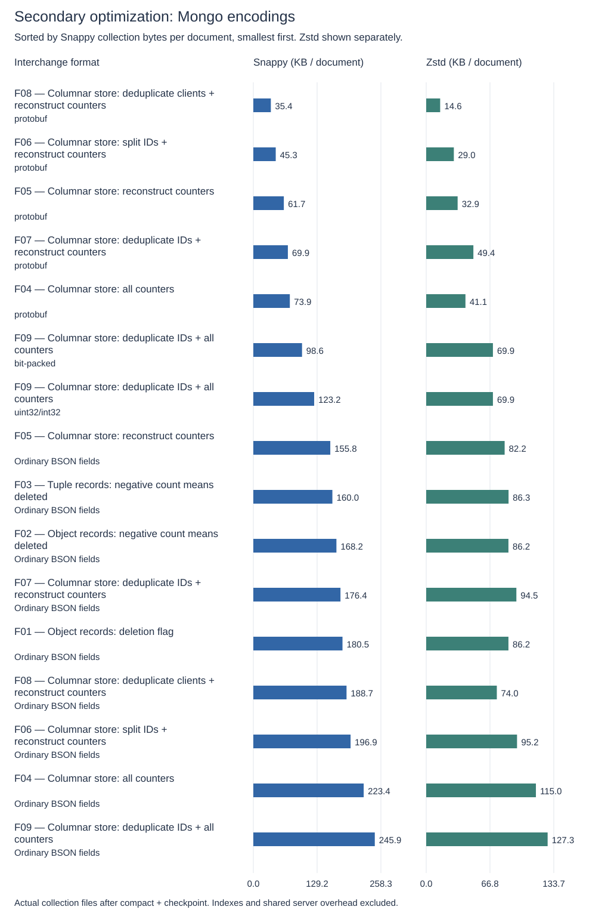

### 4 document(s): encodings and JSON baselines

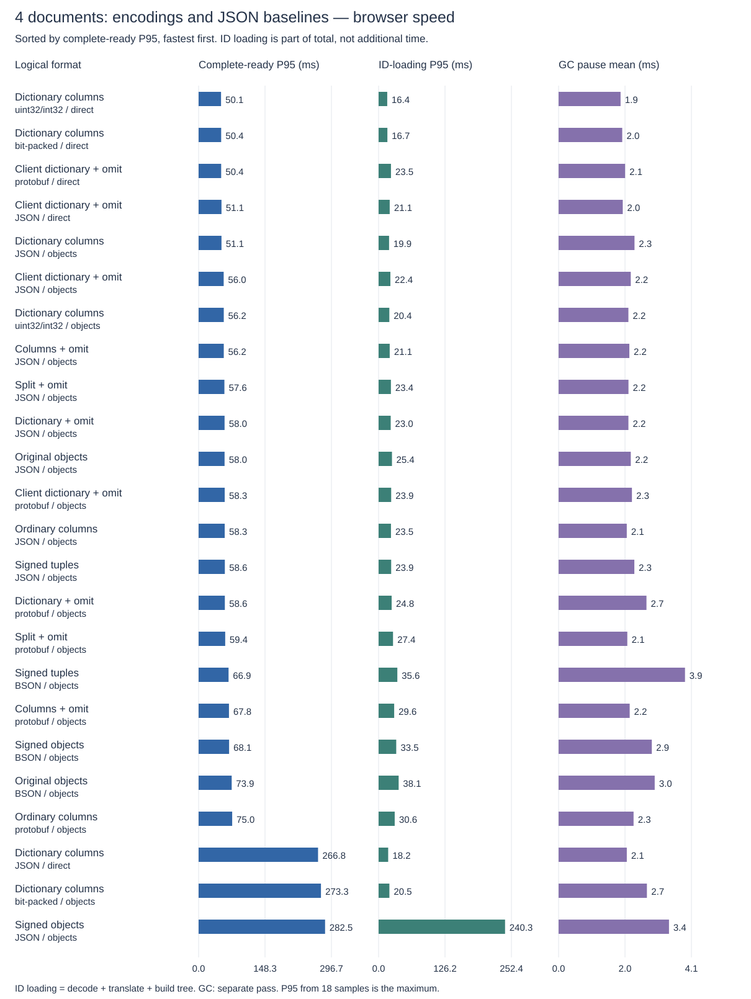

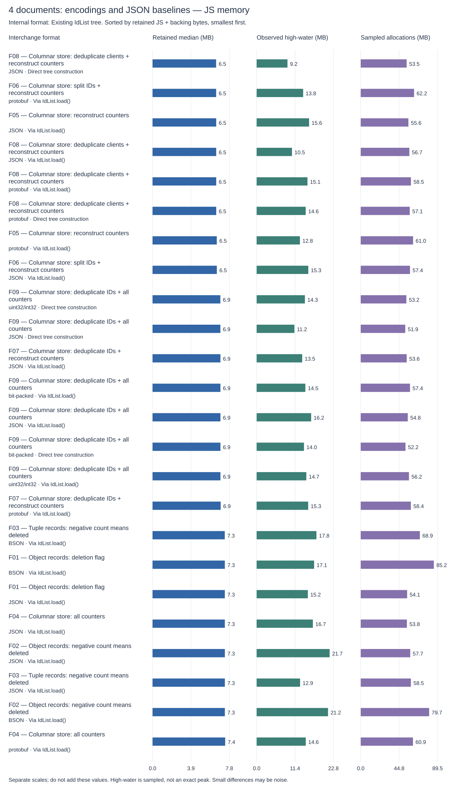

<details><summary>Show numeric results (24 rows)</summary>

| Interchange format                                               | Internal format      | Encoding     | Conversion path          | Ready mean ms | Ready P50 ms | Ready P95 ms | Ready maximum ms | Decode P95 ms | To tree mean ms | To tree P50 ms | To tree P95 ms | Cold mean ms | GC mean / max pause ms | Observed high MB | Kept MB | Sampled allocations MB | First-edit P95 ms |
| ---------------------------------------------------------------- | -------------------- | ------------ | ------------------------ | ------------: | -----------: | -----------: | ---------------: | ------------: | --------------: | -------------: | -------------: | -----------: | ---------------------: | ---------------: | ------: | ---------------------: | ----------------: |
| F09 — Columnar store: deduplicate IDs + all counters             | Existing IdList tree | JSON         | Direct tree construction |          43.7 |         41.7 |         50.0 |             51.4 |           1.2 |            14.2 |           14.0 |           16.0 |         58.5 |              2.3 / 1.5 |             11.2 |     6.9 |                   51.9 |              17.7 |
| F09 — Columnar store: deduplicate IDs + all counters             | Existing IdList tree | bit-packed   | Direct tree construction |          44.8 |         41.7 |         50.1 |             58.2 |           1.8 |            15.0 |           14.7 |           16.7 |         61.9 |              2.2 / 1.7 |             14.0 |     6.9 |                   52.2 |              17.6 |
| F09 — Columnar store: deduplicate IDs + all counters             | Existing IdList tree | uint32/int32 | Direct tree construction |          45.1 |         42.1 |         50.5 |             59.1 |           1.9 |            14.9 |           14.7 |           16.4 |         63.2 |              2.3 / 1.4 |             14.3 |     6.9 |                   53.2 |              17.7 |
| F08 — Columnar store: deduplicate clients + reconstruct counters | Existing IdList tree | JSON         | Direct tree construction |          48.3 |         49.9 |         51.9 |             58.4 |           0.9 |            18.3 |           18.0 |           20.8 |         59.9 |              2.1 / 1.3 |              9.2 |     6.5 |                   53.5 |              17.7 |
| F09 — Columnar store: deduplicate IDs + all counters             | Existing IdList tree | bit-packed   | Via IdList.load()        |          45.8 |         42.5 |         52.1 |             58.4 |           1.9 |            16.1 |           15.9 |           19.5 |         65.1 |              2.4 / 1.3 |             14.5 |     6.9 |                   57.4 |              17.7 |
| F09 — Columnar store: deduplicate IDs + all counters             | Existing IdList tree | uint32/int32 | Via IdList.load()        |          46.3 |         48.9 |         52.5 |             58.4 |           2.0 |            16.0 |           15.7 |           19.3 |         62.0 |              2.4 / 1.4 |             14.7 |     6.9 |                   56.2 |              17.7 |
| F09 — Columnar store: deduplicate IDs + all counters             | Existing IdList tree | JSON         | Via IdList.load()        |          46.7 |         49.4 |         53.6 |             58.9 |           1.3 |            16.0 |           15.7 |           19.0 |         60.2 |              2.5 / 1.7 |             16.2 |     6.9 |                   54.8 |              17.4 |
| F08 — Columnar store: deduplicate clients + reconstruct counters | Existing IdList tree | protobuf     | Direct tree construction |          49.0 |         50.0 |         57.9 |             59.8 |           1.0 |            18.5 |           18.3 |           20.4 |         61.6 |              2.2 / 1.2 |             14.6 |     6.5 |                   57.1 |              17.3 |
| F04 — Columnar store: all counters                               | Existing IdList tree | JSON         | Via IdList.load()        |          46.8 |         49.1 |         58.2 |             59.4 |           1.8 |            16.2 |           15.8 |           22.7 |         58.3 |              2.3 / 1.6 |             16.7 |     7.3 |                   53.8 |              17.7 |
| F07 — Columnar store: deduplicate IDs + reconstruct counters     | Existing IdList tree | JSON         | Via IdList.load()        |          46.8 |         42.6 |         58.3 |             70.2 |           1.0 |            16.5 |           15.5 |           21.9 |         58.5 |              2.2 / 1.6 |             13.5 |     6.9 |                   53.6 |              17.4 |
| F01 — Object records: deletion flag                              | Existing IdList tree | JSON         | Via IdList.load()        |          50.0 |         49.9 |         58.3 |             69.7 |           4.7 |            15.9 |           15.5 |           18.2 |         60.0 |              2.1 / 1.5 |             15.2 |     7.3 |                   54.1 |              17.6 |
| F07 — Columnar store: deduplicate IDs + reconstruct counters     | Existing IdList tree | protobuf     | Via IdList.load()        |          47.9 |         49.0 |         58.3 |             83.9 |           2.8 |            17.1 |           16.0 |           22.7 |         58.7 |              2.6 / 1.5 |             15.3 |     6.9 |                   58.4 |              17.7 |
| F05 — Columnar store: reconstruct counters                       | Existing IdList tree | JSON         | Via IdList.load()        |          50.6 |         50.0 |         58.3 |             70.1 |           1.1 |            19.3 |           18.7 |           21.4 |         61.6 |              2.2 / 1.4 |             15.6 |     6.5 |                   55.6 |              17.2 |
| F06 — Columnar store: split IDs + reconstruct counters           | Existing IdList tree | JSON         | Via IdList.load()        |          51.0 |         50.0 |         58.3 |             59.3 |           1.3 |            19.5 |           19.1 |           22.2 |         60.0 |              2.2 / 1.5 |             15.3 |     6.5 |                   57.4 |              17.5 |
| F08 — Columnar store: deduplicate clients + reconstruct counters | Existing IdList tree | protobuf     | Via IdList.load()        |          51.0 |         50.0 |         58.4 |             76.4 |           1.7 |            19.9 |           19.3 |           22.4 |         64.9 |              2.6 / 1.4 |             15.1 |     6.5 |                   58.5 |              17.7 |
| F05 — Columnar store: reconstruct counters                       | Existing IdList tree | protobuf     | Via IdList.load()        |          51.8 |         49.9 |         58.4 |             76.8 |           3.2 |            19.8 |           18.8 |           22.6 |         66.4 |              2.4 / 1.4 |             12.8 |     6.5 |                   61.0 |              17.7 |
| F08 — Columnar store: deduplicate clients + reconstruct counters | Existing IdList tree | JSON         | Via IdList.load()        |          51.1 |         49.9 |         58.5 |             61.1 |           0.9 |            19.9 |           19.5 |           23.2 |         65.0 |              2.4 / 1.6 |             10.5 |     6.5 |                   56.7 |              17.9 |
| F02 — Object records: negative count means deleted               | Existing IdList tree | JSON         | Via IdList.load()        |          50.8 |         50.0 |         58.5 |             66.8 |           3.8 |            16.5 |           16.0 |           19.2 |         61.7 |              2.6 / 1.4 |             21.7 |     7.3 |                   57.7 |              17.7 |
| F03 — Tuple records: negative count means deleted                | Existing IdList tree | BSON         | Via IdList.load()        |          51.8 |         50.0 |         58.5 |             75.4 |           6.3 |            16.2 |           15.1 |           21.2 |         66.7 |              3.3 / 2.0 |             17.8 |     7.3 |                   68.9 |              17.6 |
| F03 — Tuple records: negative count means deleted                | Existing IdList tree | JSON         | Via IdList.load()        |          49.5 |         49.9 |         59.2 |             79.6 |           2.1 |            17.1 |           16.1 |           22.8 |         61.8 |              2.2 / 1.4 |             12.9 |     7.3 |                   58.5 |              17.7 |
| F04 — Columnar store: all counters                               | Existing IdList tree | protobuf     | Via IdList.load()        |          50.4 |         49.9 |         66.7 |             85.7 |           5.7 |            17.5 |           16.6 |           25.1 |         64.7 |              2.5 / 1.5 |             14.6 |     7.4 |                   60.9 |              17.6 |
| F02 — Object records: negative count means deleted               | Existing IdList tree | BSON         | Via IdList.load()        |          57.8 |         58.3 |         66.7 |             75.0 |          10.1 |            18.8 |           18.4 |           23.5 |         73.9 |              3.4 / 2.0 |             21.2 |     7.3 |                   79.7 |              17.6 |
| F06 — Columnar store: split IDs + reconstruct counters           | Existing IdList tree | protobuf     | Via IdList.load()        |          52.0 |         50.0 |         66.7 |             84.1 |           2.7 |            20.1 |           19.3 |           26.8 |         66.4 |              2.3 / 1.6 |             13.8 |     6.5 |                   62.2 |              17.6 |
| F01 — Object records: deletion flag                              | Existing IdList tree | BSON         | Via IdList.load()        |          60.1 |         58.3 |         68.8 |             76.0 |          13.3 |            19.2 |           18.9 |           21.7 |         74.9 |              3.2 / 1.8 |             17.1 |     7.3 |                   85.2 |              17.6 |

</details>

### 1 document(s): encodings and JSON baselines

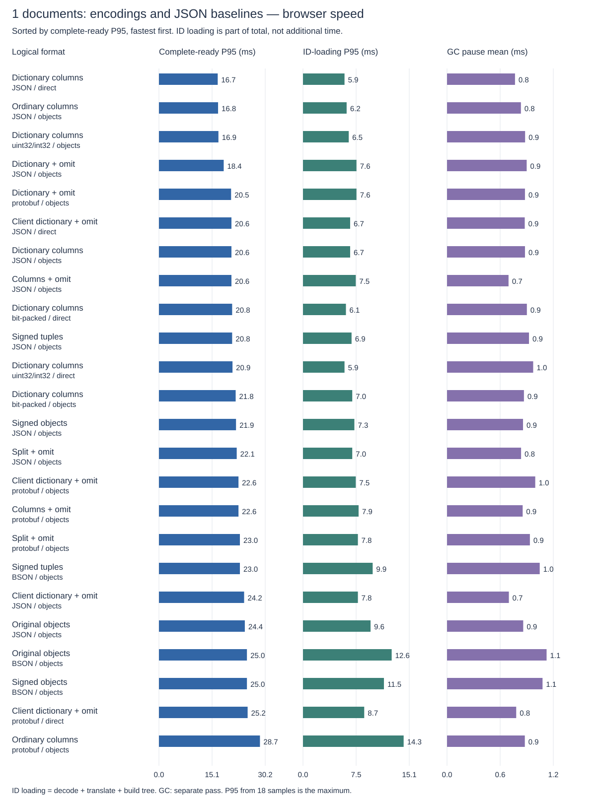

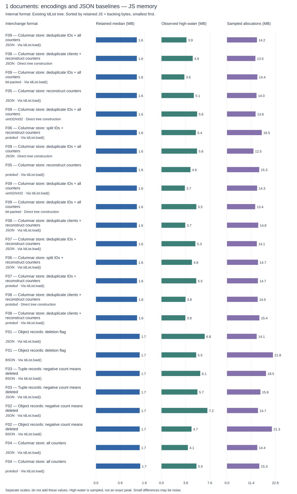

<details><summary>Show numeric results (24 rows)</summary>

| Interchange format                                               | Internal format      | Encoding     | Conversion path          | Ready mean ms | Ready P50 ms | Ready P95 ms | Ready maximum ms | Decode P95 ms | To tree mean ms | To tree P50 ms | To tree P95 ms | Cold mean ms | GC mean / max pause ms | Observed high MB | Kept MB | Sampled allocations MB | First-edit P95 ms |
| ---------------------------------------------------------------- | -------------------- | ------------ | ------------------------ | ------------: | -----------: | -----------: | ---------------: | ------------: | --------------: | -------------: | -------------: | -----------: | ---------------------: | ---------------: | ------: | ---------------------: | ----------------: |
| F09 — Columnar store: deduplicate IDs + all counters             | Existing IdList tree | JSON         | Direct tree construction |          16.5 |         16.6 |         16.7 |             24.6 |           0.4 |             4.6 |            4.4 |            5.6 |         24.6 |              0.8 / 0.7 |              5.6 |     1.6 |                   12.5 |              17.6 |
| F08 — Columnar store: deduplicate clients + reconstruct counters | Existing IdList tree | JSON         | Via IdList.load()        |          16.8 |         16.6 |         16.8 |             24.8 |           0.3 |             5.7 |            5.6 |            6.6 |         25.4 |              0.8 / 0.7 |              3.7 |     1.6 |                   14.8 |              17.4 |
| F09 — Columnar store: deduplicate IDs + all counters             | Existing IdList tree | uint32/int32 | Direct tree construction |          16.5 |         16.6 |         16.8 |             24.9 |           0.4 |             4.5 |            4.5 |            5.5 |         24.6 |              1.1 / 1.4 |              5.6 |     1.6 |                   13.6 |              17.6 |
| F09 — Columnar store: deduplicate IDs + all counters             | Existing IdList tree | JSON         | Via IdList.load()        |          16.6 |         16.6 |         16.9 |             25.4 |           0.4 |             4.9 |            4.7 |            6.1 |         25.0 |              0.9 / 1.2 |              3.9 |     1.6 |                   14.2 |              17.9 |
| F06 — Columnar store: split IDs + reconstruct counters           | Existing IdList tree | JSON         | Via IdList.load()        |          16.8 |         16.6 |         17.0 |             22.6 |           0.4 |             5.6 |            5.6 |            6.5 |         26.7 |              0.9 / 1.2 |              4.8 |     1.6 |                   14.7 |              17.8 |
| F04 — Columnar store: all counters                               | Existing IdList tree | JSON         | Via IdList.load()        |          16.7 |         16.6 |         17.1 |             25.0 |           0.5 |             4.8 |            4.6 |            5.8 |         25.0 |              0.9 / 1.1 |              4.1 |     1.7 |                   14.4 |              17.6 |
| F09 — Columnar store: deduplicate IDs + all counters             | Existing IdList tree | bit-packed   | Via IdList.load()        |          16.7 |         16.6 |         17.3 |             24.1 |           0.4 |             4.9 |            4.7 |            6.3 |         24.9 |              0.8 / 0.7 |              3.6 |     1.6 |                   14.4 |              17.7 |
| F09 — Columnar store: deduplicate IDs + all counters             | Existing IdList tree | bit-packed   | Direct tree construction |          16.7 |         16.6 |         17.5 |             25.4 |           0.3 |             4.7 |            4.6 |            5.8 |         24.9 |              1.0 / 1.2 |              5.5 |     1.6 |                   13.4 |              17.7 |
| F03 — Tuple records: negative count means deleted                | Existing IdList tree | JSON         | Via IdList.load()        |          16.8 |         16.6 |         17.5 |             22.2 |           0.6 |             4.7 |            4.6 |            6.0 |         24.4 |              1.1 / 1.1 |              5.7 |     1.7 |                   15.8 |              17.2 |
| F08 — Columnar store: deduplicate clients + reconstruct counters | Existing IdList tree | protobuf     | Via IdList.load()        |          16.7 |         16.6 |         17.6 |             24.8 |           0.7 |             5.9 |            5.8 |            6.7 |         25.1 |              0.9 / 0.8 |              3.8 |     1.6 |                   15.4 |              17.7 |
| F05 — Columnar store: reconstruct counters                       | Existing IdList tree | JSON         | Via IdList.load()        |          16.7 |         16.6 |         17.6 |             22.5 |           0.4 |             5.5 |            5.5 |            6.3 |         25.0 |              0.9 / 1.1 |              5.1 |     1.6 |                   14.0 |              17.7 |
| F02 — Object records: negative count means deleted               | Existing IdList tree | JSON         | Via IdList.load()        |          16.8 |         16.6 |         17.6 |             22.3 |           1.1 |             4.8 |            4.7 |            5.8 |         25.0 |              1.0 / 1.3 |              7.2 |     1.7 |                   14.7 |              17.6 |
| F04 — Columnar store: all counters                               | Existing IdList tree | protobuf     | Via IdList.load()        |          16.8 |         16.6 |         17.7 |             22.1 |           1.3 |             4.7 |            4.6 |            5.6 |         25.0 |              1.1 / 1.2 |              5.5 |     1.7 |                   15.3 |              17.5 |
| F01 — Object records: deletion flag                              | Existing IdList tree | JSON         | Via IdList.load()        |          16.8 |         16.6 |         17.9 |             21.6 |           1.2 |             4.6 |            4.6 |            5.6 |         24.7 |              0.8 / 1.1 |              6.8 |     1.7 |                   14.1 |              17.7 |
| F08 — Columnar store: deduplicate clients + reconstruct counters | Existing IdList tree | protobuf     | Direct tree construction |          16.9 |         16.6 |         18.2 |             25.0 |           0.6 |             5.4 |            5.4 |            6.2 |         25.0 |              0.8 / 1.2 |              3.8 |     1.6 |                   14.5 |              17.7 |
| F08 — Columnar store: deduplicate clients + reconstruct counters | Existing IdList tree | JSON         | Direct tree construction |          16.8 |         16.6 |         18.4 |             24.9 |           0.3 |             5.3 |            5.2 |            6.4 |         25.2 |              0.9 / 1.3 |              4.9 |     1.6 |                   13.5 |              17.7 |
| F09 — Columnar store: deduplicate IDs + all counters             | Existing IdList tree | uint32/int32 | Via IdList.load()        |          16.8 |         16.6 |         20.2 |             25.1 |           0.4 |             4.8 |            4.7 |            6.2 |         24.9 |              0.9 / 0.9 |              3.7 |     1.6 |                   14.3 |              17.5 |
| F07 — Columnar store: deduplicate IDs + reconstruct counters     | Existing IdList tree | JSON         | Via IdList.load()        |          16.8 |         16.6 |         20.6 |             24.9 |           0.3 |             4.8 |            4.7 |            5.9 |         24.6 |              0.9 / 1.3 |              5.3 |     1.6 |                   14.1 |              17.6 |
| F07 — Columnar store: deduplicate IDs + reconstruct counters     | Existing IdList tree | protobuf     | Via IdList.load()        |          16.8 |         16.6 |         20.9 |             25.1 |           1.3 |             4.8 |            4.6 |            5.8 |         24.9 |              0.9 / 1.2 |              5.5 |     1.6 |                   14.7 |              17.7 |
| F03 — Tuple records: negative count means deleted                | Existing IdList tree | BSON         | Via IdList.load()        |          16.9 |         16.6 |         20.9 |             25.5 |           2.0 |             4.9 |            4.8 |            5.9 |         25.0 |              1.1 / 1.5 |              6.1 |     1.7 |                   18.5 |              17.7 |
| F05 — Columnar store: reconstruct counters                       | Existing IdList tree | protobuf     | Via IdList.load()        |          16.8 |         16.6 |         21.1 |             24.9 |           1.6 |             5.4 |            5.3 |            6.3 |         25.1 |              0.9 / 0.7 |              4.6 |     1.6 |                   15.3 |              17.5 |
| F06 — Columnar store: split IDs + reconstruct counters           | Existing IdList tree | protobuf     | Via IdList.load()        |          16.9 |         16.6 |         21.3 |             24.4 |           1.4 |             5.6 |            5.5 |            6.4 |         25.0 |              1.0 / 1.1 |              5.4 |     1.6 |                   16.5 |              17.7 |
| F01 — Object records: deletion flag                              | Existing IdList tree | BSON         | Via IdList.load()        |          17.6 |         16.6 |         24.9 |             28.5 |           3.9 |             5.1 |            5.1 |            6.2 |         30.4 |              1.4 / 1.2 |              5.5 |     1.7 |                   21.8 |              17.7 |
| F02 — Object records: negative count means deleted               | Existing IdList tree | BSON         | Via IdList.load()        |          17.7 |         16.6 |         24.9 |             33.3 |           3.1 |             5.3 |            5.1 |            6.1 |         28.5 |              1.4 / 1.3 |              4.7 |     1.7 |                   21.3 |              17.8 |

</details>

### Matched encoding and loader comparisons

These are changes in measured means, not significance claims. The per-round deltas show how reproducible the direction was across fresh contexts. Negative means faster.

<details><summary>Show numeric results (14 rows)</summary>

| Documents | Same interchange format                                          | Encoding and conversion path                                             | Ready change ms | Per-round changes ms         | Kept change MB |
| --------: | ---------------------------------------------------------------- | ------------------------------------------------------------------------ | --------------: | ---------------------------- | -------------: |
|         1 | F08 — Columnar store: deduplicate clients + reconstruct counters | JSON, Via IdList.load() → protobuf, Via IdList.load()                    |            -0.1 | -0.0, 0.3, -0.6, -0.1, -0.2  |            0.0 |
|         1 | F08 — Columnar store: deduplicate clients + reconstruct counters | JSON, Direct tree construction → protobuf, Direct tree construction      |             0.1 | 0.2, 0.2, 0.1, 0.4, -0.3     |            0.0 |
|         1 | F09 — Columnar store: deduplicate IDs + all counters             | JSON, Via IdList.load() → uint32/int32, Via IdList.load()                |             0.2 | 0.1, 0.3, 0.4, 0.6, -0.4     |            0.0 |
|         1 | F09 — Columnar store: deduplicate IDs + all counters             | JSON, Direct tree construction → uint32/int32, Direct tree construction  |            -0.0 | -0.5, 0.2, -0.4, 0.1, 0.6    |           -0.0 |
|         1 | F09 — Columnar store: deduplicate IDs + all counters             | JSON, Direct tree construction → bit-packed, Direct tree construction    |             0.2 | -0.0, 0.1, -0.0, 0.0, 1.0    |            0.0 |
|         1 | F09 — Columnar store: deduplicate IDs + all counters             | uint32/int32, Via IdList.load() → uint32/int32, Direct tree construction |            -0.3 | -0.8, -0.1, -0.7, -0.3, 0.4  |           -0.0 |
|         1 | F09 — Columnar store: deduplicate IDs + all counters             | bit-packed, Via IdList.load() → bit-packed, Direct tree construction     |             0.0 | -0.0, -0.3, 0.2, -0.5, 0.9   |            0.0 |
|         4 | F08 — Columnar store: deduplicate clients + reconstruct counters | JSON, Via IdList.load() → protobuf, Via IdList.load()                    |            -0.1 | 0.0, 1.4, -0.3, -0.5, -1.2   |            0.0 |
|         4 | F08 — Columnar store: deduplicate clients + reconstruct counters | JSON, Direct tree construction → protobuf, Direct tree construction      |             0.7 | -2.7, 3.0, 1.9, 0.5, 0.7     |            0.0 |
|         4 | F09 — Columnar store: deduplicate IDs + all counters             | JSON, Via IdList.load() → uint32/int32, Via IdList.load()                |            -0.4 | -0.2, -2.7, -1.8, 0.5, 2.3   |            0.0 |
|         4 | F09 — Columnar store: deduplicate IDs + all counters             | JSON, Direct tree construction → uint32/int32, Direct tree construction  |             1.4 | 2.4, 1.2, 1.1, 0.6, 1.9      |           -0.0 |
|         4 | F09 — Columnar store: deduplicate IDs + all counters             | JSON, Direct tree construction → bit-packed, Direct tree construction    |             1.1 | 2.8, 1.9, -0.2, -1.3, 2.5    |            0.0 |
|         4 | F09 — Columnar store: deduplicate IDs + all counters             | uint32/int32, Via IdList.load() → uint32/int32, Direct tree construction |            -1.2 | -2.0, -2.0, -1.6, 0.7, -1.0  |           -0.0 |
|         4 | F09 — Columnar store: deduplicate IDs + all counters             | bit-packed, Via IdList.load() → bit-packed, Direct tree construction     |            -1.0 | -1.5, -0.1, -2.3, -0.9, -0.3 |            0.0 |

</details>

## Physical Mongo storage: all measurements

MongoDB 8.3.3; 100 documents per layout/compressor, with distinct client dictionaries. Actual allocated collection-file bytes after compact, checkpoint, another compact, and locked fsync. Indexes and shared server overhead excluded; allocated free pages may remain. No logical-BSON or wire-size proxy.

JSON rows mean ordinary BSON objects/arrays in Mongo, **not JSON strings**. Protobuf rows mean one BSON Binary. Numeric-column encodings mean a dictionary plus separate BSON Binary fields. The BSON browser-response variant for objects/tuples uses the same ordinary Mongo layout; it does not imply storing a second blob. Direct/object loader paths also share storage.

<details><summary>Show numeric results (16 rows)</summary>

| Interchange format                                               | Mongo representation | Snappy KB/doc | Zstd KB/doc |
| ---------------------------------------------------------------- | -------------------- | ------------: | ----------: |
| F01 — Object records: deletion flag                              | Ordinary BSON        |         180.5 |        86.2 |
| F02 — Object records: negative count means deleted               | Ordinary BSON        |         168.2 |        86.2 |
| F03 — Tuple records: negative count means deleted                | Ordinary BSON        |         160.0 |        86.3 |
| F04 — Columnar store: all counters                               | Ordinary BSON        |         223.4 |       115.0 |
| F04 — Columnar store: all counters                               | protobuf             |          73.9 |        41.1 |
| F05 — Columnar store: reconstruct counters                       | Ordinary BSON        |         155.8 |        82.2 |
| F05 — Columnar store: reconstruct counters                       | protobuf             |          61.7 |        32.9 |
| F06 — Columnar store: split IDs + reconstruct counters           | Ordinary BSON        |         196.9 |        95.2 |
| F06 — Columnar store: split IDs + reconstruct counters           | protobuf             |          45.3 |        29.0 |
| F07 — Columnar store: deduplicate IDs + reconstruct counters     | Ordinary BSON        |         176.4 |        94.5 |
| F07 — Columnar store: deduplicate IDs + reconstruct counters     | protobuf             |          69.9 |        49.4 |
| F08 — Columnar store: deduplicate clients + reconstruct counters | Ordinary BSON        |         188.7 |        74.0 |
| F08 — Columnar store: deduplicate clients + reconstruct counters | protobuf             |          35.4 |        14.6 |
| F09 — Columnar store: deduplicate IDs + all counters             | Ordinary BSON        |         245.9 |       127.3 |
| F09 — Columnar store: deduplicate IDs + all counters             | uint32/int32         |         123.2 |        69.9 |
| F09 — Columnar store: deduplicate IDs + all counters             | bit-packed           |          98.6 |        69.9 |

</details>

## Exact interchange structures and Mongo examples

Every encoding in a group round-trips to the **same** logical JSON. This is asserted for empty and example inputs in unit tests, and for the full fixture before browser measurement. The browser additionally checks all saved runs, visible paragraph text, and a successful first edit.

<a id="format-objects"></a>
<details><summary>F01 — Object records: deletion flag: JSON and actual Mongo representations</summary>

### Ordinary Mongo fields

```json
{
  "state": [
    {
      "bunchId": "alice_0",
      "startCounter": 0,
      "count": 3,
      "isDeleted": false
    },
    {
      "bunchId": "bob_0",
      "startCounter": 0,
      "count": 1,
      "isDeleted": false
    },
    {
      "bunchId": "alice_1",
      "startCounter": 0,
      "count": 2,
      "isDeleted": false
    },
    {
      "bunchId": "alice_0",
      "startCounter": 3,
      "count": 2,
      "isDeleted": true
    }
  ]
}
```

</details>

<a id="format-signed"></a>
<details><summary>F02 — Object records: negative count means deleted: JSON and actual Mongo representations</summary>

### Ordinary Mongo fields

```json
{
  "state": [
    {
      "bunchId": "alice_0",
      "startCounter": 0,
      "count": 3
    },
    {
      "bunchId": "bob_0",
      "startCounter": 0,
      "count": 1
    },
    {
      "bunchId": "alice_1",
      "startCounter": 0,
      "count": 2
    },
    {
      "bunchId": "alice_0",
      "startCounter": 3,
      "count": -2
    }
  ]
}
```

</details>

<a id="format-tuples"></a>
<details><summary>F03 — Tuple records: negative count means deleted: JSON and actual Mongo representations</summary>

### Ordinary Mongo fields

```json
{
  "state": [
    ["alice_0", 0, 3],
    ["bob_0", 0, 1],
    ["alice_1", 0, 2],
    ["alice_0", 3, -2]
  ]
}
```

</details>

<a id="format-columns"></a>
<details><summary>F04 — Columnar store: all counters: JSON and actual Mongo representations</summary>

### Ordinary Mongo fields

```json
{
  "state": {
    "bunchIds": ["alice_0", "bob_0", "alice_1", "alice_0"],
    "startCounters": [0, 0, 0, 3],
    "counts": [3, 1, 2, -2]
  }
}
```

### protobuf

```json
{
  "state": {
    "$binary": {
      "base64": "CgdhbGljZV8wCgVib2JfMAoHYWxpY2VfMQoHYWxpY2VfMBIEAAAAAxoEBgIEAw==",
      "subType": "00"
    }
  }
}
```

</details>

<a id="format-omit"></a>
<details><summary>F05 — Columnar store: reconstruct counters: JSON and actual Mongo representations</summary>

### Ordinary Mongo fields

```json
{
  "state": {
    "bunchIds": ["alice_0", "bob_0", "alice_1", "alice_0"],
    "startCounterIndexes": [],
    "startCounters": [],
    "counts": [3, 1, 2, -2]
  }
}
```

### protobuf

```json
{
  "state": {
    "$binary": {
      "base64": "CgdhbGljZV8wCgVib2JfMAoHYWxpY2VfMQoHYWxpY2VfMCIEBgIEAw==",
      "subType": "00"
    }
  }
}
```

</details>

<a id="format-split"></a>
<details><summary>F06 — Columnar store: split IDs + reconstruct counters: JSON and actual Mongo representations</summary>

### Ordinary Mongo fields

```json
{
  "state": {
    "clientIds": ["alice", "bob", "alice", "alice"],
    "seqNums": [0, 0, 1, 0],
    "startCounterIndexes": [],
    "startCounters": [],
    "counts": [3, 1, 2, -2]
  }
}
```

### protobuf

```json
{
  "state": {
    "$binary": {
      "base64": "CgVhbGljZQoDYm9iCgVhbGljZQoFYWxpY2USBAAAAQAqBAYCBAM=",
      "subType": "00"
    }
  }
}
```

</details>

<a id="format-dictionary"></a>
<details><summary>F07 — Columnar store: deduplicate IDs + reconstruct counters: JSON and actual Mongo representations</summary>

### Ordinary Mongo fields

```json
{
  "state": {
    "bunchIds": ["alice_0", "bob_0", "alice_1"],
    "bunchIndices": [0, 1, 2, 0],
    "startCounterIndexes": [],
    "startCounters": [],
    "counts": [3, 1, 2, -2]
  }
}
```

### protobuf

```json
{
  "state": {
    "$binary": {
      "base64": "CgdhbGljZV8wCgVib2JfMAoHYWxpY2VfMRIEAAECACoEBgIEAw==",
      "subType": "00"
    }
  }
}
```

</details>

<a id="format-client"></a>
<details><summary>F08 — Columnar store: deduplicate clients + reconstruct counters: JSON and actual Mongo representations</summary>

### Ordinary Mongo fields

```json
{
  "state": {
    "clientIds": ["alice", "bob"],
    "clientIndices": [0, 1, 0, 0],
    "seqNums": [0, 0, 1, 0],
    "startCounterIndexes": [],
    "startCounters": [],
    "counts": [3, 1, 2, -2]
  }
}
```

### protobuf

```json
{
  "state": {
    "$binary": {
      "base64": "CgVhbGljZQoDYm9iEgQAAQAAGgQAAAEAMgQGAgQD",
      "subType": "00"
    }
  }
}
```

</details>

<a id="format-full"></a>
<details><summary>F09 — Columnar store: deduplicate IDs + all counters: JSON and actual Mongo representations</summary>

### Ordinary Mongo fields

```json
{
  "state": {
    "bunchIds": ["alice_0", "bob_0", "alice_1"],
    "bunchIndices": [0, 1, 2, 0],
    "startCounters": [0, 0, 0, 3],
    "counts": [3, 1, 2, -2]
  }
}
```

### uint32/int32

```json
{
  "state": {
    "bunchIds": ["alice_0", "bob_0", "alice_1"],
    "bunchIndices": {
      "$binary": {
        "base64": "AAAAAAEAAAACAAAAAAAAAA==",
        "subType": "00"
      }
    },
    "startCounters": {
      "$binary": {
        "base64": "AAAAAAAAAAAAAAAAAwAAAA==",
        "subType": "00"
      }
    },
    "counts": {
      "$binary": {
        "base64": "AwAAAAEAAAACAAAA/v///w==",
        "subType": "00"
      }
    }
  }
}
```

### bit-packed

```json
{
  "state": {
    "bunchIds": ["alice_0", "bob_0", "alice_1"],
    "bunchIndices": {
      "$binary": {
        "base64": "ACAACAAAAA==",
        "subType": "00"
      }
    },
    "startCounters": {
      "$binary": {
        "base64": "AAAAAAYA",
        "subType": "00"
      }
    },
    "counts": {
      "$binary": {
        "base64": "BiAABDAA",
        "subType": "00"
      }
    }
  }
}
```

</details>

## What is included—and what is not

- **Start:** response bytes and document JSON have arrived; fetch/network/transport gzip and server work are excluded. JSON UTF-8 decoding and parsing, protobuf/BSON decoding, typed-array alignment copies, ID translation/tree building, document-JSON parsing, ProseMirror model/view creation, prior editor destruction, DOM creation and forced layout are inside the timer.
- **End:** two requestAnimationFrame callbacks after synchronous work. A rendering opportunity passes between them; this is a paint-ready proxy, not physical display scan-out. The separate Chrome trace must show at least one Paint event inside every measured load window or the run fails. Frame scheduling can hide sub-frame CPU improvements. The frame-wait segment includes asynchronous browser work and idle scheduling, not only paint CPU.
- **First edit:** inserts a character into both the IdList and ProseMirror document, focuses the editor, then waits through the same frame boundary. It is measured separately after load; it is not added to ready time. This minimal editor has no production plugins, decorations, media, network, React integration, or application-specific initialization.
- **GC:** union of renderer-main-thread MinorGC/MajorGC intervals intersecting each load window, without double-counting nested spans. A forced-GC canary outside the windows verifies that this browser emits the expected events. No forced GC occurs between the traced replacement loads. Concurrent/background GC work is not counted as a main-thread pause. Tracing adds overhead, so trace-pass GC is diagnostic, not a component subtracted from the untraced totals.
- **Memory:** Runtime.getHeapUsage usedSize + backingStorageSize, relative to the same warmed page with editors cleared and garbage collected. An 8 MiB ArrayBuffer calibration verifies backing-byte inclusion and guards against double counting. Inputs are released after load; the final editor and first edit remain. Kept is the median of post-GC increments. It includes JS wrappers and backing stores, not total renderer RSS, GPU memory, or all native DOM/layout allocations. Raw embedder heap and DOM-node counts are retained separately.
- **Observed high-water is NOT an exact peak.** A separate intrusive pass samples before decode and after decode, hydration, editor creation, layout and readiness. It can miss intra-stage peaks; samples also include profiler/probe overhead and garbage awaiting collection. The chart reports the largest observed increment across the memory runs. Do not rank close differences as precise transient-memory savings.
- **Allocation pressure:** a separate HeapProfiler sampling pass at 16 KiB, including objects collected by minor and major GC. It estimates JS allocations over load plus first edit, including instrumentation overhead; it is not exact allocation volume or a measurement of all ArrayBuffer/native allocations. It is not added to retained/high-water bytes. Timing runs have neither heap sampling nor memory probes.
- **Fairness:** same fixture, same editor, same viewport, same browser and CPU setting; format/workload order deterministically shuffled each round. Each timing block has a fresh context, one recorded cold load, two warmups, a GC before the block, then uninterrupted replacement loads. The result is a controlled case study on one machine/browser/structured-ID trace, not a device-independent ranking or production latency promise. All variants still create the existing editing tree; a native column-backed mutable library would require a different implementation and benchmark.
- **Format limits:** the fixture uses Matthew’s structured client/sequence IDs, not independent opaque 8-character nanoids. Split-ID results depend on that sharing. Packed columns use 13-bit dictionary indexes, 11-bit starts, and 12-bit zigzag counts: at most 8,192 dictionary entries, starts ≤ 2,047, live counts ≤ 2,047, and deleted magnitudes ≤ 2,048; overflow throws rather than widening. Fixed binary uses uint32/int32; protobuf inherits its schema’s 32-bit limits. These are experimental codecs, not hardened production input decoders.

Protocol references: [Runtime heap accounting](https://chromedevtools.github.io/devtools-protocol/tot/Runtime/#method-getHeapUsage), [heap allocation sampling](https://chromedevtools.github.io/devtools-protocol/tot/HeapProfiler/#method-startSampling), [Chrome tracing](https://chromedevtools.github.io/devtools-protocol/tot/Tracing/).

## Reproduce

Use Node 24 and pnpm 11. Run browser measurements without concurrent builds, Mongo, or other heavy workloads. The output is marked incomplete until every check passes; the report refuses partial runs.

```sh
pnpm install --frozen-lockfile
pnpm --filter benchmarks exec playwright install chromium
pnpm --filter articulated build
pnpm --filter benchmarks test
BROWSER_ROUNDS=5 BROWSER_TRIALS=20 pnpm --filter benchmarks browser:run
```

The runner binds only loopback on a random port and shuts down its browser/server. Optional BROWSER_CPU_RATE controls emulated CPU slowdown (not equivalent to a specific device); BROWSER_DOCUMENTS, BROWSER_ROUNDS, BROWSER_TRIALS, BROWSER_SWITCHES, BROWSER_MEMORY_TRIALS, BROWSER_CASES and BROWSER_EXECUTABLE control reruns. Partial-case smoke runs are useful for development but cannot generate the full report. This rerun used BROWSER_ARCHIVE_PREVIOUS=1 to preserve the original browser samples, GC traces, completion record and screenshot under results/browser/previous; that option refuses to overwrite an existing archive.

After the browser finishes, run Mongo separately:

```sh
benchmark_dbpath=$(mktemp -d /private/tmp/articulated-browser-mongo.XXXXXX)
mongod --dbpath "$benchmark_dbpath" --port 27185 --bind_ip 127.0.0.1 --wiredTigerCacheSizeGB 0.25
# In another terminal, use that exact dbPath:
ARTICULATED_BROWSER_DBPATH=/absolute/path pnpm --filter benchmarks browser:mongo
pnpm --filter benchmarks browser:report
```

The Mongo runner refuses any other port/path/binding or a nonempty database and never drops data. Stop the dedicated Mongo process afterward. Results: [browser samples](results/browser/browser.json), [Mongo measurements](results/browser/mongo.json), [GC traces](results/browser/traces), [rendered editor screenshot](results/browser/rendered-editor.png). Previous Node-only measurements remain [archived separately](full_picture.md).
