# Storage and editable ID containers: the full comparison

Draft exploration, not a production migration. This report separates **what is stored in Mongo** from **what the browser edits**, then measures both. F01 is the library’s unchanged plain-object SavedIdList baseline. All formats are ordinary JSON/BSON objects or arrays. Binary encoding, network transfer and logical BSON size are deliberately excluded.

**Baseline provenance:** existing IdList means the existing tree and plain SavedIdList on this benchmark branch, starting at commit `84e1cef`. This branch inherits the experimentalLoadFrom/experimentalSaveTo hooks from [PR #32](https://github.com/mweidner037/articulated/pull/32); IdList.load delegates through that hook. This is not a separate measurement of the pristine saved-state-alts loader. The native containers and hooks are exploratory, not a stable API or production migration.

**31 runtime configurations, all nine interchange formats, two Mongo compressors, and two ID models.** Start with the format examples and canonical replay for your eight-character IDs, then the four-document opaque-ID load tests. The broader structured-ID sweep uses 13 fixed representative choices; all 31 cases, losing experiments, page-size choices and raw measurements remain in the collapsed detail.

## Three recommendations, depending on your priority

**Implementation status: the experiments are done.** Native F05 and native F08 were implemented and benchmarked, along with the other native containers. The recommendations below concern which measured prototype to take toward production; completing the full library API and production integration remains separate work.

1. **Mongo storage first: F05 (Columns; infer counters) is the leading measured option.** With your eight-character IDs and Snappy, the canonical snapshot used **172.3 KB/document**, versus 196.9 KB for plain SavedIdList—**12.5% less**. Changing the stored format does not require replacing the editable IdList, but does require a migration and conversion on load.

2. **Browser memory first: native F05 columns with owned pages is the leading measured prototype.** In the four-document eight-character-ID test after 2,000 distributed edits, this used **4.9 MB**, versus 7.7 MB for existing IdList. The canonical one-document replay below separately tests the whole recorded history. These are incomplete API prototypes; the memory saving is not a claim of faster editing or zero initialization.

3. **Avoiding a library rewrite: keep the existing IdList.** Its 2,000 distributed ID-call batch was **19.2 ms**, versus 30.7 ms for native F05. Native loading can still be faster; editing and loading are different tradeoffs. Use the full canonical editor totals below to judge whether an ID-call difference matters to the whole editor. Keeping F01 storage as well avoids a format migration.

**Loading and editing are different:** in the separate four-document opaque-ID warm-load test, native F05 ready p95 was **41.7 ms**, versus **57.6 ms** for existing IdList; conversion p95 was 5.9 versus 16.0 ms. Ready time includes the editor work and two animation frames, not network/server time. The canonical full-edit replay does **not** establish a dependable editor-speed winner; its variable timings and all four diagnostic runs remain visible below.

**ID-model warning:** F06/F08 require structured `client_sequence` IDs. They cannot losslessly split arbitrary opaque 8-character nanoids. Opaque-ID Mongo measurements therefore exclude F06/F08. The primary browser comparison uses the original structured trace so every candidate can receive identical logical IDs; it must not be presented as measured opaque-ID browser performance. A separate opaque-ID browser section is included when its complete run is available.

**Where native F08 went:** both flat-page and indexed-page native F08 implementations completed the full canonical replay, plus loading, memory and editing benchmarks. Their results are in the [structured-ID comparison](#native-f08-results), not missing or unfinished. F08 deduplicates clients and stores sequence numbers separately; using that design for your opaque IDs would require changing the identity model. F07 is the separately implemented whole-ID dictionary alternative that supports opaque IDs.

## Exact stored JSON, F01–F09

Expand a format before reading its results. These are the actual Mongo document shapes, including the _id/state wrapper. Readable structured names illustrate the encoding; they are not proposed replacements for your opaque IDs.

F05 repeats **whole IDs** and reconstructs counters. F07 deduplicates **whole IDs**. F08 deduplicates **clients**, keeping sequence numbers separately. Counters default to zero for the first run of an ID, then the end of its preceding run; sparse exceptions preserve other starts. Negative counts mean deletion in F02–F09.

<details><summary>F01 — Plain SavedIdList objects (unchanged library baseline)</summary>

Baseline: the library's plain SavedIdList format. One object per run, with bunchId, startCounter, count and isDeleted fields.

```json
{
  "_id": 0,
  "state": [
    {
      "bunchId": "alice_0",
      "startCounter": 0,
      "count": 3,
      "isDeleted": false
    },
    {
      "bunchId": "bob_0",
      "startCounter": 0,
      "count": 1,
      "isDeleted": false
    },
    {
      "bunchId": "alice_1",
      "startCounter": 0,
      "count": 2,
      "isDeleted": false
    },
    {
      "bunchId": "alice_0",
      "startCounter": 3,
      "count": 2,
      "isDeleted": true
    }
  ]
}
```

</details>

<details><summary>F02 — Objects; signed counts</summary>

One object per run. Replace the separate deletion flag with a negative count for deleted IDs: count: -2 means two deleted IDs.

```json
{
  "_id": 0,
  "state": [
    {
      "bunchId": "alice_0",
      "startCounter": 0,
      "count": 3
    },
    {
      "bunchId": "bob_0",
      "startCounter": 0,
      "count": 1
    },
    {
      "bunchId": "alice_1",
      "startCounter": 0,
      "count": 2
    },
    {
      "bunchId": "alice_0",
      "startCounter": 3,
      "count": -2
    }
  ]
}
```

</details>

<details><summary>F03 — Tuples; signed counts</summary>

One three-element array per run: [bunchId, startCounter, count]. Negative count means deleted. This measured variant is a triple, not a four-tuple.

```json
{
  "_id": 0,
  "state": [
    ["alice_0", 0, 3],
    ["bob_0", 0, 1],
    ["alice_1", 0, 2],
    ["alice_0", 3, -2]
  ]
}
```

</details>

<details><summary>F04 — Columns; all counters</summary>

Separate arrays for bunchIds, startCounters, and counts. Each position describes one run. Negative counts mean deleted; IDs repeat in the bunchIds column.

```json
{
  "_id": 0,
  "state": {
    "bunchIds": ["alice_0", "bob_0", "alice_1", "alice_0"],
    "startCounters": [0, 0, 0, 3],
    "counts": [3, 1, 2, -2]
  }
}
```

</details>

<details><summary>F05 — Columns; infer counters</summary>

The same columns, but infer each start counter from the previous run for that ID (or zero for its first run). Store only exceptions and their delta-encoded run indexes. No data is discarded.

```json
{
  "_id": 0,
  "state": {
    "bunchIds": ["alice_0", "bob_0", "alice_1", "alice_0"],
    "startCounterIndexes": [],
    "startCounters": [],
    "counts": [3, 1, 2, -2]
  }
}
```

</details>

<details><summary>F06 — Split IDs; infer counters</summary>

Reconstruct counters as above; additionally split each structured clientId_sequence ID into clientIds and seqNums columns. Client strings still repeat. This is not valid for arbitrary opaque nanoids.

```json
{
  "_id": 0,
  "state": {
    "clientIds": ["alice", "bob", "alice", "alice"],
    "seqNums": [0, 0, 1, 0],
    "startCounterIndexes": [],
    "startCounters": [],
    "counts": [3, 1, 2, -2]
  }
}
```

</details>

<details><summary>F07 — Deduplicate IDs; infer counters</summary>

Reconstruct counters and store each distinct whole ID once in bunchIds. A bunchIndices column refers to that list; this does not split or change the IDs.

```json
{
  "_id": 0,
  "state": {
    "bunchIds": ["alice_0", "bob_0", "alice_1"],
    "bunchIndices": [0, 1, 2, 0],
    "startCounterIndexes": [],
    "startCounters": [],
    "counts": [3, 1, 2, -2]
  }
}
```

</details>

<details><summary>F08 — Deduplicate clients; infer counters</summary>

Split structured clientId_sequence IDs, store each distinct client string once, and use clientIndices plus seqNums for each run. Reconstruct counters. Requires structured IDs, not arbitrary opaque nanoids.

```json
{
  "_id": 0,
  "state": {
    "clientIds": ["alice", "bob"],
    "clientIndices": [0, 1, 0, 0],
    "seqNums": [0, 0, 1, 0],
    "startCounterIndexes": [],
    "startCounters": [],
    "counts": [3, 1, 2, -2]
  }
}
```

</details>

<details><summary>F09 — Deduplicate IDs; all counters</summary>

Store each distinct whole ID once in bunchIds, use bunchIndices per run, and store every start counter. IDs remain intact. Counts are negative for deleted runs.

```json
{
  "_id": 0,
  "state": {
    "bunchIds": ["alice_0", "bob_0", "alice_1"],
    "bunchIndices": [0, 1, 2, 0],
    "startCounters": [0, 0, 0, 3],
    "counts": [3, 1, 2, -2]
  }
}
```

</details>

<details><summary>Opaque-ID examples: F05 and F07 preserve the eight-character IDs</summary>

### F05

```json
{
  "_id": 0,
  "state": {
    "bunchIds": ["dZcBjAme", "4njgH7g1", "2T-9mmZK", "dZcBjAme"],
    "startCounterIndexes": [],
    "startCounters": [],
    "counts": [3, 1, 2, -2]
  }
}
```

### F07

```json
{
  "_id": 0,
  "state": {
    "bunchIds": ["dZcBjAme", "4njgH7g1", "2T-9mmZK"],
    "bunchIndices": [0, 1, 2, 0],
    "startCounterIndexes": [],
    "startCounters": [],
    "counts": [3, 1, 2, -2]
  }
}
```

F08 has no lossless client/sequence split for arbitrary opaque IDs.

</details>

## The original Kleppmann editing stream — not a synthetic follow-up

This replays **all 259,778 original operations** from an empty document: 182,315 single-character insertions and 77,463 deletions, including 1,767 newline insertions and 595 newline deletions. Original indices, characters and order are preserved. There is **no initial snapshot, synthetic first edit, periodic save/reload, or omitted prefix**. Final text is exactly 104,852 characters; its canonical saved state contains 11,757 runs and 5,382 bunch identities.

Source: [Martin Kleppmann’s editing trace](https://github.com/automerge/automerge-perf/blob/da212e984c777d31ee7d888f82637288aa4c61d3/edit-by-index/editing-trace.js), pinned to `da212e984c777d31ee7d888f82637288aa4c61d3`; [upstream description and CC-BY-4.0 attribution](https://github.com/automerge/automerge-perf/blob/da212e984c777d31ee7d888f82637288aa4c61d3/README.md). The recorded concurrent history was flattened upstream; cursor moves are not part of this index-based trace. ElementIds are **our controlled harness assignment**, not collaborator identities recorded in the source. Seed42 + ElementIdGenerator assigns structured IDs once; the opaque model bijectively renames whole bunch IDs to collision-checked eight-character strings without changing grouping or counters.

### Decision table for your opaque eight-character IDs

**No dependable editor-speed winner.** Timing variation remains unresolved despite the fresh-process and explicit CPU-rate controls. A useful warning within this run: F09 took 104.5 seconds without history but 52.3 seconds while retaining 100 versions. Do not interpret that reversal, or the ordering below, as an established algorithm effect. All trials and ranges are retained; memory and storage are separate observations.

Sorted by median editor replay time, fastest first. Times are **median [minimum–maximum] of three fresh-browser-process trials**, not p95; browser launch/close is outside all clocks. ID-only time and editor time are separate passes and must not be added. Memory is final retained JS heap plus backing storage after collection; values include one editor grown from empty. This is **one document**, unlike the separate four-preloaded-document load/session suite: do not compare their raw memory totals. Storage follows the saved F-format, not the runtime data structure.

**What ID lookup + mutation time means:** total elapsed time for all 259,778 edits against the ID container alone, not per edit. Each step locates the insertion anchor or deletion target with at(index), checks it against the prepared trace, and calls insertAfter or delete. The clock includes the replay loop, insertion-ID object allocation and any natural GC during the loop. It excludes saved-format loading/conversion, input preparation, ProseMirror updates and rendering. The separate editor pass includes document updates and checkpoint rendering; the two passes are not additive.

| Internal representation                      | ID lookup + mutation, seconds [range] | Editor seconds [range] | JS MB: no history / +100 versions | Mongo KB: Snappy / zstd |
| -------------------------------------------- | ------------------------------------: | ---------------------: | --------------------------------: | ----------------------: |
| F03 · native tuples                          |                         1.0 [0.7–1.1] |       48.7 [38.6–64.0] |                         2.5 / 2.9 |           176.4 / 106.8 |
| F05 · native columns; reconstruct counters   |                         1.0 [0.9–1.1] |       52.0 [50.3–63.2] |                         2.2 / 2.9 |           172.3 / 102.7 |
| F01 · native plain objects                   |                         0.9 [0.7–0.9] |       56.0 [50.6–58.4] |                         2.5 / 3.0 |           196.9 / 110.9 |
| F01 · existing IdList                        |                         0.4 [0.4–0.4] |       57.9 [51.7–64.7] |                         3.2 / 3.4 |           196.9 / 110.9 |
| F07 · native whole-ID dictionary columns     |                         1.5 [1.1–6.5] |       57.9 [50.1–60.8] |                         2.4 / 3.9 |           201.0 / 119.1 |
| F02 · native objects; negative means deleted |                         0.8 [0.8–0.8] |       58.7 [49.8–65.6] |                         2.6 / 3.1 |           180.5 / 110.9 |
| F09 · native dictionary + all counters       |                         1.7 [1.4–1.8] |     104.5 [79.2–105.8] |                         2.4 / 3.9 |           268.9 / 147.7 |

**The ID-operation result supporting the existing-IdList recommendation:** across all 259,778 operations, existing IdList took **398.0 [397.5–401.4] ms**, native F05 **1017.2 [944.8–1139.7] ms**, and native F03 **1007.1 [693.0–1080.8] ms** (median [min–max]). This pass times identity navigation and mutations without ProseMirror or rendering. It supports an ID-operation advantage in this measured workload, not a dependable full-editor speed advantage.

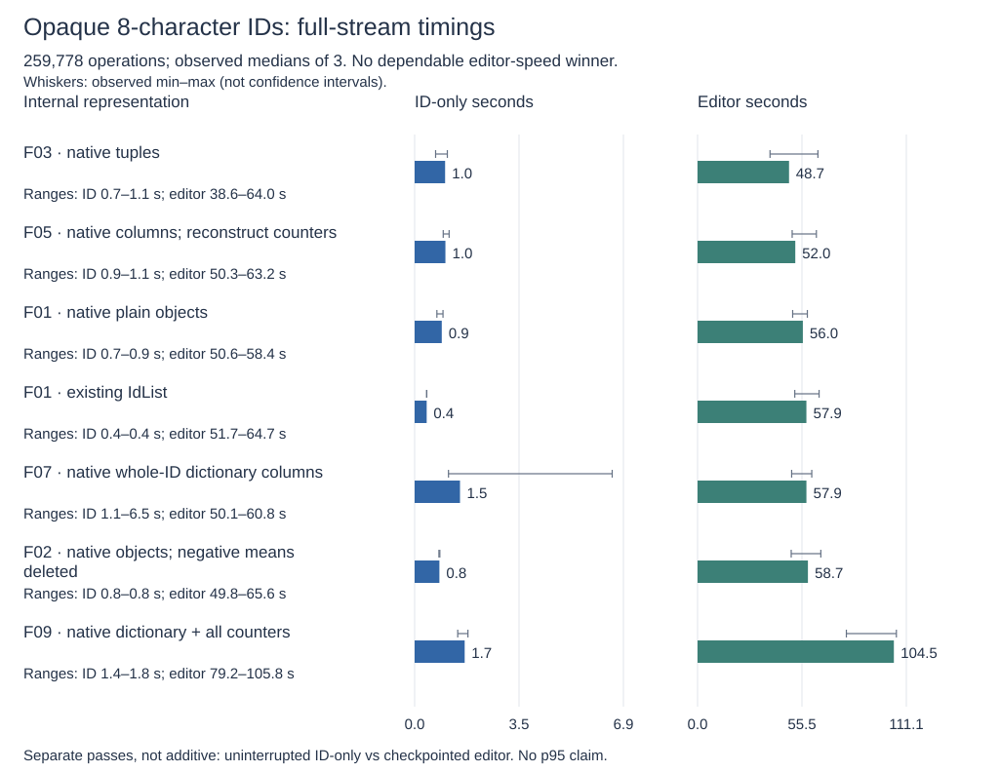

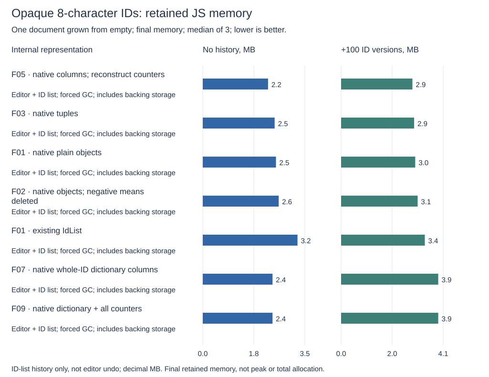

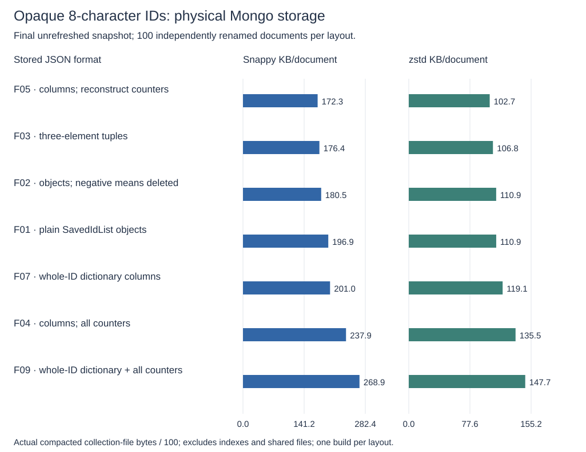

### Three priorities, three bounded conclusions

1. **Editing speed: no demonstrated winner.** F03 · native tuples has the lowest observed editor median: 48.7 [38.6–64.0] seconds, versus 57.9 [51.7–64.7] for existing IdList. Host/runtime variability and three trials prevent a dependable speed recommendation from these rankings. The separate persisted-document load test answers a different question.
2. **Editing memory:** native F05 retains 2.24 MB without history, versus 3.25 MB for existing IdList. With 100 ID-list versions, F05 · native columns; reconstruct counters has the lowest median, but F05 and F03 are practically close: 2.864 and 2.933 MB, versus 3.362 MB for existing IdList. Do not turn that small F05/F03 difference into a categorical winner. This is not full ProseMirror/application undo memory.
3. **Mongo storage:** F05 · columns; reconstruct counters is smallest under Snappy in this canonical opaque-ID snapshot: 172.3 KB/document; its zstd result is 102.7 KB. Use the corresponding replay row to judge the browser tradeoff separately. The zstd column is a measurement, not a claim that Atlas compression can be changed without operational work.

These conclusions cover one initially empty document, one canonical trace, and these implementations. They do not replace the separate persisted-document load/render benchmark. Native candidates implement the measured API subset, not every IdList operation; all native replay candidates use owned 128-run pages. F01 native rows retain immutable row objects while owning page arrays; column variants own their primitive page columns. These are exploratory implementations, not production migration recommendations.

<details>
<summary>Opaque-ID history timing and memory ranges</summary>

| Internal representation                      | Editor +100 versions, seconds [range] | JS MB no history [range] | JS MB +100 versions [range] | JS MB after releasing history [range] |
| -------------------------------------------- | ------------------------------------: | -----------------------: | --------------------------: | ------------------------------------: |
| F03 · native tuples                          |                      50.6 [44.9–62.8] |            2.5 [2.5–2.5] |               2.9 [2.9–2.9] |                         2.5 [2.5–2.5] |
| F05 · native columns; reconstruct counters   |                      63.5 [59.1–78.1] |            2.2 [2.2–2.2] |               2.9 [2.9–2.9] |                         2.2 [2.2–2.3] |
| F01 · native plain objects                   |                      52.0 [49.3–66.9] |            2.5 [2.5–2.5] |               3.0 [3.0–3.0] |                         2.5 [2.5–2.5] |
| F01 · existing IdList                        |                      60.0 [48.8–79.2] |            3.2 [3.2–3.2] |               3.4 [3.4–3.4] |                         3.2 [3.2–3.2] |
| F07 · native whole-ID dictionary columns     |                      60.3 [52.3–61.8] |            2.4 [2.4–2.4] |               3.9 [3.9–3.9] |                         2.4 [2.4–2.4] |
| F02 · native objects; negative means deleted |                      61.5 [55.3–61.9] |            2.6 [2.6–2.6] |               3.1 [3.1–3.1] |                         2.6 [2.6–2.6] |
| F09 · native dictionary + all counters       |                      52.3 [42.0–55.9] |            2.4 [2.4–2.4] |               3.9 [3.9–3.9] |                         2.4 [2.4–2.4] |

</details>

### Native F08 results

**Native F08 is implemented and measured, not pending.** Both flat-page and indexed-page versions completed all full-stream trials with structured IDs. In that same structured-ID workload, median ID-only times were 456.0 ms for existing IdList, 1126.6 ms for native F05, 2263.7 ms for native F08 flat pages, and 2252.7 ms for native F08 indexed pages. Expand the table for ranges, editor timing, memory and both Mongo compressors; these are not opaque-ID results.

<details>
<summary>Structured client_sequence IDs — separate comparison, including F08</summary>

F08 can split these IDs into clients and sequence numbers. It cannot losslessly apply that assumption to arbitrary opaque eight-character IDs. Do not transfer this model’s F08 result to the opaque-ID recommendation.

| Internal representation                       | ID lookup + mutation, seconds [range] | Editor seconds [range] | JS MB: no history / +100 versions | Mongo KB: Snappy / zstd |
| --------------------------------------------- | ------------------------------------: | ---------------------: | --------------------------------: | ----------------------: |
| F05 · native columns; reconstruct counters    |                         1.1 [0.9–1.1] |       49.5 [38.2–57.4] |                         2.3 / 2.9 |            149.0 / 78.0 |
| F03 · native tuples                           |                         0.8 [0.6–1.0] |       52.1 [51.5–60.6] |                         2.5 / 3.0 |            143.6 / 82.2 |
| F08 · native client dictionary; indexed pages |                         2.3 [1.9–2.6] |       53.6 [41.5–66.6] |                         3.3 / 3.9 |            184.6 / 82.2 |
| F09 · native dictionary + all counters        |                         1.5 [1.5–2.3] |       56.8 [40.0–59.4] |                         2.4 / 3.9 |           237.9 / 119.1 |
| F02 · native objects; negative means deleted  |                         0.8 [0.8–3.8] |       59.0 [49.7–61.2] |                         2.6 / 3.1 |            151.8 / 82.2 |
| F01 · native plain objects                    |                         0.9 [0.7–1.3] |       59.0 [47.3–59.6] |                         2.6 / 3.0 |            164.1 / 82.2 |
| F07 · native whole-ID dictionary columns      |                         1.6 [1.5–2.6] |       59.5 [58.3–70.7] |                         2.4 / 3.9 |            172.3 / 90.4 |
| F08 · native client dictionary; flat pages    |                         2.3 [2.3–2.4] |       60.6 [57.7–67.4] |                         2.3 / 3.0 |            184.6 / 82.2 |
| F01 · existing IdList                         |                         0.5 [0.4–1.4] |      80.4 [48.4–119.2] |                         3.3 / 3.4 |            164.1 / 82.2 |

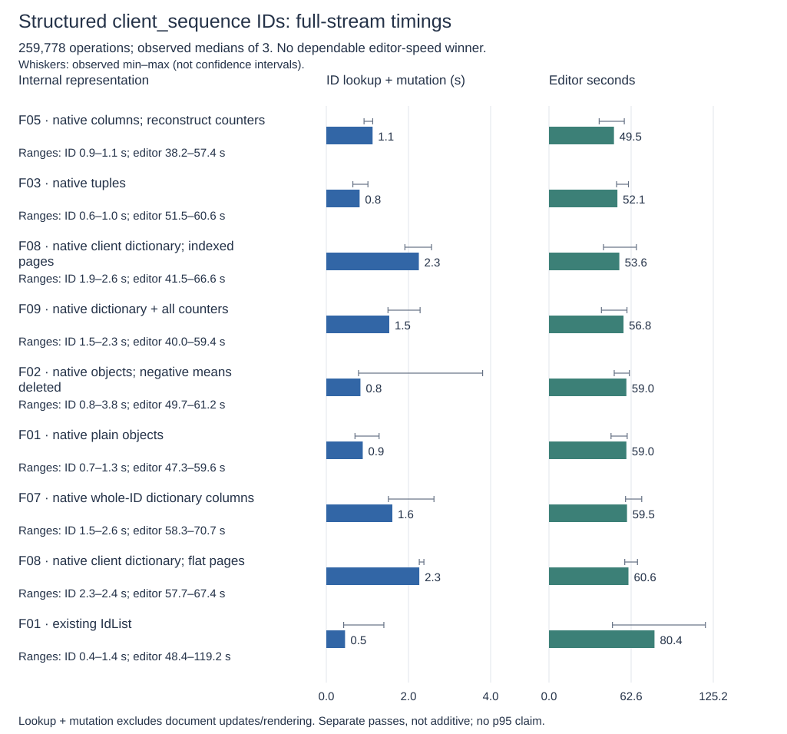

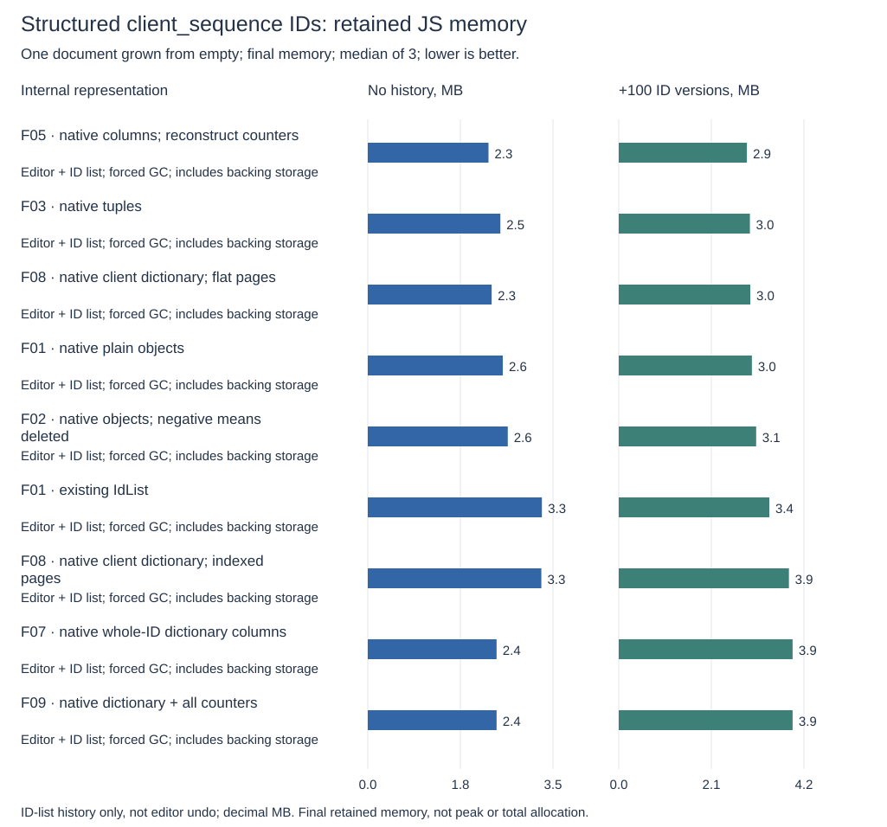

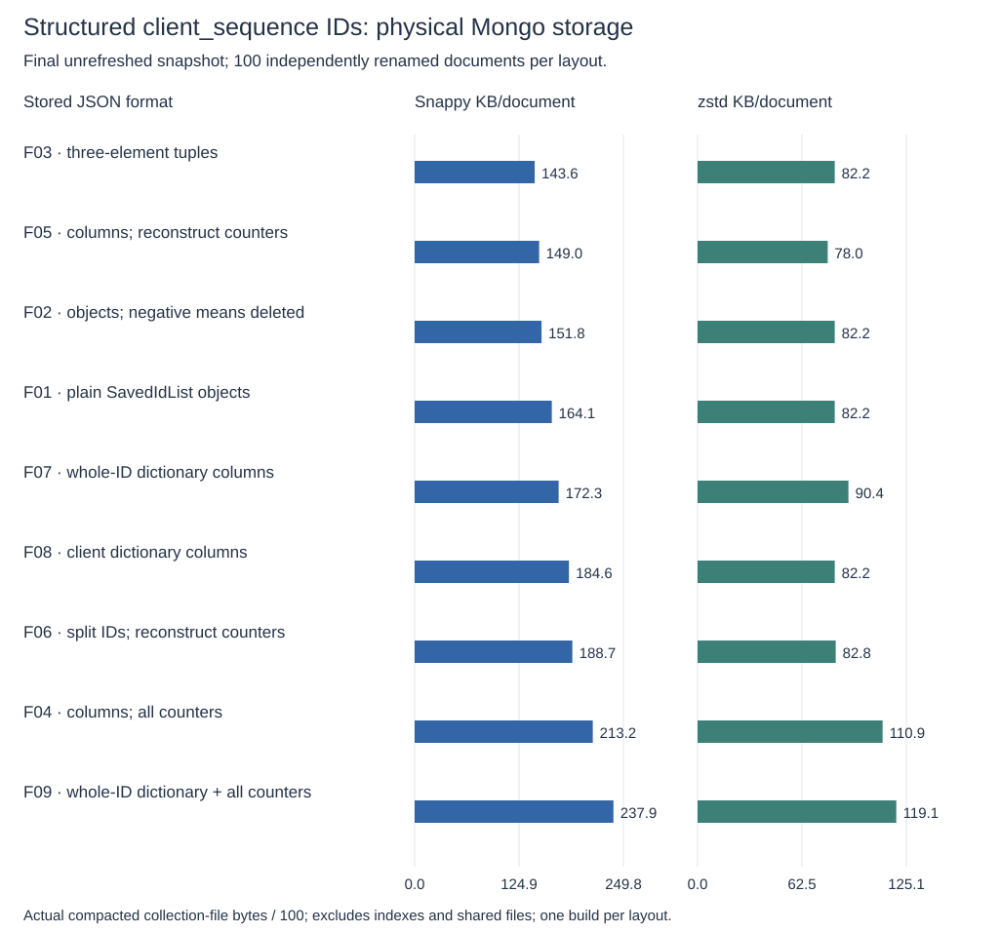

| Internal representation                       | Editor +100 versions, seconds [range] | JS MB no history [range] | JS MB +100 versions [range] | JS MB after releasing history [range] |
| --------------------------------------------- | ------------------------------------: | -----------------------: | --------------------------: | ------------------------------------: |
| F05 · native columns; reconstruct counters    |                      51.1 [50.2–53.5] |            2.3 [2.3–2.3] |               2.9 [2.9–2.9] |                         2.3 [2.3–2.3] |
| F03 · native tuples                           |                      50.7 [49.7–53.2] |            2.5 [2.5–2.5] |               3.0 [3.0–3.0] |                         2.5 [2.5–2.5] |
| F08 · native client dictionary; indexed pages |                     56.4 [52.8–118.7] |            3.3 [3.3–3.3] |               3.9 [3.9–3.9] |                         3.3 [3.3–3.3] |
| F09 · native dictionary + all counters        |                      79.1 [55.4–91.3] |            2.4 [2.4–2.4] |               3.9 [3.9–3.9] |                         2.4 [2.4–2.4] |
| F02 · native objects; negative means deleted  |                    105.2 [60.2–108.1] |            2.6 [2.6–2.6] |               3.1 [3.1–3.1] |                         2.6 [2.6–2.6] |
| F01 · native plain objects                    |                      58.8 [58.3–82.1] |            2.6 [2.6–2.6] |               3.0 [3.0–3.0] |                         2.6 [2.5–2.6] |
| F07 · native whole-ID dictionary columns      |                      52.0 [44.0–54.1] |            2.4 [2.4–2.4] |               3.9 [3.9–3.9] |                         2.4 [2.4–2.4] |
| F08 · native client dictionary; flat pages    |                      73.4 [61.5–85.2] |            2.3 [2.3–2.3] |               3.0 [3.0–3.0] |                         2.3 [2.3–2.3] |
| F01 · existing IdList                         |                      53.1 [41.9–63.6] |            3.3 [3.3–3.3] |               3.4 [3.4–3.4] |                         3.3 [3.3–3.3] |

</details>

<details>
<summary>Canonical methodology, validation, source hashes and reproduction</summary>

- **ID-only:** one uninterrupted clock around all operations; natural GC, no per-operation timers or yields. Actual at(index) navigation and mutations are timed. Identity generation, input preparation, initialization and final checking are outside the clock. There is no editor in this pass.
- **Identity allocation:** counters and ID values are precomputed equally for all containers. Each insertion allocates the same small ID object inside the timed loop; a continuation reuses the actual anchor’s bunchId string, like ElementIdGenerator. Reference preparation proves that every non-anchor bunch is globally new and every continuation uses its next counter. There is no retained intern pool or generator-policy Map in the browser. Serialized trace inputs still produce common transient garbage; this is not a measurement of live ID-generator allocation costs.
- **Editor:** every operation dispatches an incremental ProseMirror transaction, including paragraph splits/joins. Shared paragraph mapping, anchor/target checking and ID-history maintenance are included. Time is the sum of five segments with two animation frames at each checkpoint, not per-keystroke paint latency. Full verification and forced GC between segments are excluded.
- **Memory and GC:** observations after 10,000, 50,000, 100,000, 200,000 and 259,778 operations use JS heap plus backing storage after forced GC, minus the prepared-page baseline. Trace arguments/reference states are released before measurement. Charts show the final checkpoint, not a peak. Before-GC observations include discarded input garbage, so they are not pure container allocation or peak-memory measurements. The +100 condition retains the latest 100 prior ID-list versions only. Releasing history is separately measured. Natural GC contributes to elapsed time, but this canonical harness does not measure GC-pause durations or collection counts separately.
- **Mongo:** MongoDB 8.3.3, 100 independently renamed documents per layout, final unrefreshed snapshot only. Each collection is compacted, checkpointed, compacted again and fsynced with a lock; its actual .wt file length equals storageSize and its compressor is verified. Index/shared-file bytes are excluded. One storage build per layout, not repeated statistical trials; this is fresh insertion of the final snapshot, not physical fragmentation from replaying Mongo updates. All stored JSON formats are shown in the storage charts, including ones absent from the runtime replay subset.
- **Validation:** 144 complete replays: structured 9 containers + opaque 7, each with 3 ID-only trials and 3 editor trials for each history condition. Full final SavedIdList and sampled lookup checks pass; every editor checkpoint also checks full saved state and exact rendered text. Runtime: 151.0.7922.34; v24.19.0; Apple M5 Pro; darwin/arm64; explicit CPU rate 1×. Per-job timestamps and host load averages are retained for diagnosis; they do not measure thermal throttling and no outliers are discarded.
- **Hashes:** vendored trace `3af48f64f4ff18a09ec2cc21570accccfa912cffa702b45181ab383502bfe176`; canonical operation stream `1fc4e3f3a44299a7cf11d63abef214a45df9b4dc96765f5cc001f16c121deebc`; final text `a489e9022976c14e46627aea174d07797edcb3fd17df42605956d4cf01bf9039`; pinned upstream source `23116070719243e2950c310006dd50b3d80744be7542a86c62e7d5c2ed7326d0`. Upstream JS was inspected as JSON-compatible literals, never executed; offline runs recompute matching operation/text digests.
- **Executed browser bundle:** SHA-256 `3fed8faedae5c9ac9334db9d2720a37ddedffa04a0fe96e9a58ce48465b438ee`; recorded before the replay starts so the raw results identify the actual loaded implementation.

```sh
TSX_TSCONFIG_PATH=benchmarks/tsconfig.dev.json node --import tsx benchmarks/src/browser/canonical-run.ts
```

Run timings alone, with no competing benchmark processes. Default: both identity models, three trials, ID-only and editor passes, and 0/100 history. The runner refuses an existing canonical.json. Optional CANONICAL_UPSTREAM_PATH points to the pinned source downloaded as data for a fresh literal-only comparison. For storage, use the isolated local Mongo setup documented below with ARTICULATED_EXPLORATION_FIXTURE=canonical and ARTICULATED_EXPLORATION_DATASET=structured or opaque8; never point it at Atlas or another existing database.

[Raw canonical replay](results/exploration/canonical.json) · [Canonical structured Mongo](results/exploration/canonical-mongo.json) · [Canonical opaque Mongo](results/exploration/canonical-mongo-opaque8.json) · [Replay runner](src/browser/canonical-run.ts) · [Reference/provenance](src/browser/canonical-workload.ts) · [Storage runner](src/browser/exploration-mongo.ts)

</details>

<details><summary>Broader structured-ID sweep: all formats, page sizes, ownership and indexing</summary>

## Broader comparison: structured IDs, four open editors

The charts below are the primary view. Names identify two independent choices: **F01–F09 is the stored/interchange shape**; the rest describes the editable browser container.

| Chart label                | Plain-language meaning                                                                                                                                      |
| -------------------------- | ----------------------------------------------------------------------------------------------------------------------------------------------------------- |
| existing IdList            | Convert the stored shape if needed, then use Matthew’s existing library container.                                                                          |
| native rows / flat columns | Edit objects, tuples or columns directly in small pages; a flat page directory provides navigation.                                                         |
| page tree                  | Edit column pages with a persistent order tree and global numeric identity index.                                                                           |
| shared / owned             | Shared pages retain views into input arrays; owned pages have independent page arrays, not universally deep-copied input. See the ownership contract below. |
| 64 / 128 / 256             | Maximum runs per page—not IDs, characters, bytes or document count.                                                                                         |

### What ‘native’ means—and what still has to be translated

**Native F05/F08 keeps the chosen columns as the editable run storage; it does not reconstruct SavedIdList objects and then call IdList.load(). But it is not the literal interchange object with zero work.** Loading validates data, reconstructs an explicit start counter for every run into a sidecar array, and builds navigation indexes. Owned variants also copy the run columns into independently allocated pages. After editing, exporting F05/F08 flattens those pages and recomputes sparse counter exceptions. These load and export costs are measured, not treated as free.

| Native container                                   | Editable data retained                                                                                       | Additional in-memory state                                                                                                                                                  |
| -------------------------------------------------- | ------------------------------------------------------------------------------------------------------------ | --------------------------------------------------------------------------------------------------------------------------------------------------------------------------- |
| F01 objects (also F02 signed objects / F03 tuples) | Original row shape, including each explicit start counter                                                    | Per-page ID → row maps, visible lengths and a flat prefix index; no reconstructed counter sidecar.                                                                          |
| F05 columns                                        | Whole-ID bunchIds and signed counts columns                                                                  | Float64 start counter per run, per-page whole-ID → row maps, visible lengths and flat prefixes.                                                                             |
| F07 / F09 dictionary columns                       | Whole-ID dictionary, numeric bunchIndices, signed counts; F09 also retains its explicit startCounters column | Dictionary lookup map, per-page numeric-ID → row maps, visible lengths and flat prefixes. F07 reconstructs a Float64 counter sidecar; F09 uses its existing counter column. |
| F08 flat columns                                   | Client dictionary, numeric clientIndices, seqNums and signed counts                                          | Float64 counter sidecar, derived whole-ID strings in per-page ID → row maps, visible lengths and flat prefixes.                                                             |
| F08 page tree                                      | The same F08 run columns in pages                                                                            | Float64 counter sidecar, client lookup, numeric identity-range index, order tree with visible lengths, and persistent page/parent directories.                              |

Thus the question measured here is **column-/row-native storage plus its required indexes versus translation into the existing IdList container**—not ‘JSON with no initialization’ versus a tree. Snapshot JSON and editable memory share the run representation, but are not byte-for-byte identical layouts. The production IdList internals are not secretly present in native cases.

<details><summary>Exact primary results: 13 fixed cases, sorted by ready p95</summary>

| Interchange → internal container | Ready p95 ms | After 2,000 edits MB | With 100 ID versions MB | 2,000 distributed ID ops ms | Mongo KB/doc: Snappy / zstd |
| -------------------------------- | -----------: | -------------------: | ----------------------: | --------------------------: | --------------------------: |
| F09 · flat columns · owned 128   |         41.6 |                  5.4 |                     6.0 |                        30.0 |               246.0 / 127.3 |
| F05 · flat columns · owned 128   |         41.7 |                  5.0 |                     5.6 |                        29.4 |                155.9 / 82.1 |
| F07 · flat columns · owned 128   |         41.7 |                  5.5 |                     6.2 |                        31.9 |                176.4 / 94.4 |
| F08 · flat columns · shared 128  |         41.7 |                  5.5 |                     6.3 |                        38.9 |                188.7 / 74.5 |
| F03 · native rows · owned 128    |         41.7 |                  6.1 |                     6.6 |                        27.7 |                161.4 / 86.3 |
| F08 · flat columns · owned 128   |         41.9 |                  5.0 |                     5.6 |                        63.7 |                188.7 / 74.5 |
| F02 · native rows · owned 128    |         42.0 |                  5.9 |                     6.4 |                        27.7 |                168.2 / 86.3 |
| F01 · native rows · owned 128    |         42.7 |                  5.9 |                     6.4 |                        30.0 |                182.1 / 86.3 |
| F08 · page tree · owned 128      |         42.7 |                  7.9 |                     8.4 |                        40.6 |                188.7 / 74.5 |
| F01 → existing IdList            |         58.1 |                  8.7 |                     8.8 |                        18.6 |                182.1 / 86.3 |
| F03 → existing IdList            |         58.3 |                  8.7 |                     8.8 |                        18.2 |                161.4 / 86.3 |
| F08 → existing IdList            |         58.3 |                  7.8 |                     8.0 |                        18.6 |                188.7 / 74.5 |
| F05 → existing IdList            |         58.5 |                  7.8 |                     8.0 |                        21.9 |                155.9 / 82.1 |

Fastest ready p95 is first. Editing columns are medians after 2,000 distributed operations on one editor; three other editors stay open. Mongo is the **initial structured-ID snapshot**, per document, and is identical for different internal implementations of the same F-format. MB and KB are decimal. Memory includes the editor/model, not only IDs. No single score combines unlike units.

</details>

## Load → editable list → rendered document: structured IDs

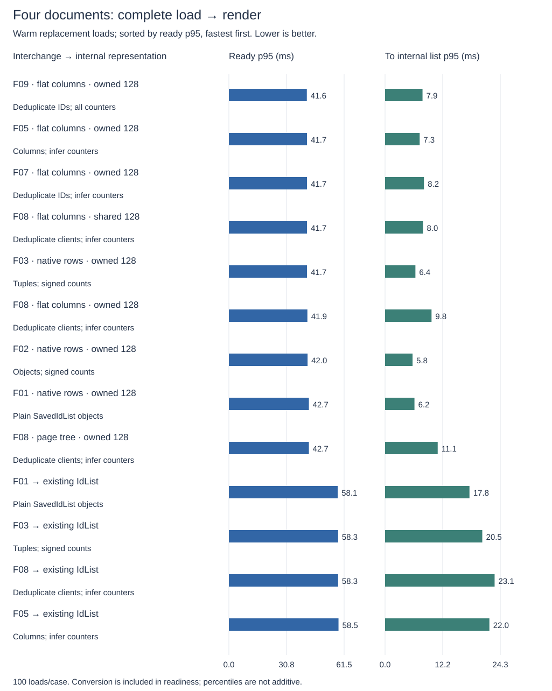

The primary chart is **100 warm replacement loads per case**, not cold first opening: replacing an existing editor includes its teardown. Ready includes decoding, conversion, validation, ownership copies, indexing, editor construction, layout and a rendering opportunity. The internal-list interval is measured around the actual loader and is already included in readiness. There is no separate constant-layout bar and no hidden prebuilt ID list. Five first-load samples from fresh browser contexts and the separate first-edit p95 are exposed in the collapsed full metrics below. Ready is a two-animation-frame proxy, not physical display scan-out or a production application startup measurement.

**Read the groups, not tiny rank changes:** 18 configurations fall between 41.6 and 42.5 ms ready p95. The sorted chart is the requested ranking, not evidence that every adjacent row is meaningfully faster. Compare conversion cost alongside readiness, then editing/memory/storage; percentiles from different phases cannot be added or subtracted as if they came from one load.

## JS memory during editing: structured IDs

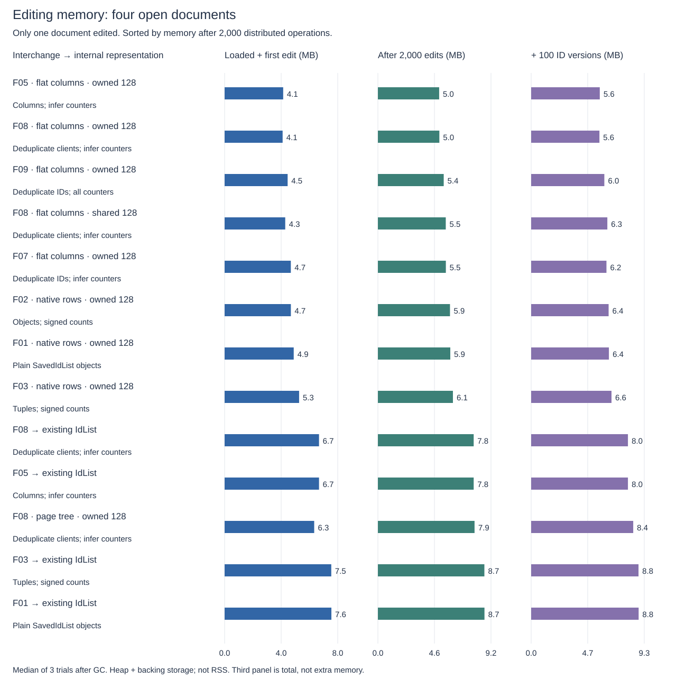

All three panels come from the session harness: loaded after the first edit, after 2,000 distributed operations without history, and after the same trajectory with 100 prior **ID-list versions** retained. The third panel is a total—not memory to add to the second. Heap plus ArrayBuffer backing storage is measured after forced GC, relative to an empty warmed harness. Workload/reference data are not retained between browser calls. This is not total renderer RSS, exact peak usage, or full ProseMirror undo history.

**Checkpoint GC changes the experiment:** the document state persists through all 2,000 operations, but forced collection occurs at load and the 200/1,000/2,000 checkpoints, outside timed segments. This measures sustained editing state and retained memory—not one uninterrupted session with only naturally scheduled GC. Natural collections within each timed segment still count toward its duration.

Independent pages address lifetime retention, not just load allocation: shared pages may keep document-sized source arrays alive after many rows have been replaced. Owned column pages copy bounded numeric/string-reference arrays during load and let obsolete pages be collected. Both kinds still build indexes; ‘native’ does not mean no derived state or zero work.

**Ownership contract:** decoded input is read-only/transferred to the container; these prototypes do not universally promise isolation from later caller mutation. Native object/tuple pages own the page arrays but reuse immutable row objects/tuples. Owned flat F08 pages copy numeric columns but still share the input clientIds dictionary. Owned F05 pages copy their primitive columns; owned F07/F09 pages also copy their whole-ID dictionary. The F08 page tree copies its client dictionary in both modes. ‘Owned’ is therefore a page-storage strategy, not a blanket deep-clone or deep-freeze guarantee.

### Retained history changes the answer when new IDs keep arriving

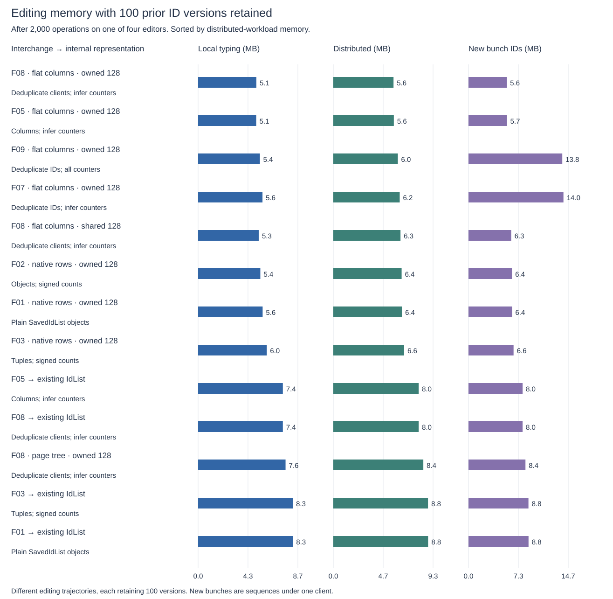

**Counterexample to choosing on distributed edits alone:** with new bunches and 100 retained ID versions, F07 owned-128 used **14.0 MB** and F09 owned-128 **13.8 MB**, versus **5.7 MB** for F05 owned-128 and 8.8 MB for plain SavedIdList → IdList. F07/F09 copy the whole-ID dictionary and lookup map when adding an identity; retaining old versions also retains earlier copies. That retained-version cost materially changes the memory tradeoff in this workload.

Each panel is a different 2,000-operation trajectory with 100 previous ID-list versions retained; values are total retained JS across four editors. New bunches means many sequences under one client, not many distinct F08 clients. Local/distributed workloads reuse one new whole ID, whereas new-bunches keeps extending the whole-ID dictionary. Keeping only the latest version can release earlier copies; retaining versions cannot. This chart therefore tests a different allocation/retention pressure, not just a new random edit position.

## Editing speed, including navigation: structured IDs

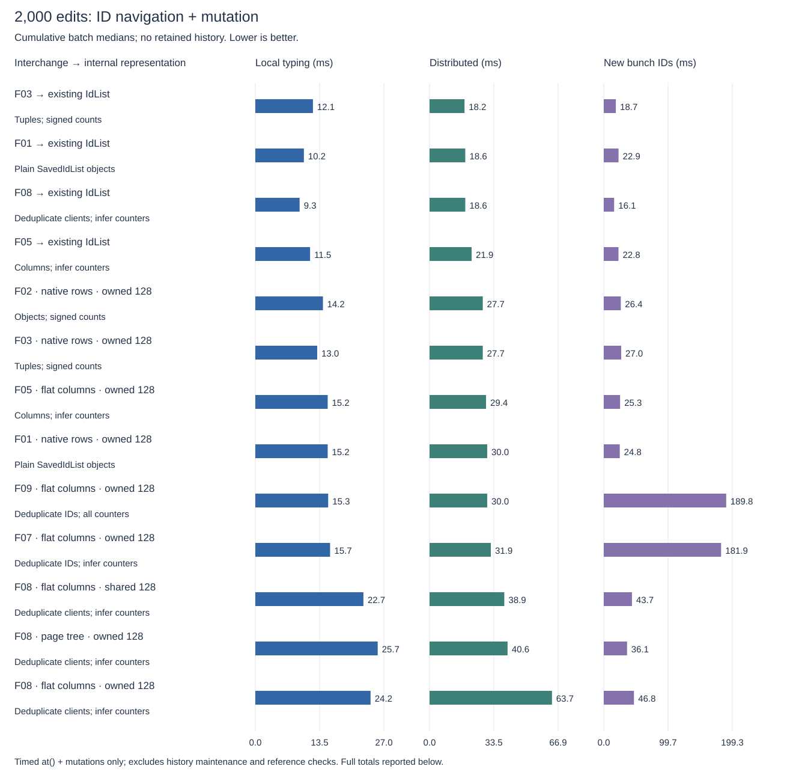

Each real operation derives its anchor/target using the current list’s at() and applies an immutable mutation; the reference ID is checked. Every operation also dispatches an incremental ProseMirror insertion/deletion. The chart isolates ID navigation + mutation; the table below includes the whole editor loop and rendering opportunities. No paragraph separators are deleted. Local typing performs bursts of 40 inserts and 10 backspaces. Distributed edits alternate inserts/deletes across the document. New-bunches uses distributed positions but introduces a new bunch identity on each insertion, exposing dictionary-growth costs.

**New bunches are not new clients:** that workload creates sequence numbers under one client, such as session-new-bunches_0, session-new-bunches_2 and session-new-bunches_4. F07/F09 therefore grow their whole-ID dictionaries, whereas F08 adds only one client entry and varies its numeric sequence column. It does not test sustained growth in the number of distinct F08 clients.

**Timing boundaries:** listMs sums only the timed at() + insertAfter/delete calls. It excludes retaining/evicting history versions, reference-ID validation, ProseMirror transactions, text-offset mapping and forced checkpoint GC. A natural collection that runs inside one of those timed calls is included, but GC occurring elsewhere in the editor loop is not. totalMs includes the entire segment loop—including history maintenance, reference checks, PM/common mapping, naturally occurring GC and checkpoint rendering—but still excludes forced collection performed between segments. The ID-only chart is not all work induced by a container or its allocations; read it alongside total time and retained memory.

Checkpoints occur after 200, 1,000 and 2,000 operations; their segment lengths are 200, 800 and 1,000. Reported session time **sums those segments**. Two animation frames occur per checkpoint, not per keystroke. Three trials support medians and ranges—not editing p95 or statistical-significance claims. The common paragraph-offset mapping and editor work can dominate total time; the ID-only columns show whether changing the container matters within that cost.

**Same implementation is not a new algorithm:** all F01–F09 → existing IdList rows use the same editing container. Small timing differences among those rows can reflect string representation, JIT history and noise; they are not evidence that an F06 adapter invented a faster editor. F01 → IdList is the unchanged editing control below.

| Structured-ID container        | 2,000 distributed ID calls ms | Batch / 2,000, µs per operation | Editor-inclusive 2,000-op total ms |
| ------------------------------ | ----------------------------: | ------------------------------: | ---------------------------------: |
| F01 → existing IdList          |                          18.6 |                             9.3 |                              162.0 |
| F05 · flat columns · owned 128 |                          29.4 |                            14.7 |                              169.9 |
| F08 · flat columns · owned 128 |                          63.7 |                            31.8 |                              249.9 |
| F08 · page tree · owned 128    |                          40.6 |                            20.3 |                              226.7 |

For example, F05 owned-128’s ID-call batch differed from the existing IdList control by **10.8 ms across 2,000 operations**, or **5.4 µs per operation when averaged over the batch**. This is not measured individual-event latency, a per-keystroke percentile or a claim that responsiveness changes by that amount. Editor-inclusive totals are separately measured, not inferred by adding phase medians.

<details><summary>Primary cases: cumulative editor-inclusive session time (median [min–max] ms)</summary>

| Container                       | Local typing, total ms | Distributed, total ms | New bunches, total ms |
| ------------------------------- | ---------------------: | --------------------: | --------------------: |
| F09 · flat columns · owned 128  |    148.6 [147.7–185.4] |   173.3 [170.9–177.0] |   334.4 [316.1–401.6] |
| F05 · flat columns · owned 128  |    151.5 [150.7–155.2] |   169.9 [169.8–172.4] |   168.8 [166.1–169.1] |
| F07 · flat columns · owned 128  |    152.2 [150.9–153.2] |   175.6 [172.0–179.1] |   323.6 [313.5–323.8] |
| F08 · flat columns · shared 128 |    156.6 [155.8–157.4] |   185.1 [184.9–228.3] |   192.1 [184.7–215.7] |
| F03 · native rows · owned 128   |    148.5 [147.4–149.8] |   170.3 [169.9–171.7] |   170.4 [170.1–170.9] |
| F08 · flat columns · owned 128  |    160.0 [159.9–160.4] |   249.9 [203.0–296.4] |   188.1 [186.2–247.3] |
| F02 · native rows · owned 128   |    148.1 [147.9–180.0] |   172.1 [170.4–218.1] |   169.8 [169.2–170.3] |
| F01 · native rows · owned 128   |    152.7 [149.9–187.1] |   183.7 [175.6–337.0] |   170.8 [170.3–173.5] |
| F08 · page tree · owned 128     |    164.3 [161.3–165.2] |   226.7 [176.6–229.6] |   183.5 [178.7–222.8] |
| F01 → existing IdList           |    150.4 [143.8–213.1] |   162.0 [161.1–165.1] |   202.9 [162.0–206.5] |
| F03 → existing IdList           |    182.2 [143.7–231.4] |   162.3 [160.9–162.5] |   163.6 [162.5–193.4] |
| F08 → existing IdList           |    145.6 [142.8–148.1] |   162.0 [161.1–162.7] |   161.8 [160.4–162.5] |
| F05 → existing IdList           |    145.7 [144.7–146.2] |   175.0 [161.4–200.3] |   192.0 [162.2–207.1] |

These totals include ID navigation/mutation, history maintenance, reference-ID validation, incremental PM transactions, common text-offset mapping, natural GC within the segment and checkpoint rendering. Forced collection between segments is excluded. They are not per-keystroke response times.

</details>

## Mongo storage is a separate decision

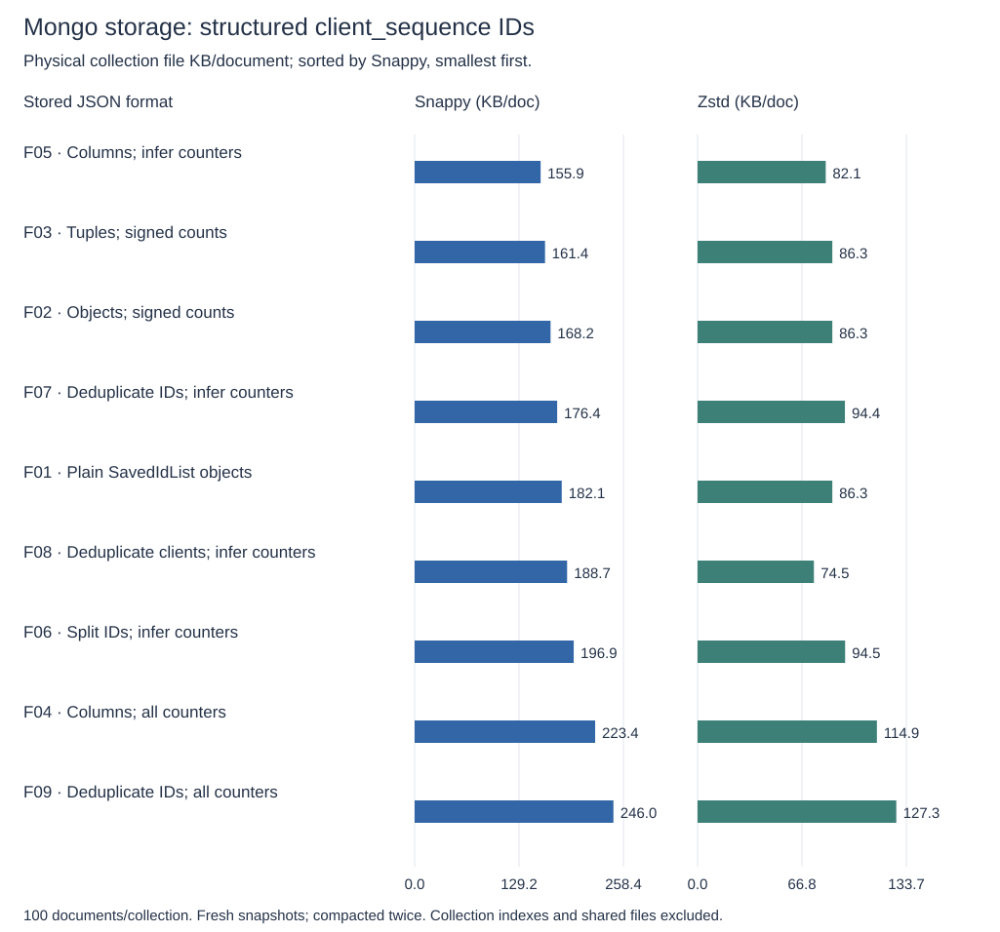

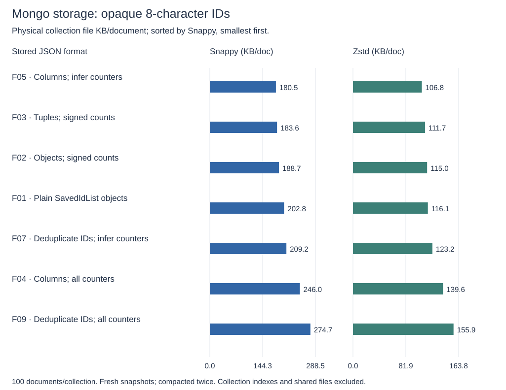

Measured Mongo 8.3.3 collection files, not JSON estimates. Each layout/compressor/snapshot uses 100 freshly inserted documents with independently renamed IDs. Collections were compacted, checkpointed, compacted again, then measured during locked filesystem sync; actual .wt file length matched storageSize and the configured compressor was checked. Collection allocation/free space is included; _id indexes and shared database files are excluded. This is one physical build per choice, not repeated statistical samples.

The structured corpus renames client dictionaries while preserving client_sequence structure. The opaque corpus remaps whole IDs to independent collision-checked 8-character base64url hash strings; it preserves run/counter shape but is not a production nanoid corpus. Both the initial and post-200-edit snapshots are freshly inserted into separate collections. Post-edit numbers measure snapshot shape, **not** in-place update fragmentation or compaction savings on Atlas. No production database was accessed or changed.

<details><summary>Exact physical Mongo sizes: initial and post-200-edit snapshots</summary>

### Structured IDs

| Stored format                             | Initial Snappy KB/doc | After edits Snappy KB/doc | Initial Zstd KB/doc | After edits Zstd KB/doc |
| ----------------------------------------- | --------------------: | ------------------------: | ------------------: | ----------------------: |
| F01 · Plain SavedIdList objects           |                 182.1 |                     188.7 |                86.3 |                    86.6 |
| F02 · Objects; signed counts              |                 168.2 |                     172.3 |                86.3 |                    91.1 |
| F03 · Tuples; signed counts               |                 161.4 |                     164.1 |                86.3 |                    86.3 |
| F04 · Columns; all counters               |                 223.4 |                     231.7 |               114.9 |                   119.1 |
| F05 · Columns; infer counters             |                 155.9 |                     160.0 |                82.1 |                    86.3 |
| F06 · Split IDs; infer counters           |                 196.9 |                     205.1 |                94.5 |                    98.6 |
| F07 · Deduplicate IDs; infer counters     |                 176.4 |                     184.6 |                94.4 |                    98.6 |
| F08 · Deduplicate clients; infer counters |                 188.7 |                     196.9 |                74.5 |                    78.1 |
| F09 · Deduplicate IDs; all counters       |                 246.0 |                     250.1 |               127.3 |                   131.4 |

### Opaque 8-character IDs

| Stored format                         | Initial Snappy KB/doc | After edits Snappy KB/doc | Initial Zstd KB/doc | After edits Zstd KB/doc |
| ------------------------------------- | --------------------: | ------------------------: | ------------------: | ----------------------: |
| F01 · Plain SavedIdList objects       |                 202.8 |                     209.2 |               116.1 |                   119.1 |
| F02 · Objects; signed counts          |                 188.7 |                     192.8 |               115.0 |                   119.1 |
| F03 · Tuples; signed counts           |                 183.6 |                     188.7 |               111.7 |                   115.9 |
| F04 · Columns; all counters           |                 246.0 |                     254.2 |               139.6 |                   143.6 |
| F05 · Columns; infer counters         |                 180.5 |                     186.2 |               106.8 |                   110.9 |
| F07 · Deduplicate IDs; infer counters |                 209.2 |                     213.3 |               123.2 |                   127.3 |
| F09 · Deduplicate IDs; all counters   |                 274.7 |                     282.9 |               155.9 |                   155.9 |

</details>

## What the first-principles alternatives actually bought us

The hypotheses were tested as implementations, not inferred from the interchange shape. The page-tree design keeps native F08 columns but separates identity, order, visibility and immutable versions. A numeric interval index locates a stable page; an order tree stores visible lengths; versioned page/parent maps preserve prior versions. A deletion without a page split reuses its identity ranges and global identity index because visibility changed but ownership did not. That removes global chunk scans/prefix rebuilds, but adds persistent-index overhead.

<details><summary>Ownership, page size and global-index experiments: exact numbers</summary>

| Experiment                      | Ready p95 ms | Distributed ID ops ms | Edited MB | With 100 ID versions MB |
| ------------------------------- | -----------: | --------------------: | --------: | ----------------------: |
| F05 · flat columns · shared 128 |         41.6 |                  26.6 |       5.2 |                     5.9 |
| F05 · flat columns · owned 64   |         41.7 |                  30.4 |       5.1 |                     5.8 |
| F05 · flat columns · owned 128  |         41.7 |                  29.4 |       5.0 |                     5.6 |
| F05 · flat columns · owned 256  |         41.7 |                  39.1 |       4.9 |                     5.8 |
| F08 · flat columns · shared 128 |         41.7 |                  38.9 |       5.5 |                     6.3 |
| F08 · flat columns · owned 64   |         42.2 |                  51.8 |       5.1 |                     5.8 |
| F08 · flat columns · owned 128  |         41.9 |                  63.7 |       5.0 |                     5.6 |
| F08 · flat columns · owned 256  |         43.2 |                  62.9 |       4.9 |                     5.8 |
| F08 · page tree · shared 128    |         42.5 |                  33.5 |       8.1 |                     8.6 |
| F08 · page tree · owned 64      |         49.9 |                  27.3 |       8.2 |                     8.5 |
| F08 · page tree · owned 128     |         42.7 |                  40.6 |       7.9 |                     8.4 |
| F08 · page tree · owned 256     |         42.2 |                  47.9 |       7.6 |                     8.5 |

</details>

**Owned versus shared:** F08 owned-128 retained 5.0 MB after distributed editing, versus 5.5 MB shared. Load p95 was 41.9 versus 41.7 ms. F05 owned/shared measured 5.0/5.2 MB. Initial zero-copy adoption is therefore not treated as an automatic lifetime-memory win.

**Global identity index and page tree:** F08 page-tree owned-128 took 40.6 ms for 2,000 distributed ID operations, versus 63.7 ms for flat owned-128; retained memory was 7.9 versus 5.0 MB. The indexed structure improved this edit workload; its memory/load tradeoff still matters.

**Page size:** 64/128/256 runs are measured for owned F05/F08 and the F08 page tree. Smaller pages reduce copied data but increase directory/index overhead. No single page size is assumed best for load, editing and retained undo versions simultaneously. Flat directories still copy their outer page list/prefix per edit; the page tree avoids that but its persistent map navigation/update paths cost O(log² pages).

**Why not blindly pick the memory minimum?** In the structured-ID sweep, F05 owned-256 retained 4.9 MB after distributed editing versus 5.0 MB for owned-128, while its 2,000-operation ID-call time was 39.1 versus 29.4 ms. That is a memory/editing tradeoff, not a reason to declare a larger page better because its memory bar is slightly shorter. The opaque sustained-session follow-up fixes page size at 128; it does not establish an opaque-ID 64/256 optimum.

**F05 versus F08 is also practical, not just numeric:** structured-session F05 owned-128 retained 5.0 MB and took 29.4 ms for the ID-call batch; F08 flat owned-128 retained 5.0 MB and took 63.7 ms. F05 preserves arbitrary whole IDs; F08 requires changing the ID model if current IDs are opaque. A near-tied memory footprint alone does not justify that extra constraint.

**Rows are not dismissed:** native plain objects, signed-count objects and tuples use the same flat-page navigation concept as columns. Unchanged row objects can be shared across versions, whereas editing a column page copies its scalar arrays. Their results are measured alongside columns rather than declaring columns the answer in advance.

These are benchmark API subsets: length, at, indexOf with deleted-entry bias, insertAfter, delete and save/snapshot. They do not implement full insertBefore/undelete/uninsert/iterator semantics or a production editor integration. New native loaders include validation; no hidden IdList.load fallback is used. Owned input copying and eager index construction are charged to load. This is a set of possible designs, not a proposal to ship 31 containers.

These measurements are not lower bounds for each representation. One concrete remaining inefficiency: the common F07/F09 loader still allocates and writes per-ID next-counter scratch for F09 even though F09 already stores every start counter. That temporary reconstruction scratch is avoidable; it is included in the measured loader, is not an additional retained dense counter column, and was left unchanged during the frozen comparison. Other prototypes likewise may admit further optimization.

## All configurations and measurements

<details><summary>All 31 configurations: complete charts and primary comparison, ready p95 sorted</summary>

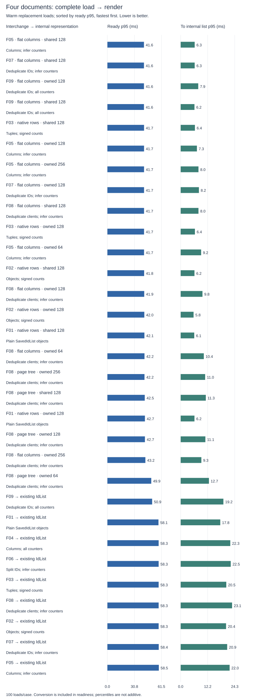

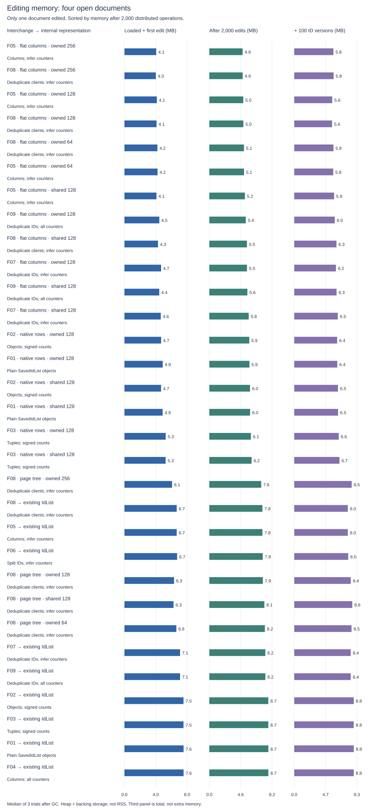

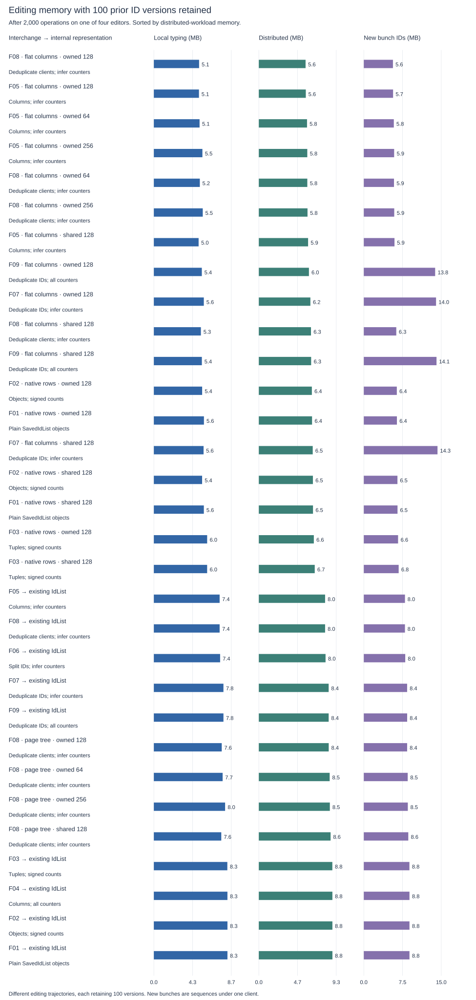

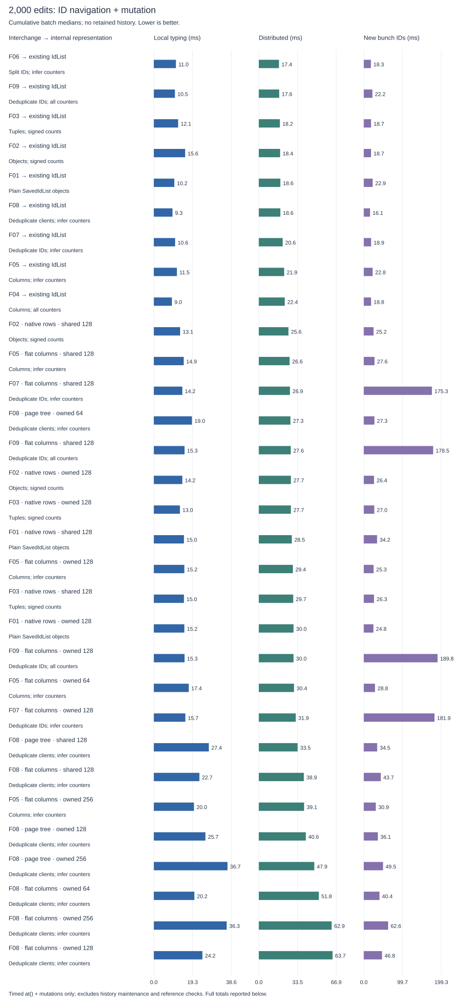

| Interchange → internal container | Ready p95 ms | After 2,000 edits MB | With 100 ID versions MB | 2,000 distributed ID ops ms | Mongo KB/doc: Snappy / zstd |
| -------------------------------- | -----------: | -------------------: | ----------------------: | --------------------------: | --------------------------: |
| F05 · flat columns · shared 128  |         41.6 |                  5.2 |                     5.9 |                        26.6 |                155.9 / 82.1 |
| F07 · flat columns · shared 128  |         41.6 |                  5.8 |                     6.5 |                        26.9 |                176.4 / 94.4 |
| F09 · flat columns · owned 128   |         41.6 |                  5.4 |                     6.0 |                        30.0 |               246.0 / 127.3 |
| F09 · flat columns · shared 128  |         41.6 |                  5.6 |                     6.3 |                        27.6 |               246.0 / 127.3 |
| F03 · native rows · shared 128   |         41.7 |                  6.2 |                     6.7 |                        29.7 |                161.4 / 86.3 |
| F05 · flat columns · owned 128   |         41.7 |                  5.0 |                     5.6 |                        29.4 |                155.9 / 82.1 |
| F05 · flat columns · owned 256   |         41.7 |                  4.9 |                     5.8 |                        39.1 |                155.9 / 82.1 |
| F07 · flat columns · owned 128   |         41.7 |                  5.5 |                     6.2 |                        31.9 |                176.4 / 94.4 |
| F08 · flat columns · shared 128  |         41.7 |                  5.5 |                     6.3 |                        38.9 |                188.7 / 74.5 |
| F03 · native rows · owned 128    |         41.7 |                  6.1 |                     6.6 |                        27.7 |                161.4 / 86.3 |
| F05 · flat columns · owned 64    |         41.7 |                  5.1 |                     5.8 |                        30.4 |                155.9 / 82.1 |
| F02 · native rows · shared 128   |         41.8 |                  6.0 |                     6.5 |                        25.6 |                168.2 / 86.3 |
| F08 · flat columns · owned 128   |         41.9 |                  5.0 |                     5.6 |                        63.7 |                188.7 / 74.5 |
| F02 · native rows · owned 128    |         42.0 |                  5.9 |                     6.4 |                        27.7 |                168.2 / 86.3 |
| F01 · native rows · shared 128   |         42.1 |                  6.0 |                     6.5 |                        28.5 |                182.1 / 86.3 |
| F08 · flat columns · owned 64    |         42.2 |                  5.1 |                     5.8 |                        51.8 |                188.7 / 74.5 |
| F08 · page tree · owned 256      |         42.2 |                  7.6 |                     8.5 |                        47.9 |                188.7 / 74.5 |
| F08 · page tree · shared 128     |         42.5 |                  8.1 |                     8.6 |                        33.5 |                188.7 / 74.5 |
| F01 · native rows · owned 128    |         42.7 |                  5.9 |                     6.4 |                        30.0 |                182.1 / 86.3 |
| F08 · page tree · owned 128      |         42.7 |                  7.9 |                     8.4 |                        40.6 |                188.7 / 74.5 |
| F08 · flat columns · owned 256   |         43.2 |                  4.9 |                     5.8 |                        62.9 |                188.7 / 74.5 |
| F08 · page tree · owned 64       |         49.9 |                  8.2 |                     8.5 |                        27.3 |                188.7 / 74.5 |
| F09 → existing IdList            |         50.9 |                  8.2 |                     8.4 |                        17.6 |               246.0 / 127.3 |
| F01 → existing IdList            |         58.1 |                  8.7 |                     8.8 |                        18.6 |                182.1 / 86.3 |
| F04 → existing IdList            |         58.3 |                  8.7 |                     8.8 |                        22.4 |               223.4 / 114.9 |
| F06 → existing IdList            |         58.3 |                  7.8 |                     8.0 |                        17.4 |                196.9 / 94.5 |
| F03 → existing IdList            |         58.3 |                  8.7 |                     8.8 |                        18.2 |                161.4 / 86.3 |
| F08 → existing IdList            |         58.3 |                  7.8 |                     8.0 |                        18.6 |                188.7 / 74.5 |
| F02 → existing IdList            |         58.3 |                  8.7 |                     8.8 |                        18.4 |                168.2 / 86.3 |
| F07 → existing IdList            |         58.4 |                  8.2 |                     8.4 |                        20.6 |                176.4 / 94.4 |
| F05 → existing IdList            |         58.5 |                  7.8 |                     8.0 |                        21.9 |                155.9 / 82.1 |

</details>

<details><summary>All 31: load/conversion, separate load memory pass, GC and edited-snapshot export</summary>

| Container                       | Ready p95, 1 / 4 docs ms | Convert p95, 1 / 4 docs ms | Load-pass retained, 4 docs MB | Load GC mean ms | Export after 200 edits ms |
| ------------------------------- | -----------------------: | -------------------------: | ----------------------------: | --------------: | ------------------------: |
| F05 · flat columns · shared 128 |              16.7 / 41.6 |                  1.9 / 6.3 |                           3.9 |             1.2 |                       0.8 |
| F07 · flat columns · shared 128 |              16.8 / 41.6 |                  2.1 / 6.3 |                           4.4 |             1.1 |                       0.7 |
| F09 · flat columns · owned 128  |              16.8 / 41.6 |                  3.1 / 7.9 |                           4.3 |             1.2 |                       0.7 |
| F09 · flat columns · shared 128 |              16.8 / 41.6 |                  2.1 / 6.2 |                           4.2 |             1.1 |                       0.7 |
| F03 · native rows · shared 128  |              16.8 / 41.7 |                  2.1 / 6.4 |                           5.0 |             1.3 |                       0.4 |
| F05 · flat columns · owned 128  |              16.8 / 41.7 |                  3.2 / 7.3 |                           3.9 |             1.2 |                       0.8 |
| F05 · flat columns · owned 256  |              16.7 / 41.7 |                  3.2 / 8.0 |                           3.9 |             1.2 |                       0.8 |
| F07 · flat columns · owned 128  |              16.7 / 41.7 |                  3.3 / 8.2 |                           4.5 |             1.1 |                       0.7 |
| F08 · flat columns · shared 128 |              16.8 / 41.7 |                  3.0 / 8.0 |                           4.1 |             1.1 |                       1.0 |
| F03 · native rows · owned 128   |              16.8 / 41.7 |                  2.1 / 6.4 |                           5.0 |             1.3 |                       0.4 |
| F05 · flat columns · owned 64   |              16.8 / 41.7 |                  3.2 / 9.2 |                           4.0 |             1.1 |                       0.9 |
| F02 · native rows · shared 128  |              16.7 / 41.8 |                  1.9 / 6.2 |                           4.4 |             1.2 |                       0.4 |
| F08 · flat columns · owned 128  |              16.8 / 41.9 |                  4.4 / 9.8 |                           3.9 |             1.4 |                       0.9 |
| F02 · native rows · owned 128   |              16.7 / 42.0 |                  2.0 / 5.8 |                           4.5 |             1.1 |                       0.4 |
| F01 · native rows · shared 128  |              16.8 / 42.1 |                  2.1 / 6.1 |                           4.6 |             1.4 |                       0.4 |
| F08 · flat columns · owned 64   |              16.7 / 42.2 |                 4.4 / 10.4 |                           4.0 |             1.4 |                       1.0 |
| F08 · page tree · owned 256     |              16.8 / 42.2 |                 4.0 / 11.0 |                           5.9 |             1.6 |                       1.0 |
| F08 · page tree · shared 128    |              16.8 / 42.5 |                 4.0 / 11.3 |                           6.1 |             1.4 |                       1.1 |
| F01 · native rows · owned 128   |              16.8 / 42.7 |                  2.0 / 6.2 |                           4.7 |             1.3 |                       0.4 |
| F08 · page tree · owned 128     |              16.8 / 42.7 |                 4.1 / 11.1 |                           6.1 |             1.2 |                       1.1 |
| F08 · flat columns · owned 256  |              16.7 / 43.2 |                  4.3 / 9.3 |                           3.8 |             1.4 |                       1.0 |
| F08 · page tree · owned 64      |              16.8 / 49.9 |                 4.4 / 12.7 |                           6.4 |             1.5 |                       1.2 |
| F09 → existing IdList           |              16.8 / 50.9 |                 6.2 / 19.2 |                           6.9 |             2.4 |                       2.5 |
| F01 → existing IdList           |              17.0 / 58.1 |                 5.6 / 17.8 |                           7.3 |             2.3 |                       1.2 |
| F04 → existing IdList           |              16.7 / 58.3 |                 5.8 / 22.3 |                           7.3 |             2.2 |                       1.5 |
| F06 → existing IdList           |              17.3 / 58.3 |                 6.8 / 22.5 |                           6.5 |             2.1 |                       2.7 |
| F03 → existing IdList           |              16.8 / 58.3 |                 5.9 / 20.5 |                           7.3 |             2.3 |                       1.5 |
| F08 → existing IdList           |              17.3 / 58.3 |                 6.7 / 23.1 |                           6.5 |             2.1 |                       3.0 |
| F02 → existing IdList           |              20.8 / 58.3 |                 5.9 / 20.4 |                           7.3 |             2.3 |                       1.5 |
| F07 → existing IdList           |              16.9 / 58.4 |                 5.7 / 20.9 |                           6.9 |             2.3 |                       2.1 |
| F05 → existing IdList           |              16.8 / 58.5 |                 6.3 / 22.0 |                           6.5 |             2.6 |                       1.9 |

GC is measured in separate traced loads, not added to untraced readiness. Export is CPU time to produce the candidate’s own F-format after the same 200-edit batch, not network time or the 2,000-operation session. Exports are round-trip checked outside timers. Flat shared formats can return their original state before editing; this measurement deliberately exports edited state. No snapshot cache is hidden in retained memory.

</details>

<details><summary>All 31: cold first load (5-context median/range) and first edit (100-sample p95)</summary>

| Container                       | Cold ready, 1 doc ms | Cold ready, 4 docs ms | First edit + render p95, 1 doc ms | First edit + render p95, 4 docs ms |
| ------------------------------- | -------------------: | --------------------: | --------------------------------: | ---------------------------------: |
| F05 · flat columns · shared 128 |     16.6 [16.1–17.4] |      41.6 [40.8–41.7] |                              17.8 |                               17.6 |
| F07 · flat columns · shared 128 |     16.6 [16.5–16.7] |      41.6 [41.5–42.2] |                              17.7 |                               17.7 |
| F09 · flat columns · owned 128  |     16.6 [16.5–16.8] |      50.0 [41.5–50.0] |                              17.2 |                               17.7 |
| F09 · flat columns · shared 128 |     16.6 [16.4–25.0] |      41.6 [41.5–49.8] |                              17.6 |                               17.7 |
| F03 · native rows · shared 128  |     16.6 [16.4–16.7] |      41.6 [41.6–42.5] |                              17.7 |                               17.3 |
| F05 · flat columns · owned 128  |     16.9 [16.5–17.0] |      41.7 [41.5–49.9] |                              17.7 |                               17.7 |
| F05 · flat columns · owned 256  |     16.6 [16.5–16.6] |      42.2 [41.7–50.0] |                              17.1 |                               17.7 |
| F07 · flat columns · owned 128  |     16.5 [16.5–24.9] |      41.7 [41.4–49.9] |                              17.6 |                               17.7 |
| F08 · flat columns · shared 128 |     17.6 [16.6–25.0] |      41.6 [41.5–50.0] |                              17.5 |                               17.7 |
| F03 · native rows · owned 128   |     16.6 [16.5–23.2] |      49.5 [41.6–50.0] |                              18.0 |                               17.1 |
| F05 · flat columns · owned 64   |     16.8 [16.6–17.2] |      41.7 [40.7–50.2] |                              17.7 |                               18.2 |
| F02 · native rows · shared 128  |     16.6 [16.6–25.4] |      47.9 [41.5–50.8] |                              17.7 |                               17.6 |
| F08 · flat columns · owned 128  |     24.0 [17.5–25.1] |      49.0 [41.7–50.0] |                              17.9 |                               17.6 |
| F02 · native rows · owned 128   |     17.6 [16.5–18.5] |      41.8 [41.7–49.5] |                              17.9 |                               17.6 |
| F01 · native rows · shared 128  |     16.7 [16.6–16.8] |      49.0 [41.9–50.0] |                              18.2 |                               17.6 |
| F08 · flat columns · owned 64   |     16.7 [16.5–24.3] |      50.1 [49.9–50.7] |                              17.2 |                               17.2 |
| F08 · page tree · owned 256     |     24.9 [17.2–25.0] |      49.9 [49.1–50.0] |                              17.6 |                               17.5 |
| F08 · page tree · shared 128    |     24.9 [24.8–25.0] |      50.0 [48.9–50.1] |                              17.7 |                               17.7 |
| F01 · native rows · owned 128   |     16.7 [16.5–25.0] |      49.9 [42.3–50.0] |                              17.7 |                               17.5 |
| F08 · page tree · owned 128     |     25.0 [24.6–25.1] |      50.0 [49.9–50.1] |                              17.7 |                               17.6 |
| F08 · flat columns · owned 256  |     18.0 [16.6–24.8] |      49.5 [42.2–49.9] |                              17.1 |                               17.4 |
| F08 · page tree · owned 64      |     25.0 [24.8–25.1] |      50.0 [49.8–57.9] |                              17.7 |                               17.5 |
| F09 → existing IdList           |     24.9 [24.9–25.0] |      58.3 [58.3–58.5] |                              17.6 |                               17.8 |
| F01 → existing IdList           |     25.0 [24.7–25.1] |      58.4 [58.0–66.7] |                              17.7 |                               17.4 |
| F04 → existing IdList           |     24.9 [24.8–25.1] |      58.2 [58.0–59.1] |                              17.6 |                               17.0 |
| F06 → existing IdList           |     25.0 [24.9–25.7] |      58.3 [58.1–66.6] |                              17.5 |                               17.5 |
| F03 → existing IdList           |     25.0 [24.2–25.1] |      58.2 [57.2–66.7] |                              17.6 |                               17.3 |
| F08 → existing IdList           |     24.9 [22.6–25.7] |      58.3 [58.2–58.7] |                              17.6 |                               17.2 |
| F02 → existing IdList           |     25.0 [24.8–25.9] |      58.4 [58.2–66.7] |                              17.6 |                               17.7 |
| F07 → existing IdList           |     25.0 [24.9–25.9] |      58.2 [58.2–58.3] |                              17.7 |                               17.7 |
| F05 → existing IdList           |     24.9 [24.9–25.3] |      58.3 [58.2–58.8] |                              17.7 |                               17.6 |

Cold means the first measured load in each of five fresh browser contexts: median [min–max], not p95. The browser process and operating-system caches are not reset, and fetching/preparing input remains outside the clock. First edit is the separate insertion + incremental PM update + rendering opportunity after each warm ready sample; it is not included in ready p95. It is a different workload from the 2,000-operation sessions.

</details>

<details><summary>All 31: session memory checkpoints and releasing retained versions</summary>

| Container                       | Loaded + first edit MB | After 200 / 1,000 / 2,000 edits MB | After 2,000 + 100 versions MB | After releasing history MB | Freed by release MB |
| ------------------------------- | ---------------------: | ---------------------------------: | ----------------------------: | -------------------------: | ------------------: |
| F05 · flat columns · shared 128 |                    4.1 |                    4.7 / 5.1 / 5.2 |                           5.9 |                        5.2 |                 0.7 |
| F07 · flat columns · shared 128 |                    4.6 |                    5.3 / 5.7 / 5.8 |                           6.5 |                        5.8 |                 0.7 |
| F09 · flat columns · owned 128  |                    4.5 |                    4.9 / 5.2 / 5.4 |                           6.0 |                        5.4 |                 0.7 |
| F09 · flat columns · shared 128 |                    4.4 |                    5.1 / 5.5 / 5.6 |                           6.3 |                        5.6 |                 0.7 |
| F03 · native rows · shared 128  |                    5.3 |                    5.7 / 6.0 / 6.2 |                           6.7 |                        6.2 |                 0.5 |
| F05 · flat columns · owned 128  |                    4.1 |                    4.6 / 4.9 / 5.0 |                           5.6 |                        5.0 |                 0.7 |
| F05 · flat columns · owned 256  |                    4.1 |                    4.5 / 4.8 / 4.9 |                           5.8 |                        4.9 |                 0.9 |
| F07 · flat columns · owned 128  |                    4.7 |                    5.1 / 5.4 / 5.5 |                           6.2 |                        5.5 |                 0.7 |
| F08 · flat columns · shared 128 |                    4.3 |                    5.0 / 5.4 / 5.5 |                           6.3 |                        5.5 |                 0.7 |
| F03 · native rows · owned 128   |                    5.3 |                    5.6 / 6.0 / 6.1 |                           6.6 |                        6.1 |                 0.5 |
| F05 · flat columns · owned 64   |                    4.2 |                    4.7 / 5.0 / 5.1 |                           5.8 |                        5.1 |                 0.7 |
| F02 · native rows · shared 128  |                    4.7 |                    5.4 / 5.8 / 6.0 |                           6.5 |                        6.0 |                 0.5 |
| F08 · flat columns · owned 128  |                    4.1 |                    4.5 / 4.9 / 5.0 |                           5.6 |                        5.0 |                 0.6 |
| F02 · native rows · owned 128   |                    4.7 |                    5.3 / 5.7 / 5.9 |                           6.4 |                        5.9 |                 0.5 |
| F01 · native rows · shared 128  |                    4.9 |                    5.4 / 5.8 / 6.0 |                           6.5 |                        6.0 |                 0.5 |
| F08 · flat columns · owned 64   |                    4.2 |                    4.7 / 5.0 / 5.1 |                           5.8 |                        5.1 |                 0.7 |
| F08 · page tree · owned 256     |                    6.1 |                    6.9 / 7.4 / 7.6 |                           8.5 |                        7.6 |                 0.9 |
| F08 · page tree · shared 128    |                    6.3 |                    7.2 / 7.8 / 8.1 |                           8.6 |                        8.1 |                 0.5 |
| F01 · native rows · owned 128   |                    4.9 |                    5.4 / 5.7 / 5.9 |                           6.4 |                        5.9 |                 0.5 |
| F08 · page tree · owned 128     |                    6.3 |                    7.1 / 7.6 / 7.9 |                           8.4 |                        7.9 |                 0.5 |
| F08 · flat columns · owned 256  |                    4.0 |                    4.4 / 4.8 / 4.9 |                           5.8 |                        4.9 |                 1.0 |
| F08 · page tree · owned 64      |                    6.6 |                    7.3 / 7.9 / 8.2 |                           8.5 |                        8.2 |                 0.4 |
| F09 → existing IdList           |                    7.1 |                    7.6 / 8.0 / 8.2 |                           8.4 |                        8.2 |                 0.2 |
| F01 → existing IdList           |                    7.6 |                    8.0 / 8.5 / 8.7 |                           8.8 |                        8.7 |                 0.2 |
| F04 → existing IdList           |                    7.6 |                    8.0 / 8.5 / 8.7 |                           8.8 |                        8.7 |                 0.2 |
| F06 → existing IdList           |                    6.7 |                    7.2 / 7.6 / 7.8 |                           8.0 |                        7.8 |                 0.2 |
| F03 → existing IdList           |                    7.5 |                    8.0 / 8.4 / 8.7 |                           8.8 |                        8.6 |                 0.2 |
| F08 → existing IdList           |                    6.7 |                    7.1 / 7.6 / 7.8 |                           8.0 |                        7.8 |                 0.2 |
| F02 → existing IdList           |                    7.5 |                    8.0 / 8.4 / 8.7 |                           8.8 |                        8.7 |                 0.2 |
| F07 → existing IdList           |                    7.1 |                    7.6 / 8.0 / 8.2 |                           8.4 |                        8.2 |                 0.2 |
| F05 → existing IdList           |                    6.7 |                    7.2 / 7.6 / 7.8 |                           8.0 |                        7.8 |                 0.2 |

After-release bytes mean total memory still retained; freed bytes are the paired before/after difference. Negative tiny release differences can reflect measurement/JIT noise and are not clamped. These histories retain ID-list versions only, not application undo state. Raw before-GC boundary readings remain available but are not exact memory peaks.

</details>

<details><summary>All 31: 2,000-operation ID navigation + mutation, median [min–max] ms</summary>

### 0 retained prior ID versions

| Container                       |  Local typing ms |   Distributed ms | New bunch identities ms |
| ------------------------------- | ---------------: | ---------------: | ----------------------: |
| F05 · flat columns · shared 128 | 14.9 [14.6–16.1] | 26.6 [26.5–27.2] |        27.6 [25.3–30.5] |
| F07 · flat columns · shared 128 | 14.2 [13.2–15.2] | 26.9 [25.8–27.5] |     175.3 [172.6–189.8] |
| F09 · flat columns · owned 128  | 15.3 [13.8–17.6] | 30.0 [27.9–34.3] |     189.8 [179.8–226.2] |
| F09 · flat columns · shared 128 | 15.3 [14.8–17.8] | 27.6 [27.2–44.1] |     178.5 [177.2–180.5] |
| F03 · native rows · shared 128  | 15.0 [13.2–17.7] | 29.7 [25.9–33.2] |        26.3 [26.2–27.8] |
| F05 · flat columns · owned 128  | 15.2 [14.4–16.5] | 29.4 [29.0–29.7] |        25.3 [23.5–27.6] |
| F05 · flat columns · owned 256  | 20.0 [19.9–28.2] | 39.1 [32.4–56.8] |        30.9 [30.8–41.0] |
| F07 · flat columns · owned 128  | 15.7 [14.3–18.7] | 31.9 [29.0–32.3] |     181.9 [177.2–183.8] |
| F08 · flat columns · shared 128 | 22.7 [21.7–22.8] | 38.9 [38.4–47.5] |        43.7 [39.9–45.1] |
| F03 · native rows · owned 128   | 13.0 [12.8–13.5] | 27.7 [27.0–28.4] |        27.0 [25.6–28.1] |
| F05 · flat columns · owned 64   | 17.4 [13.9–18.9] | 30.4 [29.9–31.2] |        28.8 [27.5–29.5] |
| F02 · native rows · shared 128  | 13.1 [11.3–13.2] | 25.6 [22.0–26.1] |        25.2 [25.0–25.6] |
| F08 · flat columns · owned 128  | 24.2 [22.8–25.8] | 63.7 [53.0–68.3] |        46.8 [46.3–54.1] |
| F02 · native rows · owned 128   | 14.2 [12.5–16.2] | 27.7 [27.4–34.9] |        26.4 [24.6–27.7] |
| F01 · native rows · shared 128  | 15.0 [13.1–15.7] | 28.5 [26.3–30.8] |        34.2 [28.5–36.4] |
| F08 · flat columns · owned 64   | 20.2 [16.5–21.1] | 51.8 [43.9–58.1] |        40.4 [36.0–51.6] |
| F08 · page tree · owned 256     | 36.7 [35.8–39.6] | 47.9 [47.5–49.2] |        49.5 [48.9–51.5] |
| F08 · page tree · shared 128    | 27.4 [25.4–27.8] | 33.5 [32.9–35.9] |        34.5 [33.4–45.4] |
| F01 · native rows · owned 128   | 15.2 [14.0–17.8] | 30.0 [29.7–59.0] |        24.8 [24.0–28.7] |
| F08 · page tree · owned 128     | 25.7 [23.9–27.0] | 40.6 [34.1–42.6] |        36.1 [32.9–39.9] |
| F08 · flat columns · owned 256  | 36.3 [34.4–40.7] | 62.9 [56.2–70.7] |        62.6 [55.5–65.3] |
| F08 · page tree · owned 64      | 19.0 [19.0–19.3] | 27.3 [26.0–31.1] |        27.3 [27.3–27.5] |
| F09 → existing IdList           | 10.5 [10.1–10.7] | 17.6 [16.5–18.7] |        22.2 [18.2–24.1] |
| F01 → existing IdList           |  10.2 [8.2–16.2] | 18.6 [16.9–18.7] |        22.9 [17.0–23.0] |
| F04 → existing IdList           |   9.0 [8.4–10.9] | 22.4 [17.3–26.2] |        18.8 [17.1–20.6] |
| F06 → existing IdList           | 11.0 [10.3–12.0] | 17.4 [17.0–25.0] |        18.3 [17.3–20.1] |
| F03 → existing IdList           | 12.1 [11.5–16.9] | 18.2 [17.8–18.3] |        18.7 [16.6–21.6] |
| F08 → existing IdList           |    9.3 [9.1–9.7] | 18.6 [17.8–18.9] |        16.1 [15.7–19.1] |
| F02 → existing IdList           | 15.6 [12.9–16.8] | 18.4 [16.5–19.9] |        18.7 [18.3–19.2] |
| F07 → existing IdList           | 10.6 [10.4–10.7] | 20.6 [18.1–27.9] |        18.9 [15.9–20.4] |
| F05 → existing IdList           |  11.5 [9.9–12.8] | 21.9 [16.3–22.6] |        22.8 [18.8–22.9] |

### 100 retained prior ID versions

| Container                       |  Local typing ms |    Distributed ms | New bunch identities ms |
| ------------------------------- | ---------------: | ----------------: | ----------------------: |
| F05 · flat columns · shared 128 | 15.0 [14.3–20.5] |  28.4 [25.8–29.9] |        27.4 [25.2–32.0] |
| F07 · flat columns · shared 128 | 14.5 [13.2–15.4] |  30.0 [28.4–35.0] |     232.0 [230.4–234.4] |
| F09 · flat columns · owned 128  | 15.1 [14.0–17.8] |  33.9 [28.8–38.6] |     235.6 [232.3–288.9] |
| F09 · flat columns · shared 128 | 15.2 [14.7–15.6] |  28.3 [27.1–29.6] |     230.0 [229.4–297.5] |
| F03 · native rows · shared 128  | 20.3 [15.2–20.3] |  26.4 [26.0–28.7] |        27.5 [27.2–27.8] |
| F05 · flat columns · owned 128  | 17.4 [16.4–31.0] |  30.0 [29.9–35.9] |        26.6 [26.5–31.4] |
| F05 · flat columns · owned 256  | 21.9 [20.7–22.5] |  37.9 [36.6–38.1] |        32.9 [32.3–36.2] |
| F07 · flat columns · owned 128  | 15.1 [14.7–21.0] |  34.5 [29.8–39.7] |     232.0 [222.3–234.8] |
| F08 · flat columns · shared 128 | 23.2 [21.5–26.4] |  40.6 [38.4–41.2] |        38.9 [38.0–45.7] |
| F03 · native rows · owned 128   | 16.4 [11.2–19.7] |  28.6 [28.1–30.1] |        27.4 [26.4–30.3] |
| F05 · flat columns · owned 64   | 17.4 [15.1–20.0] |  30.5 [28.7–32.3] |        30.5 [29.9–61.3] |
| F02 · native rows · shared 128  | 16.2 [14.8–18.1] |  26.7 [24.6–31.1] |        25.1 [24.3–27.1] |
| F08 · flat columns · owned 128  | 33.0 [25.1–39.6] | 74.0 [45.4–155.0] |        45.0 [42.5–49.3] |
| F02 · native rows · owned 128   | 14.5 [11.7–15.3] |  28.1 [27.2–28.2] |        27.3 [26.8–32.2] |
| F01 · native rows · shared 128  | 14.0 [14.0–14.9] |  33.6 [30.3–35.3] |        28.0 [25.3–56.0] |
| F08 · flat columns · owned 64   | 20.0 [19.7–23.1] |  41.9 [39.5–70.8] |        38.0 [37.7–39.7] |
| F08 · page tree · owned 256     | 37.9 [36.3–37.9] |  58.1 [50.4–63.3] |        48.6 [47.9–50.2] |
| F08 · page tree · shared 128    | 25.3 [25.1–26.3] |  35.0 [34.9–35.0] |        41.6 [34.9–44.2] |
| F01 · native rows · owned 128   | 14.5 [14.3–17.2] |  29.9 [29.0–30.1] |        30.0 [25.9–36.3] |
| F08 · page tree · owned 128     | 26.0 [25.2–34.8] |  30.9 [30.5–35.4] |        34.1 [33.9–35.9] |
| F08 · flat columns · owned 256  | 39.9 [38.1–44.5] |  66.8 [64.1–69.1] |        63.6 [62.9–70.8] |
| F08 · page tree · owned 64      | 21.8 [19.6–22.7] |  28.4 [27.8–29.5] |        31.5 [28.0–33.2] |
| F09 → existing IdList           |  10.4 [9.1–10.8] |  20.4 [18.8–21.0] |        17.3 [16.1–18.2] |
| F01 → existing IdList           |   9.6 [9.4–17.1] |  20.2 [17.9–38.5] |        17.8 [17.7–20.9] |
| F04 → existing IdList           | 10.5 [10.1–11.9] |  17.9 [17.3–20.0] |        20.0 [18.9–23.1] |
| F06 → existing IdList           |  10.0 [9.7–11.4] |  19.3 [15.8–30.6] |        17.8 [17.1–19.2] |
| F03 → existing IdList           |  12.1 [9.8–13.2] |  18.5 [18.1–18.9] |        18.7 [17.8–19.0] |
| F08 → existing IdList           | 10.3 [10.1–10.6] |  22.8 [17.2–23.4] |        18.4 [15.1–18.9] |
| F02 → existing IdList           |  10.7 [9.2–12.4] |  19.9 [15.9–19.9] |        18.6 [17.0–18.6] |
| F07 → existing IdList           |  11.1 [9.7–18.3] |  18.2 [17.4–18.3] |        20.2 [19.6–20.4] |
| F05 → existing IdList           |   9.3 [7.8–11.8] |  24.2 [23.3–25.7] |        21.0 [18.2–23.7] |

</details>

<details><summary>All 31: retained memory after 2,000 operations by workload, median [min–max] MB</summary>

### 0 retained prior ID versions

| Container                       | Local typing MB | Distributed MB | New bunch identities MB |
| ------------------------------- | --------------: | -------------: | ----------------------: |
| F05 · flat columns · shared 128 |   4.6 [4.6–4.6] |  5.2 [5.2–5.2] |           5.3 [5.3–5.3] |
| F07 · flat columns · shared 128 |   5.2 [5.2–5.2] |  5.8 [5.8–5.8] |           5.8 [5.8–5.8] |
| F09 · flat columns · owned 128  |   5.0 [5.0–5.0] |  5.4 [5.4–5.4] |           5.4 [5.4–5.4] |
| F09 · flat columns · shared 128 |   5.0 [5.0–5.0] |  5.6 [5.6–5.6] |           5.6 [5.6–5.6] |
| F03 · native rows · shared 128  |   5.7 [5.7–5.7] |  6.2 [6.2–6.2] |           6.2 [6.2–6.3] |
| F05 · flat columns · owned 128  |   4.6 [4.6–4.6] |  5.0 [5.0–5.0] |           5.0 [5.0–5.0] |
| F05 · flat columns · owned 256  |   4.6 [4.6–4.6] |  4.9 [4.9–4.9] |           4.9 [4.9–4.9] |
| F07 · flat columns · owned 128  |   5.2 [5.2–5.2] |  5.5 [5.5–5.5] |           5.6 [5.6–5.6] |
| F08 · flat columns · shared 128 |   4.8 [4.8–4.8] |  5.5 [5.5–5.5] |           5.6 [5.6–5.6] |
| F03 · native rows · owned 128   |   5.7 [5.7–5.7] |  6.1 [6.1–6.1] |           6.1 [6.1–6.1] |
| F05 · flat columns · owned 64   |   4.7 [4.7–4.7] |  5.1 [5.1–5.1] |           5.1 [5.1–5.1] |
| F02 · native rows · shared 128  |   5.1 [5.1–5.1] |  6.0 [6.0–6.0] |           6.0 [6.0–6.0] |
| F08 · flat columns · owned 128  |   4.6 [4.6–4.6] |  5.0 [5.0–5.0] |           5.0 [5.0–5.0] |
| F02 · native rows · owned 128   |   5.1 [5.1–5.1] |  5.9 [5.9–5.9] |           5.9 [5.9–5.9] |
| F01 · native rows · shared 128  |   5.3 [5.3–5.3] |  6.0 [6.0–6.0] |           6.0 [6.0–6.0] |
| F08 · flat columns · owned 64   |   4.7 [4.7–4.7] |  5.1 [5.1–5.1] |           5.2 [5.1–5.2] |
| F08 · page tree · owned 256     |   6.7 [6.7–6.7] |  7.6 [7.6–7.6] |           7.6 [7.6–7.6] |
| F08 · page tree · shared 128    |   6.9 [6.9–6.9] |  8.1 [8.1–8.1] |           8.1 [8.1–8.1] |
| F01 · native rows · owned 128   |   5.3 [5.3–5.4] |  5.9 [5.9–5.9] |           5.9 [5.9–5.9] |
| F08 · page tree · owned 128     |   6.9 [6.9–6.9] |  7.9 [7.9–7.9] |           7.9 [7.9–7.9] |
| F08 · flat columns · owned 256  |   4.5 [4.5–4.5] |  4.9 [4.9–4.9] |           4.9 [4.9–4.9] |
| F08 · page tree · owned 64      |   7.2 [7.2–7.2] |  8.2 [8.2–8.2] |           8.2 [8.2–8.2] |
| F09 → existing IdList           |   7.7 [7.7–7.7] |  8.2 [8.2–8.2] |           8.2 [8.2–8.2] |
| F01 → existing IdList           |   8.1 [8.1–8.1] |  8.7 [8.7–8.7] |           8.7 [8.7–8.7] |
| F04 → existing IdList           |   8.1 [8.1–8.1] |  8.7 [8.7–8.7] |           8.7 [8.7–8.7] |
| F06 → existing IdList           |   7.3 [7.3–7.3] |  7.8 [7.8–7.9] |           7.9 [7.9–7.9] |
| F03 → existing IdList           |   8.1 [8.1–8.1] |  8.7 [8.7–8.7] |           8.7 [8.7–8.7] |
| F08 → existing IdList           |   7.3 [7.3–7.3] |  7.8 [7.8–7.8] |           7.8 [7.8–7.8] |
| F02 → existing IdList           |   8.1 [8.1–8.1] |  8.7 [8.7–8.7] |           8.7 [8.7–8.7] |
| F07 → existing IdList           |   7.7 [7.7–7.7] |  8.2 [8.2–8.2] |           8.2 [8.2–8.2] |
| F05 → existing IdList           |   7.3 [7.3–7.3] |  7.8 [7.8–7.8] |           7.8 [7.8–7.8] |

### 100 retained prior ID versions

| Container                       | Local typing MB | Distributed MB | New bunch identities MB |
| ------------------------------- | --------------: | -------------: | ----------------------: |
| F05 · flat columns · shared 128 |   5.0 [5.0–5.0] |  5.9 [5.9–5.9] |           5.9 [5.9–5.9] |
| F07 · flat columns · shared 128 |   5.6 [5.6–5.6] |  6.5 [6.5–6.5] |        14.3 [14.3–14.3] |
| F09 · flat columns · owned 128  |   5.4 [5.4–5.4] |  6.0 [6.0–6.0] |        13.8 [13.8–13.8] |
| F09 · flat columns · shared 128 |   5.4 [5.4–5.4] |  6.3 [6.3–6.3] |        14.1 [14.1–14.1] |
| F03 · native rows · shared 128  |   6.0 [6.0–6.0] |  6.7 [6.7–6.7] |           6.8 [6.8–6.8] |
| F05 · flat columns · owned 128  |   5.1 [5.1–5.1] |  5.6 [5.6–5.6] |           5.7 [5.7–5.7] |
| F05 · flat columns · owned 256  |   5.5 [5.5–5.5] |  5.8 [5.8–5.8] |           5.9 [5.9–5.9] |
| F07 · flat columns · owned 128  |   5.6 [5.6–5.6] |  6.2 [6.2–6.2] |        14.0 [14.0–14.0] |
| F08 · flat columns · shared 128 |   5.3 [5.3–5.3] |  6.3 [6.3–6.3] |           6.3 [6.3–6.3] |
| F03 · native rows · owned 128   |   6.0 [6.0–6.0] |  6.6 [6.6–6.6] |           6.6 [6.6–6.6] |
| F05 · flat columns · owned 64   |   5.1 [5.1–5.1] |  5.8 [5.8–5.8] |           5.8 [5.8–5.8] |
| F02 · native rows · shared 128  |   5.4 [5.4–5.4] |  6.5 [6.5–6.5] |           6.5 [6.5–6.5] |
| F08 · flat columns · owned 128  |   5.1 [5.1–5.1] |  5.6 [5.6–5.7] |           5.6 [5.6–5.6] |
| F02 · native rows · owned 128   |   5.4 [5.4–5.4] |  6.4 [6.4–6.4] |           6.4 [6.4–6.4] |
| F01 · native rows · shared 128  |   5.6 [5.6–5.6] |  6.5 [6.5–6.5] |           6.5 [6.5–6.5] |
| F08 · flat columns · owned 64   |   5.2 [5.2–5.2] |  5.8 [5.8–5.8] |           5.9 [5.8–5.9] |
| F08 · page tree · owned 256     |   8.0 [8.0–8.0] |  8.5 [8.5–8.5] |           8.5 [8.5–8.5] |
| F08 · page tree · shared 128    |   7.6 [7.6–7.6] |  8.6 [8.6–8.6] |           8.6 [8.6–8.6] |
| F01 · native rows · owned 128   |   5.6 [5.6–5.6] |  6.4 [6.4–6.4] |           6.4 [6.4–6.4] |
| F08 · page tree · owned 128     |   7.6 [7.6–7.6] |  8.4 [8.4–8.4] |           8.4 [8.4–8.4] |
| F08 · flat columns · owned 256  |   5.5 [5.5–5.5] |  5.8 [5.8–5.9] |           5.9 [5.9–5.9] |
| F08 · page tree · owned 64      |   7.7 [7.7–7.7] |  8.5 [8.5–8.5] |           8.5 [8.5–8.5] |
| F09 → existing IdList           |   7.8 [7.8–7.8] |  8.4 [8.4–8.4] |           8.4 [8.4–8.4] |
| F01 → existing IdList           |   8.3 [8.3–8.3] |  8.8 [8.8–8.9] |           8.8 [8.8–8.8] |
| F04 → existing IdList           |   8.3 [8.3–8.3] |  8.8 [8.8–8.8] |           8.8 [8.8–8.8] |
| F06 → existing IdList           |   7.4 [7.4–7.5] |  8.0 [8.0–8.0] |           8.0 [8.0–8.0] |
| F03 → existing IdList           |   8.3 [8.2–8.3] |  8.8 [8.8–8.8] |           8.8 [8.8–8.8] |
| F08 → existing IdList           |   7.4 [7.4–7.4] |  8.0 [8.0–8.0] |           8.0 [8.0–8.0] |
| F02 → existing IdList           |   8.3 [8.3–8.3] |  8.8 [8.8–8.8] |           8.8 [8.8–8.8] |
| F07 → existing IdList           |   7.8 [7.8–7.8] |  8.4 [8.4–8.4] |           8.4 [8.4–8.4] |
| F05 → existing IdList           |   7.4 [7.4–7.4] |  8.0 [8.0–8.0] |           8.0 [8.0–8.0] |

Values are after forced checkpoint GC and include four actual editors. These are three-trial medians/ranges, not memory peaks or confidence intervals. New-bunches introduces many sequences under one client; distinct-client churn remains unmeasured.

</details>

</details>

## Separate browser check: actual opaque 8-character input IDs

This pass loaded the same logical trace with each distinct whole ID remapped to an opaque 8-character string, matching the Mongo corpus’s document-zero mapping. All **21 compatible configurations** were measured (2,100 timed loads, four editors). F06/F08 are excluded. The fastest ready p95 here was **F05 · flat columns · shared 128: 41.6 ms**.

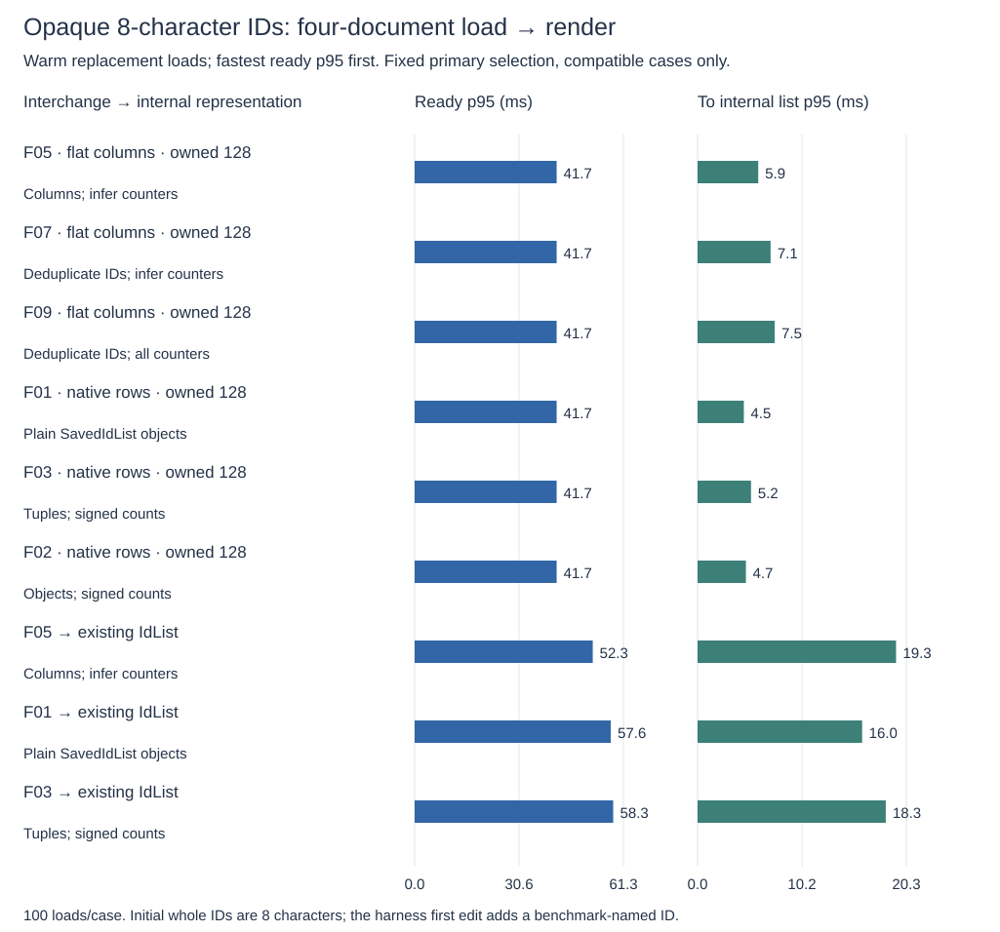

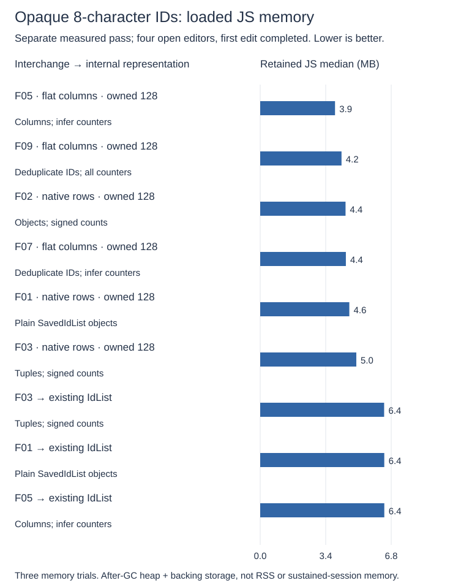

The charts use the compatible portion of the fixed primary-case selection. This is real browser loading with opaque input IDs, not an inference from structured strings. However, the first edit and the short edit/export batch introduce benchmark-named IDs; it is not a guarantee that every ID remains eight characters after editing. The 31-case sustained sessions above use the structured corpus; a distinct seven-case opaque sustained-session pass follows when available. Do not splice separate passes into one end-to-end sample.

<details><summary>All 21 opaque-ID browser configurations, ready p95 sorted</summary>

| Container                       | Ready p95 ms | Conversion p95 ms | Loaded + first edit MB | Opaque Mongo Snappy KB/doc | Opaque Mongo Zstd KB/doc |
| ------------------------------- | -----------: | ----------------: | ---------------------: | -------------------------: | -----------------------: |
| F05 · flat columns · shared 128 |         41.6 |               5.0 |                    3.8 |                      180.5 |                    106.8 |
| F05 · flat columns · owned 64   |         41.6 |               7.8 |                    4.0 |                      180.5 |                    106.8 |
| F05 · flat columns · owned 256  |         41.6 |               5.9 |                    3.8 |                      180.5 |                    106.8 |
| F07 · flat columns · shared 128 |         41.6 |               6.0 |                    4.4 |                      209.2 |                    123.2 |
| F05 · flat columns · owned 128  |         41.7 |               5.9 |                    3.9 |                      180.5 |                    106.8 |
| F07 · flat columns · owned 128  |         41.7 |               7.1 |                    4.4 |                      209.2 |                    123.2 |
| F09 · flat columns · shared 128 |         41.7 |               5.6 |                    4.2 |                      274.7 |                    155.9 |
| F09 · flat columns · owned 128  |         41.7 |               7.5 |                    4.2 |                      274.7 |                    155.9 |
| F01 · native rows · owned 128   |         41.7 |               4.5 |                    4.6 |                      202.8 |                    116.1 |
| F03 · native rows · owned 128   |         41.7 |               5.2 |                    5.0 |                      183.6 |                    111.7 |
| F02 · native rows · shared 128  |         41.7 |               4.6 |                    4.4 |                      188.7 |                    115.0 |
| F02 · native rows · owned 128   |         41.7 |               4.7 |                    4.4 |                      188.7 |                    115.0 |
| F03 · native rows · shared 128  |         41.8 |               4.9 |                    5.0 |                      183.6 |                    111.7 |
| F01 · native rows · shared 128  |         42.1 |               4.3 |                    4.6 |                      202.8 |                    116.1 |
| F04 → existing IdList           |         51.8 |              18.9 |                    6.4 |                      246.0 |                    139.6 |
| F07 → existing IdList           |         52.2 |              19.1 |                    6.4 |                      209.2 |                    123.2 |
| F05 → existing IdList           |         52.3 |              19.3 |                    6.4 |                      180.5 |                    106.8 |
| F01 → existing IdList           |         57.6 |              16.0 |                    6.4 |                      202.8 |                    116.1 |
| F02 → existing IdList           |         58.3 |              20.9 |                    6.4 |                      188.7 |                    115.0 |
| F03 → existing IdList           |         58.3 |              18.3 |                    6.4 |                      183.6 |                    111.7 |
| F09 → existing IdList           |         58.4 |              21.5 |                    6.4 |                      274.7 |                    155.9 |

| Container                       | Cold ready, 5-context median [min–max] ms | First edit + render p95 ms |
| ------------------------------- | ----------------------------------------: | -------------------------: |
| F05 · flat columns · shared 128 |                          42.2 [41.4–48.9] |                       17.7 |
| F05 · flat columns · owned 64   |                          42.6 [41.7–50.0] |                       17.9 |
| F05 · flat columns · owned 256  |                          41.6 [40.6–49.9] |                       17.7 |
| F07 · flat columns · shared 128 |                          48.8 [42.6–50.2] |                       17.7 |
| F05 · flat columns · owned 128  |                          41.6 [40.4–42.3] |                       18.2 |
| F07 · flat columns · owned 128  |                          42.1 [41.5–50.0] |                       17.6 |
| F09 · flat columns · shared 128 |                          41.6 [40.8–55.0] |                       17.7 |
| F09 · flat columns · owned 128  |                          49.8 [41.7–50.8] |                       17.7 |
| F01 · native rows · owned 128   |                          49.7 [48.9–50.0] |                       17.6 |
| F03 · native rows · owned 128   |                          41.7 [41.6–49.2] |                       18.2 |
| F02 · native rows · shared 128  |                          41.7 [41.5–50.6] |                       17.6 |
| F02 · native rows · owned 128   |                          49.9 [42.6–50.0] |                       17.7 |
| F03 · native rows · shared 128  |                          42.5 [41.6–49.1] |                       17.7 |
| F01 · native rows · shared 128  |                          50.0 [49.9–50.2] |                       17.7 |
| F04 → existing IdList           |                          58.4 [57.9–66.5] |                       17.6 |
| F07 → existing IdList           |                          58.5 [58.3–70.6] |                       17.5 |
| F05 → existing IdList           |                          58.3 [58.2–66.6] |                       17.4 |
| F01 → existing IdList           |                          58.6 [58.4–67.5] |                       17.6 |
| F02 → existing IdList           |                          66.5 [58.9–66.7] |                       17.8 |
| F03 → existing IdList           |                          65.5 [58.3–66.1] |                       17.7 |
| F09 → existing IdList           |                          58.3 [58.2–66.5] |                       18.0 |

[Opaque-ID browser raw data](results/exploration-opaque8/browser.json)

</details>

## Actual opaque-ID sustained sessions: seven fixed compatible containers

This separate 126-trajectory pass uses opaque 8-character input IDs and collision-checked 8-character IDs for every session insertion. Only the existing harness’s first setup insertion retains its benchmark name. Four actual PM editors remain open; one receives 2,000 incremental operations. Each of the seven fixed containers has three trials for each workload/history combination, with exactly the same checkpoint GC and timing boundaries as the structured sessions.

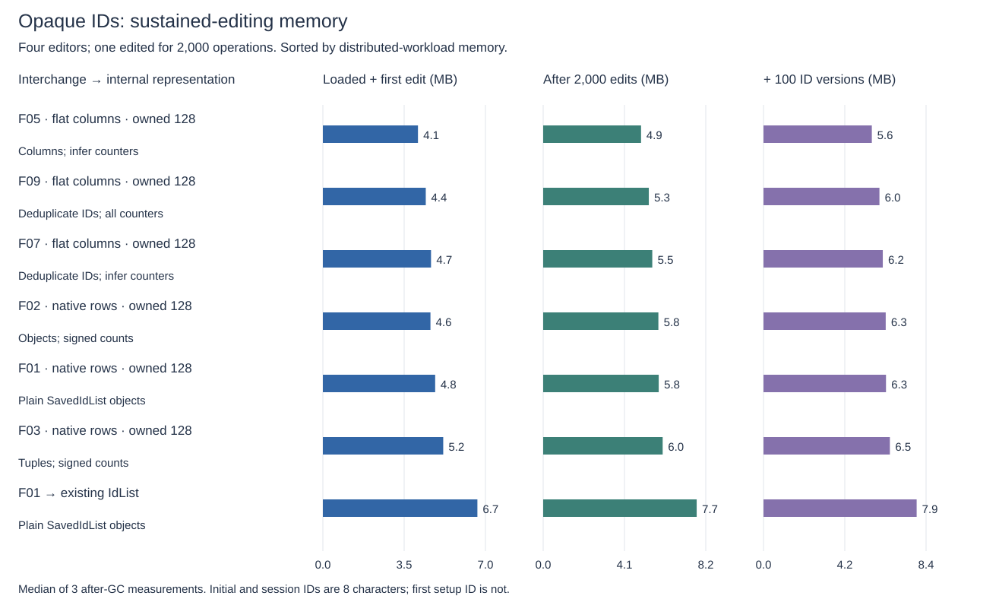

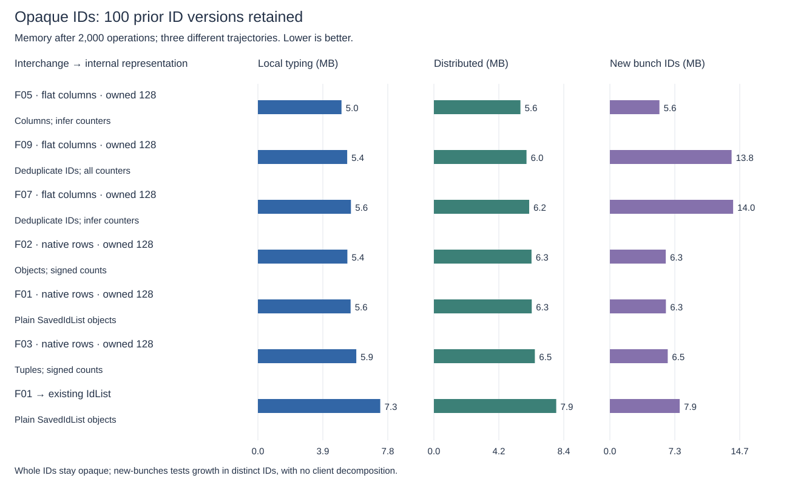

With new whole IDs and 100 prior versions retained, F07/F09 owned-128 measured **14.0/13.8 MB**, versus **5.6 MB** for F05 owned-128 and 7.9 MB for the unchanged IdList baseline. Those numbers directly test opaque identities rather than transferring conclusions from structured sequences.

| Actual opaque-ID container     | 2,000 distributed ID calls ms | Batch / 2,000, µs per operation | Editor-inclusive total ms |
| ------------------------------ | ----------------------------: | ------------------------------: | ------------------------: |
| F01 → existing IdList          |                          19.2 |                             9.6 |                     164.5 |
| F05 · flat columns · owned 128 |                          30.7 |                            15.4 |                     172.9 |
| F07 · flat columns · owned 128 |                          30.8 |                            15.4 |                     176.6 |
| F09 · flat columns · owned 128 |                          27.8 |                            13.9 |                     174.0 |

The per-operation column is a batch average, not measured keystroke latency. The total includes the actual editor loop and checkpoint renders, not just ID calls.

<details><summary>Seven opaque-ID containers: exact session memory and timing, median [min–max]</summary>

### 0 retained prior ID versions

| Container                      | Local memory MB | Distributed memory MB | New-bunch memory MB |
| ------------------------------ | --------------: | --------------------: | ------------------: |
| F05 · flat columns · owned 128 |   4.6 [4.6–4.6] |         4.9 [4.9–4.9] |       5.0 [5.0–5.0] |
| F09 · flat columns · owned 128 |   4.9 [4.9–4.9] |         5.3 [5.3–5.3] |       5.3 [5.3–5.3] |
| F07 · flat columns · owned 128 |   5.2 [5.2–5.2] |         5.5 [5.5–5.5] |       5.5 [5.5–5.5] |
| F02 · native rows · owned 128  |   5.1 [5.1–5.1] |         5.8 [5.8–5.8] |       5.8 [5.8–5.8] |
| F01 · native rows · owned 128  |   5.3 [5.3–5.3] |         5.8 [5.8–5.8] |       5.8 [5.8–5.8] |
| F03 · native rows · owned 128  |   5.6 [5.6–5.6] |         6.0 [6.0–6.0] |       6.0 [6.0–6.0] |
| F01 → existing IdList          |   7.2 [7.2–7.2] |         7.7 [7.7–7.7] |       7.7 [7.7–7.8] |

| Container                      | Local ID calls ms | Distributed ID calls ms | New-bunch ID calls ms |
| ------------------------------ | ----------------: | ----------------------: | --------------------: |
| F05 · flat columns · owned 128 |  14.7 [14.5–17.0] |        30.7 [27.8–31.9] |      25.8 [25.5–27.1] |
| F09 · flat columns · owned 128 |  14.2 [13.8–14.3] |        27.8 [27.7–31.0] |   180.6 [172.2–180.8] |
| F07 · flat columns · owned 128 |  18.2 [18.1–18.4] |        30.8 [28.7–31.5] |   178.0 [175.6–189.9] |
| F02 · native rows · owned 128  |  13.1 [11.9–13.7] |        24.9 [23.9–26.7] |      25.1 [23.4–26.8] |
| F01 · native rows · owned 128  |  13.4 [12.8–13.8] |        28.1 [27.5–29.8] |      26.9 [24.3–27.2] |
| F03 · native rows · owned 128  |  13.7 [12.4–15.0] |        27.5 [27.0–28.9] |      24.1 [22.8–25.8] |
| F01 → existing IdList          |    9.8 [8.7–10.3] |        19.2 [16.6–20.6] |      18.1 [16.2–21.4] |

| Container                      |      Local total ms | Distributed total ms |  New-bunch total ms |
| ------------------------------ | ------------------: | -------------------: | ------------------: |
| F05 · flat columns · owned 128 | 151.2 [150.8–156.1] |  172.9 [171.9–176.6] | 170.4 [167.7–173.3] |
| F09 · flat columns · owned 128 | 151.7 [150.4–152.5] |  174.0 [172.3–174.7] | 317.0 [310.2–320.9] |
| F07 · flat columns · owned 128 | 157.0 [152.9–158.4] |  176.6 [175.3–180.5] | 316.9 [315.4–333.6] |
| F02 · native rows · owned 128  | 149.5 [148.6–153.4] |  172.8 [168.8–173.8] | 170.0 [169.7–170.5] |
| F01 · native rows · owned 128  | 148.7 [148.3–150.3] |  174.5 [172.7–184.0] | 170.7 [170.3–171.2] |
| F03 · native rows · owned 128  | 149.8 [148.0–151.5] |  173.2 [170.9–173.6] | 168.4 [167.4–168.9] |
| F01 → existing IdList          | 144.9 [144.9–147.4] |  164.5 [161.4–166.4] | 163.6 [161.6–171.7] |

### 100 retained prior ID versions

| Container                      | Local memory MB | Distributed memory MB | New-bunch memory MB |
| ------------------------------ | --------------: | --------------------: | ------------------: |
| F05 · flat columns · owned 128 |   5.0 [5.0–5.0] |         5.6 [5.6–5.6] |       5.6 [5.6–5.6] |
| F09 · flat columns · owned 128 |   5.4 [5.4–5.4] |         6.0 [6.0–6.0] |    13.8 [13.8–13.8] |
| F07 · flat columns · owned 128 |   5.6 [5.6–5.6] |         6.2 [6.2–6.2] |    14.0 [14.0–14.0] |
| F02 · native rows · owned 128  |   5.4 [5.4–5.4] |         6.3 [6.3–6.3] |       6.3 [6.3–6.3] |
| F01 · native rows · owned 128  |   5.6 [5.6–5.6] |         6.3 [6.3–6.3] |       6.3 [6.3–6.3] |
| F03 · native rows · owned 128  |   5.9 [5.9–5.9] |         6.5 [6.5–6.5] |       6.5 [6.5–6.6] |
| F01 → existing IdList          |   7.3 [7.3–7.4] |         7.9 [7.9–7.9] |       7.9 [7.9–7.9] |

| Container                      | Local ID calls ms | Distributed ID calls ms | New-bunch ID calls ms |
| ------------------------------ | ----------------: | ----------------------: | --------------------: |
| F05 · flat columns · owned 128 |  17.2 [14.9–17.7] |        30.6 [30.0–30.8] |      28.4 [26.2–29.3] |
| F09 · flat columns · owned 128 |  14.3 [14.1–15.7] |        30.7 [30.7–32.6] |   233.9 [229.9–233.9] |
| F07 · flat columns · owned 128 |  15.1 [14.4–15.2] |        33.7 [32.2–35.1] |   234.0 [226.6–241.3] |
| F02 · native rows · owned 128  |  14.3 [12.7–14.6] |        28.0 [24.1–28.1] |      25.7 [24.9–27.7] |
| F01 · native rows · owned 128  |  14.2 [13.8–15.3] |        29.5 [27.8–29.7] |      24.6 [23.5–25.2] |
| F03 · native rows · owned 128  |  13.6 [12.9–16.3] |        28.0 [25.9–29.3] |      24.2 [23.8–25.8] |
| F01 → existing IdList          |   10.5 [9.4–10.8] |        20.9 [18.6–21.5] |      19.7 [18.0–19.7] |

| Container                      |      Local total ms | Distributed total ms |  New-bunch total ms |
| ------------------------------ | ------------------: | -------------------: | ------------------: |
| F05 · flat columns · owned 128 | 154.4 [153.6–154.4] |  174.9 [174.4–185.5] | 173.1 [172.9–179.1] |
| F09 · flat columns · owned 128 | 153.1 [150.8–154.9] |  176.9 [176.2–178.0] | 377.3 [376.1–379.6] |
| F07 · flat columns · owned 128 | 154.4 [153.5–158.6] |  180.5 [179.1–186.3] | 380.2 [368.0–390.6] |
| F02 · native rows · owned 128  | 156.1 [153.4–156.4] |  178.5 [176.2–178.7] | 174.6 [171.7–174.9] |
| F01 · native rows · owned 128  | 152.0 [150.5–153.8] |  180.3 [177.8–182.1] | 173.2 [170.6–173.8] |
| F03 · native rows · owned 128  | 152.9 [152.1–154.4] |  176.3 [174.6–177.1] | 173.7 [173.6–176.6] |
| F01 → existing IdList          | 147.1 [147.1–149.4] |  170.4 [167.8–181.5] | 166.6 [166.2–168.6] |

ID-call time excludes history bookkeeping and reference checks; total time includes them plus PM/common mapping/natural GC/rendering. Both exclude forced collection between timed segments. Values sum 200/800/1,000-operation segments, not individual keystroke latency. This pass does not measure F06/F08, which cannot represent these IDs.

[Opaque-ID session raw data](results/exploration-opaque8/sessions.json)

</details>

## Scaling diagnostic: no editor or rendering

A separate 5-trial diagnostic repeats the trace with disjoint client identities at 1×, 4×, 16× scale. It measures cold JSON parse+hydrate, 256 lookups, 200 precomputed mutations and post-GC ID-list memory. This is not a load/render benchmark, production corpus, warm throughput test or p95 estimate. It cannot replace the browser/editor results above.

<details><summary>Scaling medians, with every measured case retained</summary>

| Scale / runs  | Container                      | History |             Load ms | 256 lookups ms |      200 edits ms | Loaded / edited MB |
| ------------- | ------------------------------ | ------: | ------------------: | -------------: | ----------------: | -----------------: |
| 1× / 12,091   | F01 → existing IdList          |       0 |       8.5 [8.3–8.7] |  0.7 [0.7–0.8] |     3.4 [3.3–3.4] |          1.7 / 1.9 |
| 1× / 12,091   | F05 → existing IdList          |       0 |       8.6 [8.5–8.7] |  0.8 [0.7–0.8] |     3.2 [3.1–3.4] |          1.6 / 1.7 |
| 1× / 12,091   | F08 → existing IdList          |       0 |       8.9 [8.8–9.0] |  0.8 [0.7–0.8] |     3.3 [3.3–3.5] |          1.6 / 1.7 |
| 1× / 12,091   | F05 · flat columns · owned 128 |       0 |      3.4 [3.4–20.3] |  0.6 [0.5–3.1] |    2.9 [2.9–17.6] |          0.8 / 1.0 |
| 1× / 12,091   | F08 · flat columns · owned 128 |       0 |       4.8 [4.6–4.9] |  0.5 [0.4–0.6] |     5.0 [4.8–5.0] |          0.8 / 1.0 |
| 1× / 12,091   | F08 · page tree · owned 128    |       0 |       5.1 [4.9–9.1] |  0.8 [0.7–0.8] |     6.4 [6.3–6.5] |          1.2 / 1.8 |
| 1× / 12,091   | F01 · native rows · owned 128  |       0 |       4.2 [4.2–4.3] |  0.6 [0.5–0.6] |     2.5 [2.4–2.6] |          1.0 / 1.1 |
| 1× / 12,091   | F07 · flat columns · owned 128 |       0 |       3.8 [3.7–3.8] |  0.6 [0.4–0.6] |     3.1 [3.0–3.2] |          1.0 / 1.1 |
| 4× / 48,364   | F01 → existing IdList          |       0 |    27.8 [27.3–28.3] |  0.9 [0.8–1.0] |     3.2 [3.1–3.2] |          6.2 / 6.4 |
| 4× / 48,364   | F05 → existing IdList          |       0 |   28.1 [27.8–161.2] |  0.9 [0.7–4.6] |    3.2 [3.1–17.6] |          5.7 / 5.9 |
| 4× / 48,364   | F08 → existing IdList          |       0 |   27.2 [26.4–160.9] |  0.9 [0.8–4.6] |    3.4 [3.0–18.4] |          5.6 / 5.7 |
| 4× / 48,364   | F05 · flat columns · owned 128 |       0 |       9.1 [9.0–9.4] |  0.9 [0.8–0.9] |     5.7 [5.6–5.8] |          3.2 / 3.4 |
| 4× / 48,364   | F08 · flat columns · owned 128 |       0 |    12.1 [12.0–12.2] |  0.8 [0.8–0.9] |     8.3 [8.1–8.4] |          3.0 / 3.3 |
| 4× / 48,364   | F08 · page tree · owned 128    |       0 |    13.3 [13.2–13.5] |  0.8 [0.7–0.9] |     9.6 [9.4–9.6] |          4.5 / 5.3 |
| 4× / 48,364   | F01 · native rows · owned 128  |       0 |    11.9 [11.6–12.0] |  0.9 [0.9–0.9] |     5.3 [5.2–5.5] |          4.0 / 4.1 |
| 4× / 48,364   | F07 · flat columns · owned 128 |       0 |      9.8 [9.7–10.1] |  0.8 [0.8–1.0] |     6.4 [6.3–6.5] |          3.5 / 3.8 |
| 16× / 193,456 | F01 → existing IdList          |       0 | 111.6 [109.4–641.9] |  1.1 [1.0–5.0] |    4.1 [3.9–21.4] |        24.3 / 24.4 |
| 16× / 193,456 | F05 → existing IdList          |       0 | 110.2 [109.4–111.5] |  1.1 [1.0–1.2] |     4.1 [4.0–4.3] |        22.7 / 22.9 |
| 16× / 193,456 | F08 → existing IdList          |       0 |  101.3 [99.1–102.6] |  1.1 [1.1–1.1] |     3.9 [3.8–3.9] |        21.6 / 21.8 |
| 16× / 193,456 | F05 · flat columns · owned 128 |       0 |    33.5 [33.1–33.6] |  2.7 [2.6–2.9] |  13.1 [12.9–13.2] |        13.1 / 13.4 |
| 16× / 193,456 | F08 · flat columns · owned 128 |       0 |    40.2 [39.9–40.4] |  2.7 [2.6–2.9] |  16.5 [16.1–16.7] |        11.9 / 12.2 |
| 16× / 193,456 | F08 · page tree · owned 128    |       0 |    42.8 [42.2–46.9] |  1.0 [0.9–1.6] |  12.3 [12.1–14.8] |        17.7 / 18.6 |
| 16× / 193,456 | F01 · native rows · owned 128  |       0 |    42.9 [42.3–43.2] |  2.9 [2.7–3.1] |  12.6 [12.2–12.8] |        15.3 / 15.5 |
| 16× / 193,456 | F07 · flat columns · owned 128 |       0 |   34.7 [34.5–205.5] | 2.6 [2.5–15.0] | 16.7 [16.4–102.3] |        13.7 / 14.2 |

Times are median [minimum–maximum], including every outlier. Some first-run trials slowed by roughly 5–6× across load, lookup and mutation together. The cause was not established; memory remained much more stable. Treat timing as a noisy scaling diagnostic, not a reliable production speed ranking.

### Identical full rerun: no samples discarded

The entire matrix was repeated unchanged to check the suspicious timing swings. Both complete raw runs are retained; the second run does not replace the first. Each cell is a five-trial median [minimum–maximum] in milliseconds.

| Scale          | Container                      |      Load: original |         Load: rerun | 200 edits: original |  200 edits: rerun |
| -------------- | ------------------------------ | ------------------: | ------------------: | ------------------: | ----------------: |
| 1×, history 0  | F01 → existing IdList          |       8.5 [8.3–8.7] |      8.6 [8.5–49.9] |       3.4 [3.3–3.4] |    3.5 [3.2–19.9] |
| 1×, history 0  | F05 → existing IdList          |       8.6 [8.5–8.7] |      8.6 [8.3–48.1] |       3.2 [3.1–3.4] |    3.3 [3.1–18.6] |
| 1×, history 0  | F08 → existing IdList          |       8.9 [8.8–9.0] |      9.0 [8.9–11.3] |       3.3 [3.3–3.5] |     3.4 [3.2–4.2] |
| 1×, history 0  | F05 · flat columns · owned 128 |      3.4 [3.4–20.3] |     20.1 [3.3–20.4] |      2.9 [2.9–17.6] |   17.1 [2.9–18.3] |
| 1×, history 0  | F08 · flat columns · owned 128 |       4.8 [4.6–4.9] |      4.7 [4.7–28.7] |       5.0 [4.8–5.0] |    5.0 [4.9–29.3] |
| 1×, history 0  | F08 · page tree · owned 128    |       5.1 [4.9–9.1] |      5.0 [4.9–30.8] |       6.4 [6.3–6.5] |    6.5 [6.4–38.1] |
| 1×, history 0  | F01 · native rows · owned 128  |       4.2 [4.2–4.3] |      4.8 [4.2–25.9] |       2.5 [2.4–2.6] |    2.8 [2.5–15.4] |
| 1×, history 0  | F07 · flat columns · owned 128 |       3.8 [3.7–3.8] |      3.8 [3.6–22.2] |       3.1 [3.0–3.2] |    3.1 [3.0–17.7] |
| 4×, history 0  | F01 → existing IdList          |    27.8 [27.3–28.3] |   28.3 [27.4–163.3] |       3.2 [3.1–3.2] |    3.3 [3.1–18.1] |
| 4×, history 0  | F05 → existing IdList          |   28.1 [27.8–161.2] |   28.6 [27.8–177.6] |      3.2 [3.1–17.6] |    3.3 [3.2–19.5] |
| 4×, history 0  | F08 → existing IdList          |   27.2 [26.4–160.9] |  162.1 [27.4–164.0] |      3.4 [3.0–18.4] |   16.9 [3.1–17.8] |
| 4×, history 0  | F05 · flat columns · owned 128 |       9.1 [9.0–9.4] |     10.5 [9.1–11.0] |       5.7 [5.6–5.8] |     6.7 [5.7–6.9] |
| 4×, history 0  | F08 · flat columns · owned 128 |    12.1 [12.0–12.2] |    12.2 [12.1–74.0] |       8.3 [8.1–8.4] |    8.4 [8.2–50.8] |
| 4×, history 0  | F08 · page tree · owned 128    |    13.3 [13.2–13.5] |    13.4 [13.0–78.4] |       9.6 [9.4–9.6] |    9.7 [9.5–59.2] |
| 4×, history 0  | F01 · native rows · owned 128  |    11.9 [11.6–12.0] |    12.0 [11.7–12.7] |       5.3 [5.2–5.5] |     5.4 [5.2–5.7] |
| 4×, history 0  | F07 · flat columns · owned 128 |      9.8 [9.7–10.1] |      9.9 [9.7–11.7] |       6.4 [6.3–6.5] |     6.7 [6.2–7.8] |
| 16×, history 0 | F01 → existing IdList          | 111.6 [109.4–641.9] | 112.6 [108.0–636.4] |      4.1 [3.9–21.4] |    4.2 [4.0–22.2] |
| 16×, history 0 | F05 → existing IdList          | 110.2 [109.4–111.5] | 110.6 [108.1–123.8] |       4.1 [4.0–4.3] |     4.0 [4.0–4.5] |
| 16×, history 0 | F08 → existing IdList          |  101.3 [99.1–102.6] | 125.7 [100.5–235.6] |       3.9 [3.8–3.9] |    4.6 [3.8–10.0] |
| 16×, history 0 | F05 · flat columns · owned 128 |    33.5 [33.1–33.6] |   37.7 [33.1–183.9] |    13.1 [12.9–13.2] |  14.7 [12.9–77.7] |
| 16×, history 0 | F08 · flat columns · owned 128 |    40.2 [39.9–40.4] |   40.2 [40.0–230.6] |    16.5 [16.1–16.7] | 16.6 [16.4–100.5] |
| 16×, history 0 | F08 · page tree · owned 128    |    42.8 [42.2–46.9] |   43.7 [40.9–249.3] |    12.3 [12.1–14.8] |  12.2 [11.8–68.2] |
| 16×, history 0 | F01 · native rows · owned 128  |    42.9 [42.3–43.2] |   43.3 [42.8–128.5] |    12.6 [12.2–12.8] |  13.0 [12.4–37.1] |
| 16×, history 0 | F07 · flat columns · owned 128 |   34.7 [34.5–205.5] |  199.6 [33.6–204.5] |   16.7 [16.4–102.3] | 97.3 [16.6–101.2] |

[Original scale raw data](results/exploration/scale.json) · [Complete rerun raw data](results/exploration-scale-recheck/scale.json)

### Browser-process isolation control

A third full matrix keeps the implementations, workloads, order and launch flags unchanged, but launches a new browser process for every sample. Launch/close remain outside clocks. Several-fold slowing still occurred: new processes alone did not resolve it. The underlying OS/browser cause is not established. Keep this cold-process diagnostic separate from the warm load/render results.

| Scale          | Container                      |     Load ms [range] | 256 lookups ms [range] | 200 edits ms [range] | Loaded / edited MB |
| -------------- | ------------------------------ | ------------------: | ---------------------: | -------------------: | -----------------: |
| 1×, history 0  | F01 → existing IdList          |     11.3 [8.3–50.4] |          1.0 [0.7–4.1] |       4.8 [3.5–20.2] |          1.7 / 1.9 |
| 1×, history 0  | F05 → existing IdList          |     11.4 [8.7–50.7] |          1.0 [0.7–4.1] |       4.4 [3.4–19.4] |          1.6 / 1.7 |
| 1×, history 0  | F08 → existing IdList          |     13.6 [8.9–53.7] |          1.1 [0.7–4.2] |       5.1 [3.4–20.7] |          1.6 / 1.7 |
| 1×, history 0  | F05 · flat columns · owned 128 |     20.4 [3.3–20.6] |          2.9 [0.6–3.2] |      17.7 [3.0–18.0] |          0.8 / 1.0 |
| 1×, history 0  | F08 · flat columns · owned 128 |      7.2 [5.3–28.1] |          0.7 [0.5–3.0] |       7.1 [5.6–29.1] |          0.8 / 1.0 |
| 1×, history 0  | F08 · page tree · owned 128    |      6.9 [5.6–29.3] |          0.9 [0.8–4.1] |       8.4 [7.2–37.5] |          1.2 / 1.8 |
| 1×, history 0  | F01 · native rows · owned 128  |      5.6 [4.9–24.3] |          0.9 [0.7–3.4] |       3.4 [3.0–14.4] |          1.0 / 1.1 |
| 1×, history 0  | F07 · flat columns · owned 128 |      5.2 [3.9–22.3] |          0.7 [0.5–3.1] |       4.0 [3.0–17.7] |          1.0 / 1.1 |
| 4×, history 0  | F01 → existing IdList          |   38.3 [27.4–162.2] |          1.2 [0.9–4.6] |       4.4 [3.1–18.0] |          6.2 / 6.4 |
| 4×, history 0  | F05 → existing IdList          |   41.6 [32.8–164.2] |          1.2 [1.1–4.4] |       4.5 [3.7–17.9] |          5.7 / 5.9 |
| 4×, history 0  | F08 → existing IdList          |  156.3 [30.5–162.3] |          4.3 [1.0–4.7] |      17.4 [3.3–18.9] |          5.6 / 5.7 |
| 4×, history 0  | F05 · flat columns · owned 128 |    12.2 [10.0–52.9] |          1.2 [1.0–4.9] |       7.9 [6.4–33.8] |          3.2 / 3.4 |
| 4×, history 0  | F08 · flat columns · owned 128 |    15.2 [12.0–73.7] |          1.0 [0.7–4.8] |      11.0 [8.3–50.0] |          3.0 / 3.3 |
| 4×, history 0  | F08 · page tree · owned 128    |    19.7 [14.3–78.9] |          1.1 [0.8–4.4] |     14.1 [10.4–54.9] |          4.5 / 5.3 |
| 4×, history 0  | F01 · native rows · owned 128  |    17.4 [14.2–67.9] |          1.3 [1.0–5.3] |       7.6 [6.1–31.5] |          4.0 / 4.1 |
| 4×, history 0  | F07 · flat columns · owned 128 |    13.1 [11.3–60.1] |          1.1 [0.9–4.8] |       8.8 [7.0–37.9] |          3.5 / 3.8 |
| 16×, history 0 | F01 → existing IdList          | 625.8 [150.1–644.4] |          4.8 [1.4–5.1] |      20.8 [5.3–22.0] |        24.3 / 24.4 |
| 16×, history 0 | F05 → existing IdList          | 125.4 [109.4–657.7] |          1.2 [1.0–5.2] |       4.4 [4.0–22.1] |        22.7 / 22.9 |
| 16×, history 0 | F08 → existing IdList          | 136.0 [100.6–579.5] |          1.3 [1.0–4.8] |       5.0 [3.9–20.5] |        21.6 / 21.8 |
| 16×, history 0 | F05 · flat columns · owned 128 |  189.6 [33.6–190.9] |        14.3 [2.6–14.9] |     78.1 [13.0–81.8] |        13.1 / 13.4 |
| 16×, history 0 | F08 · flat columns · owned 128 |   49.3 [39.5–221.6] |         3.6 [2.8–15.0] |     22.0 [16.2–95.0] |        11.9 / 12.2 |
| 16×, history 0 | F08 · page tree · owned 128    |   53.4 [42.7–253.1] |          1.1 [0.9–4.8] |     14.5 [11.9–68.2] |        17.7 / 18.6 |
| 16×, history 0 | F01 · native rows · owned 128  |   53.1 [42.8–244.2] |         3.6 [2.9–15.3] |     15.6 [12.6–76.3] |        15.3 / 15.4 |
| 16×, history 0 | F07 · flat columns · owned 128 |  201.4 [40.5–205.3] |        14.4 [2.9–15.2] |     96.6 [19.1–97.8] |        13.7 / 14.2 |

[Fresh-process control raw data](results/exploration-scale-process/scale.json)

### Explicit CPU-rate control

A fourth full matrix repeats the fresh-process control with one additional setting: CDP CPU throttling is explicitly set to 1× before each sample's baseline. All inputs, implementations, order and launch flags are unchanged. Several-fold variation remained, this time with slower early samples and faster later ones: explicitly setting 1× did not eliminate the instability. Every sample is retained. The cause is unresolved; these diagnostics cannot support a dependable speed ranking.

| Scale          | Container                      |     Load ms [range] | 256 lookups ms [range] | 200 edits ms [range] | Loaded / edited MB |
| -------------- | ------------------------------ | ------------------: | ---------------------: | -------------------: | -----------------: |
| 1×, history 0  | F01 → existing IdList          |    50.2 [18.7–51.7] |          4.1 [1.6–4.4] |      19.0 [7.3–23.1] |          1.7 / 1.9 |
| 1×, history 0  | F05 → existing IdList          |    50.6 [15.3–59.4] |          4.1 [1.2–4.7] |      19.9 [5.8–22.6] |          1.6 / 1.7 |
| 1×, history 0  | F08 → existing IdList          |    53.3 [19.4–54.2] |          4.0 [1.6–4.1] |      19.6 [7.0–20.2] |          1.6 / 1.7 |
| 1×, history 0  | F05 · flat columns · owned 128 |      7.4 [6.2–20.5] |          1.1 [0.9–3.0] |       6.3 [5.3–17.9] |          0.8 / 1.0 |
| 1×, history 0  | F08 · flat columns · owned 128 |    28.0 [10.4–30.5] |          3.0 [1.2–3.2] |     28.9 [10.7–32.5] |          0.8 / 1.0 |
| 1×, history 0  | F08 · page tree · owned 128    |    30.1 [12.2–30.9] |          4.0 [1.7–4.1] |     38.3 [15.3–40.1] |          1.2 / 1.8 |
| 1×, history 0  | F01 · native rows · owned 128  |     23.3 [8.8–24.3] |          3.3 [1.2–3.5] |      14.6 [5.3–15.7] |          1.0 / 1.1 |
| 1×, history 0  | F07 · flat columns · owned 128 |     21.9 [8.0–22.9] |          3.0 [1.0–3.1] |      17.9 [6.5–18.9] |          1.0 / 1.1 |
| 4×, history 0  | F01 → existing IdList          |  162.9 [40.9–172.9] |          4.6 [1.3–4.9] |      18.4 [4.7–19.0] |          6.2 / 6.4 |
| 4×, history 0  | F05 → existing IdList          |  167.8 [51.0–180.6] |          4.4 [1.5–4.9] |      17.5 [5.8–19.5] |          5.7 / 5.9 |
| 4×, history 0  | F08 → existing IdList          |   58.7 [49.1–192.6] |          1.8 [1.4–4.7] |       6.6 [5.6–19.0] |          5.6 / 5.7 |
| 4×, history 0  | F05 · flat columns · owned 128 |    51.9 [19.0–52.3] |          4.6 [1.7–4.7] |     33.5 [12.2–34.1] |          3.2 / 3.4 |
| 4×, history 0  | F08 · flat columns · owned 128 |    71.8 [25.6–73.3] |          4.6 [1.7–4.9] |     47.3 [17.1–49.4] |          3.0 / 3.2 |
| 4×, history 0  | F08 · page tree · owned 128    |    78.4 [28.3–79.6] |          4.2 [1.5–4.3] |     54.9 [20.1–57.4] |          4.5 / 5.3 |
| 4×, history 0  | F01 · native rows · owned 128  |    69.0 [26.7–69.6] |          5.3 [2.2–5.6] |     31.7 [12.2–32.2] |          4.0 / 4.1 |
| 4×, history 0  | F07 · flat columns · owned 128 |    58.6 [20.9–62.6] |          4.7 [1.7–5.1] |     38.4 [13.5–40.6] |          3.5 / 3.8 |
| 16×, history 0 | F01 → existing IdList          | 627.3 [236.0–653.2] |          4.8 [1.9–5.3] |      20.8 [7.6–22.7] |        24.3 / 24.4 |
| 16×, history 0 | F05 → existing IdList          | 639.1 [229.4–661.2] |          5.0 [2.0–5.4] |      21.8 [8.2–21.9] |        22.7 / 22.9 |
| 16×, history 0 | F08 → existing IdList          | 574.1 [229.6–602.0] |          4.7 [2.5–4.9] |      20.3 [9.0–21.6] |        21.6 / 21.8 |
| 16×, history 0 | F05 · flat columns · owned 128 |   86.6 [67.6–226.9] |         7.0 [5.3–17.9] |     30.7 [27.4–88.1] |        13.1 / 13.4 |
| 16×, history 0 | F08 · flat columns · owned 128 |  230.9 [91.5–252.3] |        15.6 [6.4–17.0] |   100.1 [36.4–105.8] |        11.9 / 12.2 |
| 16×, history 0 | F08 · page tree · owned 128    |  250.3 [91.1–260.2] |          5.0 [1.9–5.1] |     68.8 [25.5–73.0] |        17.7 / 18.6 |
| 16×, history 0 | F01 · native rows · owned 128  |  242.9 [78.0–261.9] |        15.4 [4.7–15.6] |     76.5 [23.3–82.4] |        15.3 / 15.4 |
| 16×, history 0 | F07 · flat columns · owned 128 |   73.3 [63.3–206.9] |         5.2 [4.5–14.9] |    35.0 [29.3–100.9] |        13.7 / 14.2 |

[Explicit CPU-rate control raw data](results/exploration-scale-cpu1/scale.json)

</details>

## Method, limits and reproduction

Primary browser run started 2026-10-21T03:10:48.562Z: Chromium 151.0.7922.34, Playwright 1.62.1, Apple M5 Pro, darwin/arm64, CPU rate 1×. Fixture: 104,852 visible characters, 1,173 paragraphs, 12,091 runs. Four documents are four copies of one Kleppmann trace, not four independently sampled production documents.

Load comparison: 31 cases × 2 document counts × 5 fresh-context rounds × 20 timed replacement loads = **6,200 warm samples**, shuffled case order and no discarded outliers. Cold loads are stored separately. 496 separately traced loads, 186 separate memory measurements, 620 short edit/export batches. Backing-storage calibration and traced paint checks passed. Session comparison: 558 fresh-context trajectories, three workloads × two history limits × three repetitions per candidate, four actual editors each.

Loaded and edited ID snapshots are checked against the reference IdList; session checkpoints verify visible state and actual rendered paragraphs. Source JSON, generated IDs, reference lists and expected text are prepared outside timed loading/operation intervals. Session calls receive edit instructions, but no reference list remains retained when after-GC memory is read. Primary load timings are untraced; load memory/GC passes are separate. Sessions instead combine untraced timed segments with forced-GC memory checkpoints between them. Session individual operations include timing probes, so very small per-operation differences should not be overinterpreted.

The report does not establish full API parity, real production document distributions, remote merges, full editor undo behavior, exact peak memory, low-end-device performance, concurrent tabs, or Atlas storage savings after migration. The structured/opaque Mongo comparison is controlled representation testing. Choosing a compressor on a local standalone does not establish whether or how your Atlas deployment can change it.

The commands below record every published run from the repository root, including output names and sample counts. Use Node 24 and the repository’s installed dependencies; run sequentially on an otherwise idle machine. **Do not execute them over the published results.** Preserve those files and use fresh output names for a new experiment (updating the report’s input paths for that rerun), or reproduce in a separate disposable checkout with empty result targets. Do not run diagnostics concurrently with primary timing:

```sh
TSX_TSCONFIG_PATH=benchmarks/tsconfig.dev.json node --import tsx --test benchmarks/src/browser/*.test.ts benchmarks/src/full_picture/codecs.test.ts

# Primary structured-ID browser comparison: all 31 configurations.
TSX_TSCONFIG_PATH=benchmarks/tsconfig.dev.json EXPLORATION_OUTPUT=exploration BROWSER_ID_MODEL=structured BROWSER_DOCUMENTS=1,4 BROWSER_ROUNDS=5 BROWSER_TRIALS=20 BROWSER_SWITCHES=8 BROWSER_MEMORY_TRIALS=3 BROWSER_CPU_RATE=1 node --import tsx benchmarks/src/browser/exploration-run.ts

# Actual opaque 8-character input IDs: all 21 compatible configurations.
TSX_TSCONFIG_PATH=benchmarks/tsconfig.dev.json EXPLORATION_OUTPUT=exploration-opaque8 BROWSER_ID_MODEL=opaque8 BROWSER_DOCUMENTS=4 BROWSER_ROUNDS=5 BROWSER_TRIALS=20 BROWSER_SWITCHES=8 BROWSER_MEMORY_TRIALS=3 BROWSER_CPU_RATE=1 BROWSER_CASES=objects,signed,tuples,columns,omit,dictionary,full,f05-flat-shared-128,f05-flat-owned-64,f05-flat-owned-128,f05-flat-owned-256,f07-flat-shared-128,f07-flat-owned-128,f09-flat-shared-128,f09-flat-owned-128,f01-rows-shared-128,f01-rows-owned-128,f02-rows-shared-128,f02-rows-owned-128,f03-rows-shared-128,f03-rows-owned-128 node --import tsx benchmarks/src/browser/exploration-run.ts

# Sustained editing: four editors, all three workloads, both history limits.
TSX_TSCONFIG_PATH=benchmarks/tsconfig.dev.json EXPLORATION_OUTPUT=exploration SESSION_DOCUMENTS=4 SESSION_TRIALS=3 SESSION_OPERATIONS=2000 SESSION_WORKLOADS=local,distributed,new-bunches node --import tsx benchmarks/src/browser/session-run.ts

# Actual opaque-ID sustained sessions: the seven fixed compatible containers.
TSX_TSCONFIG_PATH=benchmarks/tsconfig.dev.json EXPLORATION_OUTPUT=exploration-opaque8 BROWSER_ID_MODEL=opaque8 SESSION_DOCUMENTS=4 SESSION_TRIALS=3 SESSION_OPERATIONS=2000 SESSION_WORKLOADS=local,distributed,new-bunches SESSION_CASES=objects,f01-rows-owned-128,f02-rows-owned-128,f03-rows-owned-128,f05-flat-owned-128,f07-flat-owned-128,f09-flat-owned-128 node --import tsx benchmarks/src/browser/session-run.ts

# Synthetic scaling, no editor/rendering; selected cases and sample counts.
TSX_TSCONFIG_PATH=benchmarks/tsconfig.dev.json EXPLORATION_OUTPUT=exploration SCALE_MULTIPLIERS=1,4,16 SCALE_HISTORY_LIMITS=0 SCALE_TRIALS=5 SCALE_CASES=objects,omit,client,f05-flat-owned-128,f08-flat-owned-128,f08-tree-owned-128,f01-rows-owned-128,f07-flat-owned-128 node --import tsx benchmarks/src/browser/exploration-scale.ts

# Identical full scaling recheck; original results remain untouched.
TSX_TSCONFIG_PATH=benchmarks/tsconfig.dev.json EXPLORATION_OUTPUT=exploration-scale-recheck node --import tsx benchmarks/src/browser/exploration-scale.ts

# Isolation control: new browser process per sample, outside all clocks.
TSX_TSCONFIG_PATH=benchmarks/tsconfig.dev.json EXPLORATION_OUTPUT=exploration-scale-process SCALE_BROWSER_ISOLATION=process node --import tsx benchmarks/src/browser/exploration-scale.ts

# Same fresh-process control, with CPU throttling explicitly disabled.
TSX_TSCONFIG_PATH=benchmarks/tsconfig.dev.json EXPLORATION_OUTPUT=exploration-scale-cpu1 SCALE_BROWSER_ISOLATION=process SCALE_CPU_RATE=1 node --import tsx benchmarks/src/browser/exploration-scale.ts

# Generate only after both Mongo datasets and all browser/session runs complete.
TSX_TSCONFIG_PATH=benchmarks/tsconfig.dev.json node --import tsx benchmarks/src/browser/exploration-report.ts
```

Preserve existing raw results before a new run; use a fresh EXPLORATION_OUTPUT directory for browser/session/scaling reruns. This report intentionally reads the fixed published exploration directory and refuses incomplete or mismatched input. The Mongo script additionally refuses an existing result file and any nonempty target database. Mongo reproduction requires a **new local standalone for each dataset** on loopback port 27186, with a freshly created directory matching /private/tmp/articulated-exploration-mongo-*. It verifies dbPath, port and bind address before any writes. Do not point it at Atlas, a production URI or an existing data directory.

```sh
# After starting an isolated local server on the verified fresh STRUCTURED path:
TSX_TSCONFIG_PATH=benchmarks/tsconfig.dev.json ARTICULATED_EXPLORATION_DBPATH=/private/tmp/articulated-exploration-mongo-STRUCTURED_UNIQUE ARTICULATED_EXPLORATION_DATASET=structured node --import tsx benchmarks/src/browser/exploration-mongo.ts
# Stop that isolated server, preserve its files, and start a NEW empty server
# on port 27186 with a different fresh OPAQUE path before this command:
TSX_TSCONFIG_PATH=benchmarks/tsconfig.dev.json ARTICULATED_EXPLORATION_DBPATH=/private/tmp/articulated-exploration-mongo-OPAQUE_UNIQUE ARTICULATED_EXPLORATION_DATASET=opaque8 node --import tsx benchmarks/src/browser/exploration-mongo.ts
```

There are no destructive cleanup commands here. Preserve the isolated database files for audit or remove them deliberately after verifying their exact paths. The saved Mongo raw files contain the actual temporary paths and command outcomes.

[Browser raw data](results/exploration/browser.json) · [Completion record](results/exploration/complete.json) · [Session raw data](results/exploration/sessions.json) · [Structured Mongo measurements](results/exploration/mongo.json) · [Opaque-ID Mongo measurements](results/exploration/mongo-opaque8.json) · [All candidate definitions](src/browser/exploration-candidates.ts) · [Session workload](src/browser/session-workload.ts) · [Browser harness](src/browser/page-runtime.ts) · [F08 page tree](src/browser/paged-f08.ts) · [F05 native columns](src/browser/native-f05.ts) · [Report generator](src/browser/exploration-report.ts)
