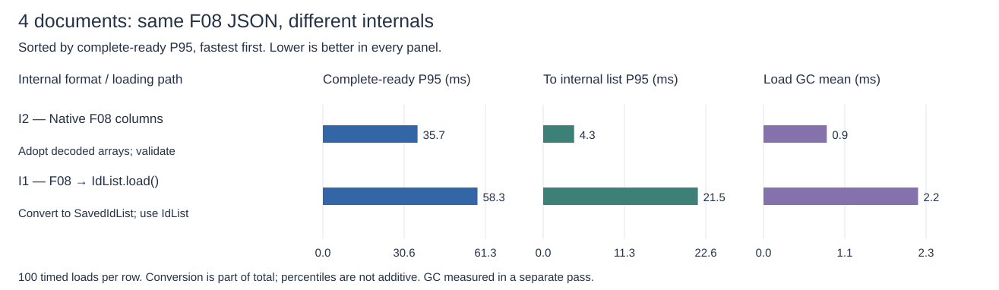
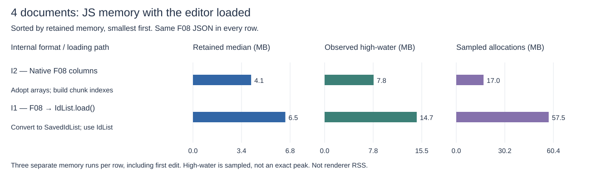
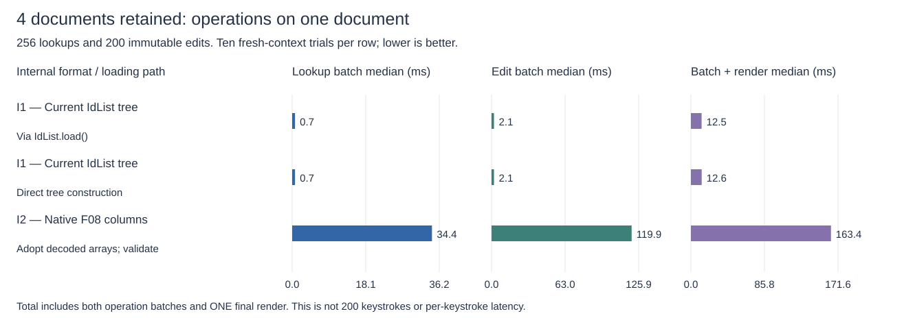
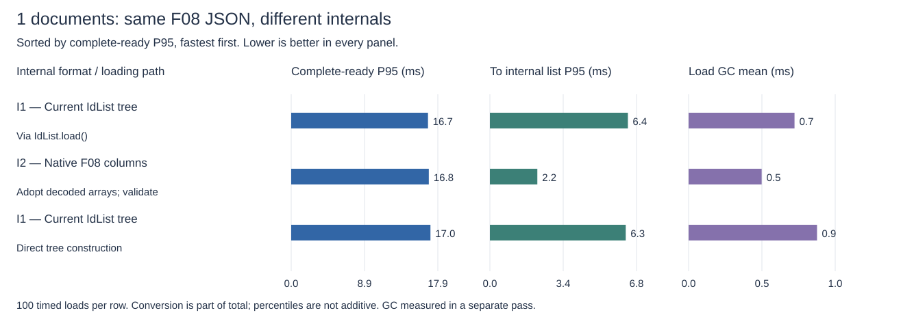
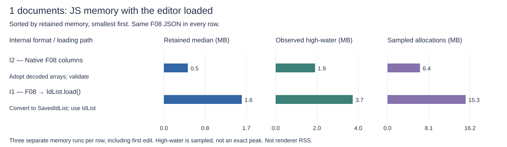
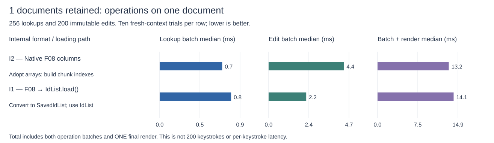

# Same F08 JSON: current IdList tree versus native columns

Draft experiment, not a production migration. **Yes: avoiding the translation/tree build saved meaningful time and memory in the four-document test. But the literal, unindexed wire layout was much slower for lookups and edits.** One document reached the rendering threshold at essentially the same time with either design, despite faster native loading.

This is a matched comparison of **two internal formats**, with a third loading path as a control. Every row receives byte-identical **F08 — Columnar store: deduplicate clients + reconstruct counters**, encoded as ordinary JSON. Binary and network transfer are excluded. I1/I2 identify internal designs; F08 identifies the unchanged interchange format.

## Four-document result

| Internal format / loading path                           | Ready p95 (ms) | Conversion p95 (ms) | Retained JS (MB) | 200 edits, median (ms) |
| -------------------------------------------------------- | -------------: | ------------------: | ---------------: | ---------------------: |
| I2 — Native F08 columns — Adopt decoded arrays; validate |           35.7 |                 4.3 |              2.4 |                  119.9 |
| I1 — Current IdList tree — Direct tree construction      |           51.7 |                20.4 |              6.5 |                    2.1 |
| I1 — Current IdList tree — Via IdList.load()             |           58.3 |                21.5 |              6.5 |                    2.1 |

Compared with the normal tree loader, native columns reduced ready p95 by **22.6 ms (38.8%)** and retained JS by **4.1 MB (63.1%)**. The conversion/validation interval fell from 21.5 to 4.3 ms. Compared with direct tree construction, the ready-p95 difference was 16.0 ms. These are differences between empirical percentiles, not a decomposition of a single load.

## What I recommend

1. **Editing performance first:** keep I1, the existing tree. The native prototype's edit batch took 57.1× as long; the lookup batch took 49.1× as long. The direct-tree loader is a smaller optimization to investigate without changing the editing data structure.

2. **Opening many documents / retained memory first:** native columns are worth further work. This experiment demonstrates an actual benefit from not building the tree, not merely a smaller serialized payload. A read-mostly document could retain columns and build a tree only when editing starts, but that hybrid has not been implemented or measured here.

3. **Fast loading AND fast editing:** do not ship this unindexed prototype. Next test columns with compact lookup indexes and chunked immutable updates. They may preserve much of the loading/memory benefit without full scans and whole-array rewrites, but their build time and retained memory must be included. These results do not establish that all columnar internal designs edit slowly.

## Exactly what is stored and loaded

All three paths store the same Mongo fields and parse the same JSON. Example: three live IDs from alice_0, one from bob_0, two from alice_1, then two deleted IDs from alice_0:

```json
{
  "clientIds": ["alice", "bob"],
  "clientIndices": [0, 1, 0, 0],
  "seqNums": [0, 0, 1, 0],
  "startCounterIndexes": [],
  "startCounters": [],
  "counts": [3, 1, 2, -2]
}
```

Each position in clientIndices, seqNums and counts is a run. Negative counts mean deleted. The start counter defaults to zero for the first run of a whole ID, then the end of its preceding run. Exceptions go into startCounters; startCounterIndexes stores delta-encoded run positions. Here the last run starts at 3, so there is no exception. If it started at 8, those arrays would be [3] and [8].

**ID limitation:** this is Matthew's structured client_sequence design, where the sequence suffix is base 36. It is NOT a proposed conversion of independent opaque 8-character nanoids. F07 deduplicates whole IDs without that requirement; it is a different format and is not the native implementation tested here.

| Case                          | What happens after JSON.parse                                                                          | What the library uses for lookup/editing              |
| ----------------------------- | ------------------------------------------------------------------------------------------------------ | ----------------------------------------------------- |
| I1 / Via IdList.load()        | Reconstruct IDs/counters into SavedIdList run objects, then build the tree                             | Existing IdList tree                                  |
| I1 / Direct tree construction | Stream reconstructed fields directly into the tree builder, skipping the intermediate run-object array | The same existing tree                                |
| I2 / Native F08 columns       | Validate the columns and cache visible length; retain those exact arrays                               | F08 columns, with counters reconstructed during scans |

The actual native implementation is [NativeF08](src/browser/native.ts), not another adapter that eventually invokes IdList.load:

```ts
const decoded = JSON.parse(json);
const list = NativeF08.load(decoded); // validates, then adopts the arrays
list.wireState === decoded; // true: no tree or second snapshot
list.wireState.counts === decoded.counts; // true
const id = list.at(2); // reads the columns, reconstructing counters
const edited = list.delete(id); // new F08 columns; original list unchanged
const snapshot = edited.wireState; // already the interchange shape
```

Zero-copy adoption does **not** mean zero-cost loading: schema/range/duplicate validation uses temporary maps and interval arrays, and is included in conversion time. No expanded counter column, lookup index, run objects, or editing tree is retained. Callers transfer ownership of the decoded arrays and must not mutate them afterward. wireState is read-only by contract, not deeply frozen.

at/indexOf scan runs; inserts/deletes stream a new column set and merge compatible adjacent runs. That keeps the exact wire shape and immutable previous versions, but makes operations O(number of runs) rather than using the tree's indexes/structural sharing. Reconstructing counters also allocates temporary maps during scans. This is a deliberately literal first implementation, not an optimized bound on columnar performance.

Implemented API subset: length, at, indexOf (including deleted-entry bias), insertAfter, delete, and save for correctness checks. No insertBefore, undelete, uninsert, or complete iterator/API parity. The prototype lives in the benchmark package; the public library default has not changed.

## Load speed, conversion and GC



Complete-ready covers decoding → internal list → ProseMirror creation → layout → a rendering opportunity. Conversion is timed directly around the loader and is already part of total. Common editor/layout work is not presented as a separate competitive metric. GC is measured in separate traced runs; do not add that bar to the timed total.

For **one document**, ready p95 was 16.7 ms with the normal tree loader, 17.0 ms with direct tree construction and 16.8 ms with native columns. Native conversion still fell from 6.4 to 2.2 ms, but the rendering-opportunity threshold masked that gain in this workload. Do not promise a visible single-document speedup from these results.

## JS memory



Retained = JS heap + backing storage after forced GC, relative to the empty harness, with editors loaded and the first edit completed. It includes editor/model state, not just IDs. Observed high-water is the largest sampled phase boundary, not an exact peak. Sampled allocations include subsequently collected objects; they are not retained memory. These three values are different measures and must not be added. These runs do not measure memory after the sustained edit batch or total renderer RSS.

## Lookup and edit cost



Each fresh-context trial retains one or four documents but operates on **one**: 128 distributed at calls + 128 indexOf calls, followed by 100 inserts and 100 deletes at deterministic distributed positions. Both designs perform real immutable mutations; the final saved IDs are checked against the reference tree. The document's final text is rendered once after the batch and verified. ID anchors and expected text are prepared outside the timing interval.

This is **not** 200 simulated keystrokes or 200 incremental ProseMirror renders. Operation timing isolates library work; batch + render adds one final document replacement/layout/rendering opportunity. Ten trials support medians and ranges, not a robust p95 editing claim. It does not cover a representative production distribution of local typing, remote merges, undo, or long edit sessions.

In one separately traced four-document edit batch, tree / direct tree / native columns spent **0.3 / 0.3 / 5.7 ms** in main-thread GC, with **1 / 1 / 39** events. The native implementation saves retained memory but creates substantially more temporary work during editing. This single trace per case is diagnostic, not an estimate of tail GC.

## Mongo storage: unchanged by this internal-format choice

| Internal representation                  | Mongo Snappy KB/document | Mongo Zstd KB/document |
| ---------------------------------------- | -----------------------: | ---------------------: |
| I1 — Current IdList tree (either loader) |                    188.7 |                   74.0 |
| I2 — Native F08 columns                  |                    188.7 |                   74.0 |

Both persist the same initial F08 fields. These are the existing **measured Mongo 8.3.3 collection-file results**, not estimates from JSON/BSON size: 100 documents per layout, independent client dictionaries, compact/checkpoint and locked filesystem sync. Collection indexes/shared server overhead excluded. Mongo was not rerun because the stored payload is unchanged. The measurement is for the initial snapshot, not the post-edit batch. [Storage procedure and raw data](browser.md#physical-mongo-storage-all-measurements).

## Complete measurements (collapsed)

<details><summary>1 document(s): load, memory, edits, GC and per-round p95</summary>

| Internal / loader                                        | Decode p95 ms | Conversion p50 / p95 ms | Ready p50 / p95 / max ms | First edit + render p95 ms | Load GC mean ms |
| -------------------------------------------------------- | ------------: | ----------------------: | -----------------------: | -------------------------: | --------------: |
| I1 — Current IdList tree — Via IdList.load()             |           0.3 |               5.6 / 6.4 |       16.6 / 16.7 / 16.8 |                       16.8 |             0.7 |
| I2 — Native F08 columns — Adopt decoded arrays; validate |           0.3 |               0.8 / 2.2 |       16.6 / 16.8 / 17.5 |                       16.9 |             0.5 |
| I1 — Current IdList tree — Direct tree construction      |           0.3 |               5.3 / 6.3 |       16.7 / 17.0 / 24.9 |                       16.8 |             0.9 |

| Internal / loader                                        | Retained median MB | High-water maximum MB | Allocations median MB | Ready p95 by round (ms)          |
| -------------------------------------------------------- | -----------------: | --------------------: | --------------------: | -------------------------------- |
| I1 — Current IdList tree — Via IdList.load()             |                1.6 |                   3.7 |                  15.3 | 16.7 / 16.8 / 16.7 / 16.7 / 16.8 |
| I2 — Native F08 columns — Adopt decoded arrays; validate |                0.5 |                   1.9 |                   6.4 | 16.7 / 16.7 / 16.7 / 16.8 / 16.7 |
| I1 — Current IdList tree — Direct tree construction      |                1.6 |                   5.0 |                  14.4 | 16.9 / 16.8 / 16.8 / 17.0 / 17.2 |

Operation batches: median [minimum–maximum], ms. GC: one separate traced batch.

| Internal / loader                                        |      256 lookups |           200 edits | Both batches + final render | GC ms / events / longest ms |
| -------------------------------------------------------- | ---------------: | ------------------: | --------------------------: | --------------------------: |
| I1 — Current IdList tree — Via IdList.load()             |    0.7 [0.6–0.8] |       2.0 [2.0–2.2] |             12.1 [8.3–15.7] |               0.2 / 1 / 0.2 |
| I2 — Native F08 columns — Adopt decoded arrays; validate | 34.2 [33.7–34.7] | 119.3 [116.7–124.0] |         161.8 [158.8–168.5] |              5.7 / 40 / 0.2 |
| I1 — Current IdList tree — Direct tree construction      |    0.7 [0.7–0.8] |       2.1 [2.0–2.2] |             11.1 [9.9–14.7] |               0.2 / 1 / 0.2 |







</details>

<details><summary>4 document(s): load, memory, edits, GC and per-round p95</summary>

| Internal / loader                                        | Decode p95 ms | Conversion p50 / p95 ms | Ready p50 / p95 / max ms | First edit + render p95 ms | Load GC mean ms |
| -------------------------------------------------------- | ------------: | ----------------------: | -----------------------: | -------------------------: | --------------: |
| I2 — Native F08 columns — Adopt decoded arrays; validate |           1.0 |               2.4 / 4.3 |       33.3 / 35.7 / 41.8 |                       17.0 |             0.9 |
| I1 — Current IdList tree — Direct tree construction      |           0.9 |             17.4 / 20.4 |       49.9 / 51.7 / 58.4 |                       16.8 |             2.0 |
| I1 — Current IdList tree — Via IdList.load()             |           0.9 |             18.6 / 21.5 |       49.9 / 58.3 / 59.5 |                       16.8 |             2.2 |

| Internal / loader                                        | Retained median MB | High-water maximum MB | Allocations median MB | Ready p95 by round (ms)          |
| -------------------------------------------------------- | -----------------: | --------------------: | --------------------: | -------------------------------- |
| I2 — Native F08 columns — Adopt decoded arrays; validate |                2.4 |                   7.5 |                  16.2 | 33.7 / 35.7 / 35.1 / 36.4 / 34.9 |
| I1 — Current IdList tree — Direct tree construction      |                6.5 |                   9.1 |                  53.8 | 50.1 / 50.1 / 50.7 / 58.3 / 50.1 |
| I1 — Current IdList tree — Via IdList.load()             |                6.5 |                  10.5 |                  56.6 | 50.9 / 50.5 / 58.4 / 51.0 / 58.4 |

Operation batches: median [minimum–maximum], ms. GC: one separate traced batch.

| Internal / loader                                        |      256 lookups |           200 edits | Both batches + final render | GC ms / events / longest ms |
| -------------------------------------------------------- | ---------------: | ------------------: | --------------------------: | --------------------------: |
| I2 — Native F08 columns — Adopt decoded arrays; validate | 34.4 [33.8–35.1] | 119.9 [118.3–120.9] |         163.4 [162.2–166.5] |              5.7 / 39 / 0.3 |
| I1 — Current IdList tree — Direct tree construction      |    0.7 [0.6–0.8] |       2.1 [2.0–2.3] |             12.6 [9.5–16.1] |               0.3 / 1 / 0.3 |
| I1 — Current IdList tree — Via IdList.load()             |    0.7 [0.6–0.8] |       2.1 [2.0–2.2] |             12.5 [9.0–15.1] |               0.3 / 1 / 0.3 |

</details>

## Reproduce and interpret

Run started 2026-10-21T01:42:08.030Z. Chromium 151.0.7922.34, Apple M5 Pro, CPU rate 1×. Same 104,852-character, 1,173-paragraph, 12,091-run Kleppmann trace used by the interchange benchmark, with Matthew's structured IDs. Four documents are four copies of this trace, not a corpus of independent production documents.

Three paths × two document counts × 5 fresh-context rounds × 20 measured replacement loads = **600 warm timed loads**, with shuffled case order and no filtered samples. First load in each context is retained separately as cold data, not mixed into the p95. Separate passes: **48 traced loads**, **18 memory runs**, **60 edit/lookup batches**, and **6 traced operation batches**. All three paths were measured together; this report does not compare new native timings against the older interchange run.

Ready is a two-animation-frame proxy, not physical display scan-out. The controlled minimal ProseMirror harness is not the production integration. Server/network transfer and ID generation are excluded. The first edit is measured separately after readiness. GC uses matched main-thread trace windows with paint checks and an outside-window GC canary; timing runs are untraced. Memory measurements are intrusive and separate from primary timing. Cold samples, first edits and raw phases remain available.

Correctness checks cover full loaded/edited SavedIdList equality, visible length, actual rendered text, paint events and backing-memory calibration. Unit tests verify identical encoders/decoders across cases, exact array identity, no hidden tree fallback, 250 immutable mutations against the reference tree, all visible lookups, tombstone bias, bulk changes, counter exceptions and malformed input. This is not complete public-API parity or security hardening.

From the benchmark package, using the repository's pinned dependencies:

```sh
npm run native:run
npm run native:report
npm test
```

[Raw measurements](results/native/browser.json) · [Completion record](results/native/complete.json) · [Exact edit workload](results/native/edit-workload.json) · [GC traces](results/native/traces) · [Native implementation](src/browser/native.ts) · [Matched candidates](src/browser/native-candidates.ts) · [Shared rendering/timing harness](src/browser/page-runtime.ts) · [Broader interchange-format comparison and examples F01–F09](browser.md)
