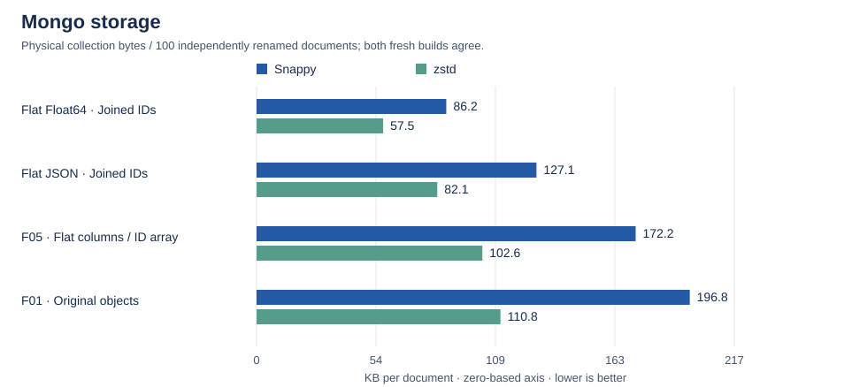
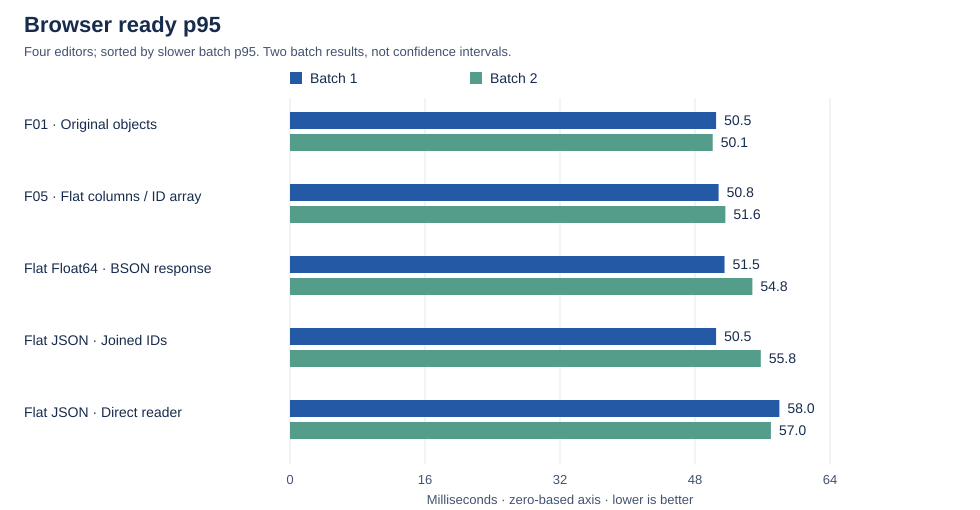
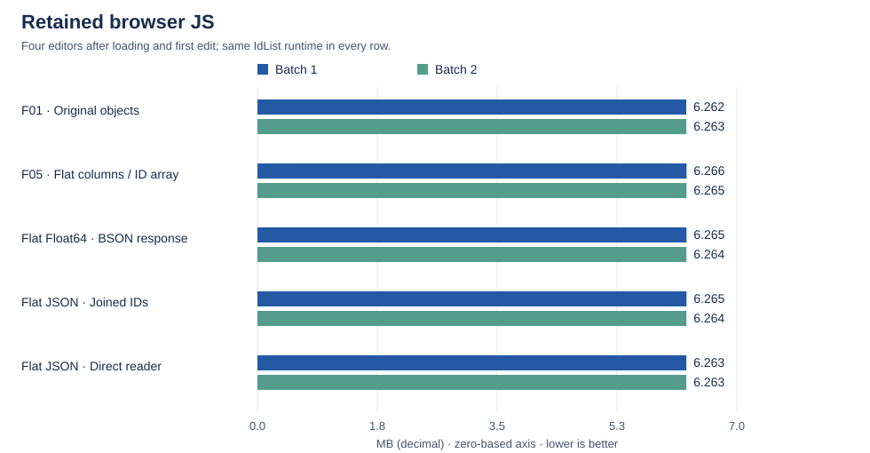

# Recommendation: smaller storage, keep the existing editable IdList

This is an **exploration, not a production migration**. It concludes the investigation begun in [PR #33](https://github.com/mweidner037/articulated/pull/33), without changing that PR. Start here; the linked studies preserve the full experiments, unsuccessful alternatives, timings and raw evidence.

**Storage/interchange format means the flat columnar shape we store in Mongo and send to the browser, not the live editor data structure.** Choose that logical shape first. Binary is an optional encoding of its numeric columns, independently of whether the browser receives JSON or BSON. Keeping binary in Mongo does **not** require sending binary to the browser.

## Three recommendations

1. **Best fit for the requested balance: flat columns + concatenated IDs + Float64 binary numeric fields, loading into the existing IdList.** This uses **86.2 / 57.5 KB per document (Snappy / zstd)**, versus **196.8 / 110.8 KB** for original saved objects. That is **48.1% less zstd storage**, without pages or a new editing data structure. Retained browser memory is effectively unchanged. Loading is in the same range as flat JSON, not a demonstrated browser speedup.
2. **If ordinary JSON is the priority: the same flat columns with ordinary numeric arrays.** This uses **127.1 / 82.1 KB**, or **25.9% less zstd storage than original objects**. Keep the previously measured JSON decoder: the new direct JSON reader did not improve p95. The saved shape and the editable runtime do not need to match.
3. **If reducing browser memory/opening time outweighs editing throughput and implementation simplicity: consider the optimized native-column runtime separately.** It retained **3.790 MB versus 6.264 MB** across four editors and reached ready p95 in **41.8 versus 50.1 ms** in its paired experiment. But the existing IdList completed the full canonical ID-operation stream in **300.0 ms versus 436.8 ms** for the optimized alternative. The native prototype is not API-complete and uses pages. Given the preference against pages and the importance of editing throughput, **do not make that rewrite the default recommendation**.

**Adoption gate:** the canonical snapshot has **zero counter exceptions**. Nonempty exception columns and large safe integers are correctness-tested, but representative multi-client/reordered production snapshots still need paired storage and browser measurements. The F01 storage ceiling passed under both compressors for this corpus; it is not a guarantee for every document. These are local Mongo measurements, not an Atlas bill or a verified Atlas compressor migration.

### Mongo encoding and browser response are separate choices

| Mongo numeric fields  | Browser response                                              | Browser load path                                                            |
| --------------------- | ------------------------------------------------------------- | ---------------------------------------------------------------------------- |
| Ordinary arrays       | JSON, with ordinary numeric arrays                            | JSON decode → runs → existing IdList.load                                    |
| Binary Float64 fields | JSON, after the server converts numeric fields back to arrays | The same JSON browser path; **server conversion cost has not been measured** |
| Binary Float64 fields | BSON, preserving the binary numeric fields                    | BSON decode → typed views/copies → runs → existing IdList.load               |

All three use the **same logical flat columnar format**. The latest timing table's Flat-F64 row measures the third path, not the second. For Mongo binary + a JSON response, the measured storage component is Flat-F64 and the measured browser component is the JSON path; this is **not a measured end-to-end server pipeline**. Binary delivery is optional, not a condition of choosing binary Mongo storage. Network transfer size/time is outside this investigation.

For example, a server returning JSON from binary Mongo fields would use the tested `readFloat64` helper like this (not `JSON.stringify` on Binary objects, which would produce a different representation):

```javascript
const responseState = {
  bunchIds: storedState.bunchIds,
  startCounterIndexes: Array.from(readFloat64(storedState.startCounterIndexes)),
  startCounters: Array.from(readFloat64(storedState.startCounters)),
  counts: Array.from(readFloat64(storedState.counts)),
};
// Send responseState as JSON; the browser receives the ordinary arrays below.
```

## What exactly would we store?

Start with these four ordinary saved objects (F01). IDs are opaque eight-character strings, not UUIDs or decomposed client/sequence IDs:

```javascript
[
  { bunchId: "aB3dE5fG", startCounter: 0, count: 3, isDeleted: false },
  { bunchId: "aB3dE5fG", startCounter: 3, count: 2, isDeleted: true },
  { bunchId: "hJ7kL9mN", startCounter: 20, count: 1, isDeleted: false },
  { bunchId: "aB3dE5fG", startCounter: 8, count: 2, isDeleted: false },
];
```

The recommended **logical shape** is one flat object, with no pages or navigation indexes:

```javascript
{
  bunchIds: "aB3dE5fGaB3dE5fGhJ7kL9mNaB3dE5fG",
  startCounterIndexes: [2, 1],
  startCounters: [20, 8],
  counts: [3, -2, 1, 2]
}
```

- Split `bunchIds` every eight characters: one complete ID per run. This concatenates IDs; it does **not** deduplicate them.
- Positive counts are visible; negative counts are deleted.
- Infer each run's starting counter from the previous end for that same whole ID, initially zero. Include deleted runs in that calculation.
- Exceptions here are at row 2 and then row 3. `startCounterIndexes` stores the first index and then positive deltas: `[2, 1]`. The corresponding actual counters are `[20, 8]`.

**Sflat-joined** stores that JSON directly. **Flat-F64** stores the exact same fields but replaces each numeric array with a standard BSON Binary field containing consecutive eight-byte IEEE754 Float64 values, little endian:

```javascript
import { Binary } from "bson";

function binaryNumbers(values) {
  const bytes = new Uint8Array(values.length * 8);
  const view = new DataView(bytes.buffer);
  values.forEach((value, index) => {
    if (!Number.isSafeInteger(value)) throw new Error("Invalid integer");
    view.setFloat64(index * 8, value, true);
  });
  return new Binary(bytes);
}

await collection.insertOne({
  _id: documentId,
  state: {
    bunchIds: "aB3dE5fGaB3dE5fGhJ7kL9mNaB3dE5fG",
    startCounterIndexes: binaryNumbers([2, 1]),
    startCounters: binaryNumbers([20, 8]),
    counts: binaryNumbers([3, -2, 1, 2]),
  },
});
```

There are **no custom record headers, per-column type fields, varints or bit packing**. The schema fixes all numeric columns to Float64; unlike the earlier int32 prototype, this preserves every JavaScript safe integer. Mongo stores generic Binary, not numeric arrays that Mongo can address element by element. Reading/modifying individual numeric entries therefore requires decoding in application code. This remains a schema/codec agreement, not a self-describing numeric Mongo type.

On load, the [tested reader](src/browser/flat-f64-formats.ts) obtains `Float64Array` views where alignment and native byte order permit, otherwise copies once or uses the portable DataView path. It reconstructs the ordinary saved run objects and calls **the existing `IdList.load`**. The actual BSON counts field was unaligned and required a copy; this is **not a zero-copy claim**. Temporary columns are released afterward. The live editor still uses the existing tree and its indexes; changing saved bytes does not change its editing implementation.

## One table: storage and browser outcomes

Latest paired experiment only. Sorted by the **slower observed ready p95** across the two fresh browser batches, better on top. All rows use the same existing IdList. **All browser payloads are JSON except Flat-F64, which uses BSON.** Mongo is physical collection KB **per document**; browser measurements cover **four editors**. KB/MB are decimal.

| Saved format / decoder                                              | Mongo KB/doc, Snappy / zstd | Parse + load p95, ms | Ready p95, ms | Retained JS, MB |
| ------------------------------------------------------------------- | --------------------------: | -------------------: | ------------: | --------------: |
| F01: original objects                                               |               196.8 / 110.8 |            18.9–21.0 |     50.1–50.5 |     6.262–6.263 |
| F05: flat columns, ordinary ID array                                |               172.2 / 102.6 |                 19.4 |     50.8–51.6 |     6.265–6.266 |
| **Flat-F64: flat columns, concatenated IDs, binary numeric fields** |             **86.2 / 57.5** |        **20.3–20.6** | **51.5–54.8** | **6.264–6.265** |
| Sflat-joined: flat JSON, previous decoder                           |                127.1 / 82.1 |            21.1–21.3 |     50.5–55.8 |     6.264–6.265 |
| Flat-JSON-direct: identical JSON, new direct decoder                |                127.1 / 82.1 |            22.3–23.1 |     57.0–58.0 |           6.263 |

The ranges are the two batch results, **not confidence intervals**. Parse + load is the percentile of each sample's actual decode + conversion + initialization duration, not a sum of phase percentiles. Ready additionally includes common editor creation/layout and frame waits; those common stages are not credited as format improvements. It is a rendering-opportunity proxy, not physical display timing or server-to-screen latency. Fetching and bundle startup are outside these clocks. No wire-size/gzip metric is used.

**Reading this table:** Float64 saves another **29.9% zstd storage versus the identical flat JSON shape**, while retaining the same editing runtime and effectively the same browser memory. Its ready p95 is slightly higher than original objects. Do not call it the fastest browser option, or infer better editing throughput from smaller persisted bytes.

### Mongo storage — independent of browser timing



### Browser loading — full observed ready time, p95 sorted



### Browser retained memory — same runtime, no meaningful reduction



Charts use the latest [machine-readable summary](results/flat-f64-browser-1/summary.json). The two browser marks are batch results, not error bars or confidence intervals. GC and stage-boundary memory high-water are separately reported in [the full Float64 study](flat-f64.md); they are not added to ready time or mislabeled exact peak memory.

## Why keep the existing internal structure?

This was tested, not assumed. The runtime investigation held input constant, profiled loading/editing, implemented alternatives, then retested storage/runtime pairings. It covered **11 runtime variants and 429 jobs**, including **66 uninterrupted full canonical replays**, loaded edit sessions, lookups, retained versions and adversarial fragmented/gap cases. Separate browser checks used **700 warm loads**.

| Editable runtime                    | Full canonical ID-operation replay, median [min–max] ms | Library construction median, ms | Loaded library/runtime MB |
| ----------------------------------- | ------------------------------------------------------: | ------------------------------: | ------------------------: |
| **Existing IdList**                 |                                 **300.0 [298.2–308.3]** |                             3.5 |                     1.286 |
| Existing IdList, bulk-built indexes |                                     302.1 [300.0–318.0] |                             2.7 |                     1.309 |
| Optimized native F05, 128-run pages |                                     436.8 [415.1–444.7] |                             1.2 |                     0.628 |
| Original native F05, 128-run pages  |                                     888.4 [839.3–925.1] |                             1.3 |                     0.629 |

The canonical column is **all 259,778 recorded operations from empty**, excluding editor rendering, with three runs per case and no retained versions. It measures library work that is part of browser editing; it is not per-keystroke p95. The 136.8 ms difference across that entire stream does not prove perceptible latency on individual keystrokes. Full-editor 200-edit batch ranges overlapped, so no dependable full-editor editing winner was established.

The optimized native F05 shares unchanged ID/counter columns during continuation edits and adopts freshly created bounded buffers. That cut its canonical time by **50.8%**, but it remained **45.6% slower than existing IdList**. It is a real alternative for memory/opening priorities, not a missing implementation. Native F08 and the wider object/tuple/column alternatives remain in the [earlier canonical comparison](exploration.md); their results are not silently replaced by this narrower optimization study.

Bulk-building the existing tree's auxiliary indexes reduced isolated construction work without a material ready-p95 win and somewhat worsened loaded-edit timings. Page membership filters did not win. Interval-aware deletion helped specific sparse-gap/redundant-delete workloads, not the ordinary canonical stream. These opt-in hooks remain experimental and are **not enabled in the recommended storage path**.

**Translation is not the main justification for a redesign.** The earlier phase attribution measured F05-to-run conversion around 1 ms across four documents, compared with about 13 ms constructing existing IdLists. Native F05 initialization was about 3 ms. Matching a stored shape to a runtime does not eliminate validation, ownership and indexes. The final storage comparison charges all decoding and conversion to the browser outcome.

## Why not the other storage ideas?

<details><summary>Pages, dictionaries, persisted indexes, integer packing and typed internal arrays</summary>

- **Pages:** the earlier 22-format sweep found 128-run pages with joined IDs used 74.0 KB/document with zstd, versus 82.2 KB for its flat joined-ID control. That is a real storage tradeoff, but adds page boundaries and per-page counter inference. The latest flat Float64 candidate is 57.5 KB in a separate paired run, so we do not need pages to recommend a substantial saving. This is not an isolated same-run page-size comparison between those two binary designs.
- **Whole-ID dictionaries:** they did not beat joined IDs in that sweep. Flat dictionary storage actually exceeded F01 under both compressors in the tested corpus. Repeated-ID deduplication is not automatically better once physical Mongo compression is included.
- **Persisted navigation indexes:** the evaluated complete-index layouts exceeded the F01 physical storage ceiling. They also couple the stored schema to a particular runtime. Rejected for this recommendation.
- **Int32 binary fields:** the earlier prototype was smaller than ordinary columns, but rejected counters outside signed 32-bit range. Float64 addresses that limitation while retaining the simple, schema-fixed typed-array model. Custom bit-packed/variable-width record formats are not the recommendation.
- **Typed internal arrays:** a controlled fixed-topology probe did not establish a material retained-memory benefit just by replacing numeric JS arrays. That probe is not a substitute for a complete editable-container benchmark. Saving Float64 columns and using a typed-array view while decoding is independent of choosing typed arrays as the live editing model.

</details>

## Measurement quality and remaining uncertainty

- **Canonical workload:** Martin Kleppmann/paper authors' full editing trace, upstream-verified; 259,778 operations and 104,852 final characters. Harness-assigned opaque eight-character IDs preserve whole-ID equivalence, counters, ordering and grouping. They are not recorded collaborator IDs. Attribution and upstream hashes are in the [runtime evidence](results/library-perf-full/results.json).
- **Latest Mongo study:** two fresh local database builds, four layouts × two compressors × 100 independently renamed documents = **16 physical collection measurements**. Each collection was compacted twice around checkpointing. Actual collection `.wt` file length matched `storageSize` under fsync lock. Includes allocation/free space, excludes indexes/shared database files. Documents 0 and 99 were read back, checked exactly and loaded through IdList. Neither production nor Atlas was modified.
- **Latest browser study:** two fresh Chromium processes, five candidates × five contexts × 20 warm trials each = **1,000 warm loads**, plus fresh-context, post-GC memory and separately traced GC measurements. Four real ProseMirror editors; final text and first edit verified. Heavy benchmark jobs ran serially, with temporary Mongo stopped before browser measurement.
- **Exact matching:** browser and Mongo source snapshot SHA256 is `b3cc04d6e0a3261d25b13f139d4fdde5c9bd44f956eb6797b79f74fc7583299b`. Independently renamed Mongo document 0 has SHA256 `03b8a65280ab9ff04a8b6b6f9975d10a8ff1b8d4370b9ecb967ef91ce78d1006`. Both latest browser batches executed bundle `6d6108009706e24c5d0afac821ffea4e648491e62ec5277f80bd7891d8aad635`; executed bundles are archived.
- **Important corpus limitation:** both counter-exception columns are empty in the measured final snapshot; counts occupy 94,056 numeric bytes. Tests cover nonempty exceptions, endian/alignment handling, malformed input and safe-integer extremes, but not production performance for those distributions. A single flattened canonical history is not concurrent/multi-client workload coverage.
- **Delivery choice:** the binary browser row decodes BSON, not JSON base64. If the server converts binary back to JSON arrays, use the JSON browser results. BSON support is bundled for all benchmark cases; incremental production dependency startup cost remains unmeasured. Retained memory excludes native DOM allocation and process RSS. There is no new full-edit replay for each final storage encoding because they reconstruct identical runs through the same IdList.load path.
- **Baseline:** the existing-library control includes experimental hooks inherited on this research branch; it is not an untouched upstream release. Default editing/loading algorithms remain the controls. Earlier timing anomalies and prior reports remain available; results from different source versions/batches are not pooled.

Before production adoption: benchmark representative exception-heavy/multi-client snapshots against F01 with both compressors; validate save/update costs and actual server/browser delivery integration; establish a versioned document-level schema and backwards-compatible loader/migration. Those are adoption requirements, not claimed completed work in this draft.

## Full report and evidence map

This recommendation supersedes **storage recommendations** in the earlier reports, not their observations. Those studies are preserved in order so that both the successful and rejected ideas remain reviewable.

| Study                                   | What it answers                                                                  | Report and raw evidence                                                                                                                                                                                                                                                     |
| --------------------------------------- | -------------------------------------------------------------------------------- | --------------------------------------------------------------------------------------------------------------------------------------------------------------------------------------------------------------------------------------------------------------------------- |
| Original native-container exploration   | F01–F09, native F05/F08, canonical replay, memory and Mongo                      | [Report](exploration.md), [canonical replays](results/exploration/canonical.json)                                                                                                                                                                                           |
| Frontend attribution and direct storage | Translation versus initialization; indexes, pages, typed arrays                  | [Report](browser-storage-findings.md), [Mongo](results/direct-storage-probe/mongo.json), [typed-array probe](results/direct-array-probe/browser.json), [frontend phases](results/frontend-profile-canonical/browser.json)                                                   |
| Runtime profiling and optimization      | Existing tree versus optimized native F05, edit/lookup/load/history tradeoffs    | [Report](library-performance.md), [runtime results](results/library-perf-full/results.json), [browser results](results/library-frontend/browser.json)                                                                                                                       |
| Storage sweep                           | 22 flat/paged/ID encodings, then secondary int32 binary optimization             | [Report](storage-sweep.md), [Mongo build 1](results/storage-sweep-mongo-1/mongo.json), [build 2](results/storage-sweep-mongo-2/mongo.json), [browser sweep](results/storage-sweep-browser/browser.json), [confirmation](results/storage-sweep-browser-confirm/browser.json) |
| Final no-pages Float64 test             | Same flat shape, full safe-integer range, binary versus JSON and decoder control | [Report](flat-f64.md), [Mongo build 1](results/flat-f64-mongo-1/mongo.json), [build 2](results/flat-f64-mongo-2/mongo.json), [browser batch 1](results/flat-f64-browser-1/browser.json), [batch 2](results/flat-f64-browser-2/browser.json)                                 |

The accompanying draft includes the actual experimental implementations and tests, raw results, traces, measured bundles and reproducible runners. It does not enable a production format, change Atlas settings or replace the library's default editable representation. Each study documents its own reproduction commands and timing boundaries. Charts can be regenerated from archived evidence with `node --import tsx benchmarks/src/browser/recommendation-charts.ts` from the repository root using Node 24 and `TSX_TSCONFIG_PATH=benchmarks/tsconfig.dev.json`.

### Final publication checks

- **206 benchmark/codec tests and 186 library tests passed** (392 total).
- Benchmark/library TypeScript checks, touched-source ESLint/Prettier and diff whitespace checks passed.
- Revalidated all **144 original full canonical replays**, the **429 later runtime jobs** including **66 additional full replays**, and exact source/bundle hashes for the final paired comparisons. No partial or anomalous result was replaced with fabricated completion.
- Regenerated the final Float64 summary from raw evidence, checked all 70 local links across the five new reports, and visually inspected the three recommendation charts.

Run checks from the relevant workspace with Node 24: `pnpm test` in `benchmarks/`; `TSX_TSCONFIG_PATH=tsconfig.dev.json ../../node_modules/.bin/mocha --reporter dot` in `packages/articulated/`. From the repository root, type-check `benchmarks/tsconfig.dev.json` and `packages/articulated/tsconfig.dev.json` with `tsc --noEmit`.
